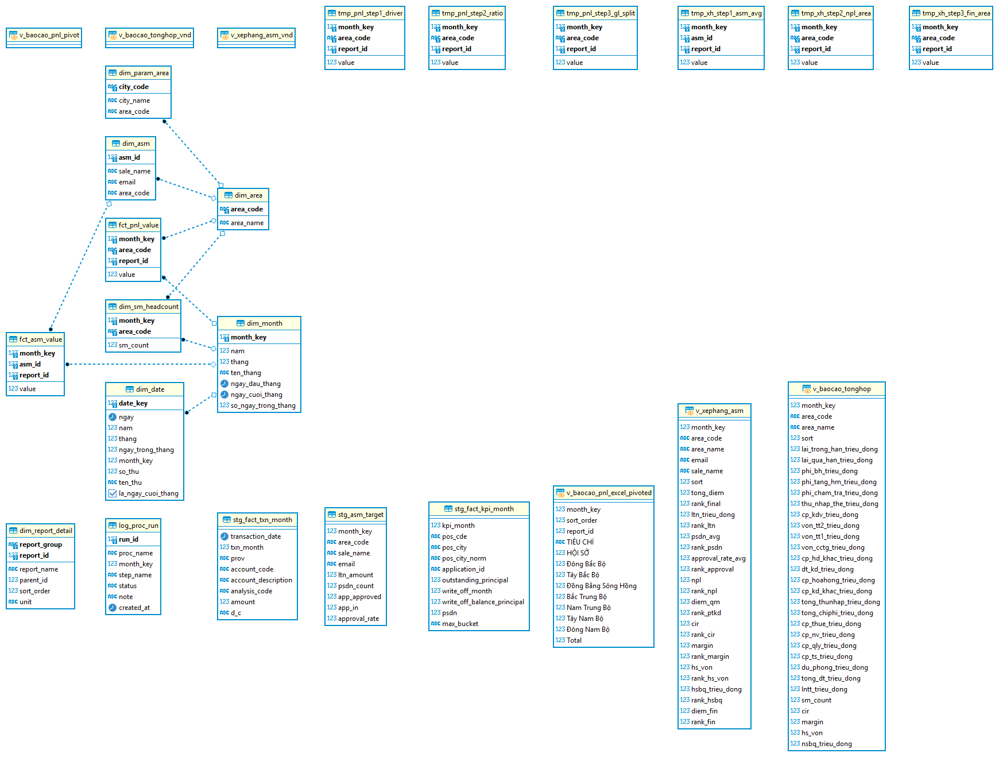

<div align="center">

# Xây dựng hệ thống báo cáo quản trị lãi lỗ thẻ tín dụng và xếp hạng Quản lý vùng (ASM)

**Ngôn ngữ / Language**: **Tiếng Việt** · [English](README_eng.md)

<p>
  
  
  
  
</p>

</div>

## 📑 Mục lục

1. [🏢 Bài toán đặt ra từ Ban Điều Hành](#1--bài-toán-đặt-ra-từ-ban-điều-hành)
2. [🎯 Từ yêu cầu ban đầu đến bộ báo cáo đầu ra](#2--từ-yêu-cầu-ban-đầu-đến-bộ-báo-cáo-đầu-ra)
3. [🔍 Nguồn dữ liệu và những chỗ vướng khi xử lý](#3--nguồn-dữ-liệu-và-những-chỗ-vướng-khi-xử-lý)
4. [🧮 Cách chia chi phí Hội sở và chấm điểm Quản lý vùng](#4--cách-chia-chi-phí-hội-sở-và-chấm-điểm-quản-lý-vùng)
5. [🔄 Quy trình xử lý dữ liệu và 7 trang báo cáo Power BI](#5--quy-trình-xử-lý-dữ-liệu-và-7-trang-báo-cáo-power-bi)
6. [📊 Những điểm đáng chú ý và đề xuất điều hành](#6--những-điểm-đáng-chú-ý-và-đề-xuất-điều-hành)
7. [📚 Bài học rút ra khi làm dự án](#7--bài-học-rút-ra-khi-làm-dự-án)
8. [🛠️ Công cụ và công nghệ sử dụng](#8--công-cụ-và-công-nghệ-sử-dụng)
9. [📂 Cấu trúc thư mục dự án](#9--cấu-trúc-thư-mục-dự-án)
10. [📖 Tài liệu chi tiết kèm theo](#10--tài-liệu-chi-tiết-kèm-theo)
11. [👤 Tác giả](#11--tác-giả)

---

## 1. 🏢 Bài toán đặt ra từ Ban Điều Hành

### Hoạt động mảng thẻ tín dụng hiện tại
Mảng thẻ tín dụng của ngân hàng được chia về **7 vùng kinh doanh** trên cả nước. Mỗi vùng có đội ngũ Quản lý vùng (Area Sales Manager - ASM) phụ trách bán hàng và giữ chất lượng khách hàng. Tùy từng tháng, toàn hàng có từ **74 đến 84 ASM** đang hoạt động.

### Yêu cầu từ Ban Điều Hành
Dự án bắt đầu từ một yêu cầu khá rộng:
> *"**Ban Điều Hành** cần một **hệ thống báo cáo quản trị** để theo dõi kết quả kinh doanh thẻ tín dụng ở từng vùng và **đánh giá công bằng hiệu quả làm việc** của đội ngũ **Quản lý vùng (ASM)**."*

Yêu cầu ban đầu chỉ nêu mục tiêu tổng quan như vậy, chưa có công thức tính sẵn, chưa có bảng điểm mẫu hay mẫu báo cáo. Khi bắt tay vào làm, phải tự xây dựng từ đầu các phần việc:
- Xác định cách tính xem từng vùng thực sự lãi hay lỗ bao nhiêu.
- Xây dựng nguyên tắc chia các khoản chi phí chung đang hạch toán tập trung ở Hội sở về cho 7 vùng.
- Chốt bộ chỉ tiêu vừa đo sức bán hàng vừa kiểm soát rủi ro nợ xấu.
- Thiết kế thước đo công bằng để đánh giá Quản lý vùng.
- Lên phương án chấm điểm, xếp hạng và mẫu biểu trình bày rõ ràng.

Từ bài toán đó, hệ thống báo cáo tập trung làm rõ những câu hỏi sát sườn với việc điều hành:

| Khía cạnh | Câu hỏi cần trả lời rõ | Đầu ra của báo cáo |
|---|---|---|
| **Lãi lỗ thật của từng vùng** | Sau khi gánh đủ phần chi phí Hội sở, vùng nào lãi thật và vùng nào đang lỗ? | Lập bảng lãi lỗ đầy đủ của 7 vùng và Hội sở |
| **Lý do lãi tăng hay giảm** | Tháng này lãi đổi chiều là do thu nhập tăng, chi phí giảm hay do dự phòng? | Tách riêng số từng tháng và dựng biểu đồ từng bước hình thành lợi nhuận |
| **Năng lực Quản lý vùng** | Ai vừa bán khỏe vừa giữ được nợ xấu thấp, ai chỉ chạy doanh số? | Bảng điểm xếp hạng từ 74 đến 84 người theo cả bán hàng và tài chính vùng |
| **Cách tra cứu và đối soát** | Làm sao để xem nhanh, đối chiếu khớp từng đồng với sổ cái và quyết định kịp thời? | Bộ 7 trang báo cáo trên Power BI đồng bộ số liệu với PostgreSQL |

---

## 2. 🎯 Từ yêu cầu ban đầu đến bộ báo cáo đầu ra

Thay cho cách làm rời rạc từng bảng, dự án tách bài toán của Ban Điều Hành thành hai luồng song song để xử lý cho rành mạch: một luồng tính đúng lãi lỗ từng vùng, một luồng chấm điểm công bằng đội ngũ Quản lý vùng.

| Giai đoạn | Luồng 1: Tính lãi lỗ 7 vùng (P&L) | Luồng 2: Chấm điểm Quản lý vùng (ASM) |
|---|---|---|
| **Bước 1: Chốt phạm vi bài toán** | Cần nhìn ra lãi lỗ thực chất của mảng thẻ tín dụng tại 7 vùng sau khi chia hết chi phí chung | Cần xếp hạng công bằng từ **74 – 84** Quản lý vùng (ASM) để khen đúng người và hỗ trợ đúng chỗ |
| **Bước 2: Chọn chỉ tiêu cốt lõi** | • Tách rõ tiền thu từ thẻ, chi phí vốn, chi phí vận hành và chi phí dự phòng nợ xấu.<br>• Chia phần chi phí chung đang treo ở Hội sở về 7 vùng theo tỷ lệ sát thực tế như dư nợ, số lượng thẻ và quân số.<br>• Theo dõi thêm các tỷ lệ gọn: tỷ lệ chi phí trên thu nhập (`CIR`), biên lãi (`Margin`), mức sinh lời trên đồng vốn và năng suất mỗi quản lý. | • **Kết quả bán hàng cá nhân**: Doanh số mở thẻ mới (`LTN`), số khách hàng phát sinh dư nợ (`PSDN`), tỷ lệ duyệt hồ sơ.<br>• **Trách nhiệm với tài chính và nợ xấu của vùng**: Tỷ lệ nợ xấu mở rộng (`NPL`), tỷ lệ chi phí (`CIR`), biên lãi, hiệu suất vốn và lợi nhuận bình quân mỗi quản lý, tránh tình trạng mở thẻ ồ ạt mặc kệ nợ xấu. |
| **Bước 3: Đưa lên báo cáo Power BI** | • **Trang 2 – Từ điển dữ liệu**: Giải thích tên gọi, đơn vị tính và cách tính chung cho cả hệ thống.<br>• **Trang 3 – Bảng lãi lỗ lũy kế vùng**: Đối soát thu – chi của `HỘI SỞ (Phân Bổ)`, 7 vùng và `Tổng`.<br>• **Trang 4 – Đánh giá hiệu quả kinh doanh vùng**: Tách riêng số trong tháng với số lũy kế, vẽ biểu đồ thác nước, bong bóng và xu hướng theo tháng. | • **Trang 5 – Báo cáo xếp hạng ASM**: Bảng điểm tổng hợp xếp hạng Quản lý vùng theo cả sức bán cá nhân lẫn tài chính vùng.<br>• **Trang 6 – Đánh giá năng lực ASM**: Biểu đồ mạng nhện xem Top 3 dẫn đầu, 3 người cuối bảng, mặt bằng 7 vùng và 4 nhóm năng lực bán hàng cá nhân. |

### Hợp nhất cả hai luồng: Trang 7 – `KẾT QUẢ KINH DOANH CỦA DOANH NGHIỆP`
Hai luồng tính lãi lỗ (P&L) và chấm điểm Quản lý vùng (ASM) hội tụ tại **Trang 7 (`KẾT QUẢ KINH DOANH CỦA DOANH NGHIỆP`)**: ghép bức tranh thu, chi, dự phòng và lợi nhuận lũy kế 5 tháng của 7 vùng từ Luồng 1 với thực trạng bán hàng và xếp hạng ASM từ Luồng 2 thành bảng kế hoạch hành động cho cả 7 vùng.

### Giá trị mang lại cho việc điều hành
- **Nhìn rõ lãi thật – lỗ thật của từng vùng (32 dòng lãi lỗ, tỷ lệ chi phí, biên lãi, sinh lời trên vốn):** Ban Điều Hành không còn bị đánh lừa bởi số trước khi chia chi phí Hội sở, từ đó giao chỉ tiêu và phân bổ ngân sách sát thực tế hơn.
- **Thưởng phạt quản lý đi đôi với kiểm soát nợ xấu (8 chỉ tiêu xếp hạng ASM):** Người bán thẻ giỏi nhưng làm vùng ngập trong nợ xấu vẫn bị trừ điểm rõ ràng, còn người vừa bán tốt vừa giữ chất lượng tín dụng sạch sẽ đứng đầu bảng.

---

## 3. 🔍 Nguồn dữ liệu và những chỗ vướng khi xử lý

### Ba tệp dữ liệu đầu vào
Trong ngân hàng không có sẵn một bảng ghép chung cho cả báo cáo lãi lỗ lẫn bảng điểm nhân sự, nên dự án lấy dữ liệu từ **3 tệp Excel** của các bộ phận nghiệp vụ:

| STT | Tên nguồn dữ liệu | Bảng trong kho & Số dòng | **CHỨA GÌ?** (Nội dung bên trong) | **DÙNG LÀM GÌ?** (Vai trò trong báo cáo) |
|:---:|---|---|---|---|
| **1** | **Dữ liệu hạch toán mỗi tháng (GL)** | `fact_txn_month`<br>(**63.134** dòng) | **Sổ ghi thu – chi thực tế tại 7 vùng và Hội sở**, gồm **62.953** dòng gắn sẵn mã tỉnh thành và **181** dòng chi chung tại Hội sở mang mã `'00'`. Khóa ghép: `city_code`, `account_code`. | **Lập bảng lãi lỗ (P&L) của 7 vùng**: Cộng thẳng các dòng có mã tỉnh và chia phần chi Hội sở về từng vùng. |
| **2** | **Dữ liệu sao kê thẻ mỗi tháng** | `fact_kpi_month`<br>(**2.932.922** dòng, **117,2 MB**) | **Chi tiết từng hợp đồng thẻ suốt 5 tháng**: dư nợ còn lại, nhóm nợ từ nhóm 1 đến nhóm 5, nợ đã xóa ngoại bảng (*write-off*) và trạng thái có phát sinh dư nợ. Khóa ghép: `branch_code`, `month_key`. | **Tính tỷ lệ chia chi phí Hội sở và đo nợ xấu**: Lấy tỷ trọng dư nợ, số thẻ đang hoạt động để chia chi phí chung và tính tỷ lệ nợ xấu mở rộng cho 7 vùng. |
| **3** | **Dữ liệu kết quả sale của ASM mỗi tháng** | `kpi_asm_data`<br>(**420** dòng cho **84** quản lý trong 5 tháng) | **Thành tích bán hàng hàng tháng của 74 đến 84 ASM**: doanh số giải ngân mới, số khách hàng có dư nợ bình quân và tỷ lệ duyệt hồ sơ. Khóa ghép: `asm_id`, `month_key`. | **Chấm điểm phần bán hàng của ASM**: Tính điểm quy mô kinh doanh (`diem_qm`) rồi ghép với điểm tài chính vùng (`diem_fin`) ra `Hạng tổng thể`. |

*(Đi kèm 3 nguồn số liệu chính trên còn có bảng tham số ghép **64** tỉnh thành vào **8** khu vực quản lý gồm Hội sở `'A'` và 7 vùng `'B'..'H'`, danh mục **56** dòng chỉ tiêu trong `dim_report_detail` và từ điển **68** chỉ tiêu giải thích chi tiết).*

### Dữ liệu có đủ dùng để làm trọn vẹn 7 trang báo cáo không?

| Trang báo cáo cần dựng | Cần những số liệu nào? | Lấy từ đâu? | Cách xử lý để ghép khớp |
|---|---|---|---|
| **01. Bảng lãi lỗ vùng** & **03. Đánh giá hiệu quả vùng** | Khoản thu, khoản chi, mã tỉnh, mã tài khoản kế toán, tỷ lệ chia chi phí Hội sở | `1. Dữ liệu hạch toán mỗi tháng (GL)` & `2. Dữ liệu sao kê thẻ mỗi tháng` | Gán thẳng 62.953 dòng có mã tỉnh về 7 vùng; lấy dư nợ và số thẻ từ 2.932.922 dòng sao kê để chia 181 dòng chi chung ở Hội sở (mã `'00'`) |
| **Tính tỷ lệ nợ xấu (NPL) dùng cho bảng điểm ASM và Trang 7** | Dư nợ 5 nhóm nợ và nợ đã xóa ngoại bảng theo chi nhánh | `2. Dữ liệu sao kê thẻ mỗi tháng` (`fact_kpi_month`) | Nhờ mỗi hợp đồng thẻ đều có mã chi nhánh nên cộng lên đúng từng vùng qua suốt 5 tháng |
| **02. Bảng xếp hạng ASM** & **04. Đánh giá năng lực ASM** (phần bán hàng) | Doanh số mở mới, số khách có dư nợ, tỷ lệ duyệt thẻ của từng quản lý | `3. Dữ liệu kết quả sale của ASM mỗi tháng` (`kpi_asm_data`) | Có đủ số từng tháng của 74 đến 84 người nên chấm điểm cá nhân trực tiếp được ngay |
| **Phần tài chính & nợ xấu trong bảng điểm ASM** | Tỷ lệ nợ xấu mở rộng, tỷ lệ chi phí `CIR`, biên lãi, sinh lời trên vốn, lợi nhuận bình quân mỗi quản lý | Ghép kết quả vùng từ `fact_txn_month` và `fact_kpi_month` | Vì hợp đồng thẻ chỉ ghi mã chi nhánh chứ không ghi tên nhân viên ASM, phần tài chính và nợ xấu phải tính chung theo cả vùng rồi áp cho các ASM đang phụ trách vùng đó |

### Ba điểm vướng của dữ liệu thô khi mới nhận về:
1. **Tệp sao kê thẻ quá nặng, mở Excel là treo:** Tệp có gần 3 triệu dòng (**2.932.922 dòng**, nặng **117,2 MB**), không thể xoay bảng hay nối dữ liệu trên bảng tính thông thường mà phải đưa vào PostgreSQL xử lý.
2. **Tệp kết quả bán hàng của ASM nằm dàn hàng ngang:** Số liệu từ tháng 1 đến tháng 5 xếp thành nhiều cột cạnh nhau nên trước khi đưa vào kho dữ liệu phải xoay dọc lại thành từng dòng theo tháng.
3. **Tên tỉnh thành giữa hai tệp viết không giống nhau:** Sao kê thẻ ghi `"Bà Rịa - Vũng Tàu"` trong khi bảng danh mục lại ghi `"Vũng Tàu"`. Nếu ghép trực tiếp mà không làm sạch tên tỉnh trước (`pos_city_norm`), hơn **36.000 hợp đồng thẻ** sẽ bị rơi mất khỏi vùng Đông Nam Bộ, làm sai hoàn toàn tỷ lệ nợ xấu của cả vùng.

---

## 4. 🧮 Cách chia chi phí Hội sở và chấm điểm Quản lý vùng

Cả hai phần tính toán đều xuất phát từ bản chất từng khoản thu – chi và đặc thù dữ liệu ngân hàng để chia chi phí và chấm điểm công bằng.

### 4.1. Cách lập bảng lãi lỗ cho 7 vùng (xử lý phần chi phí Hội sở)

Khó nhất khi tính lãi lỗ từng vùng là xử lý khối chi phí lớn đang nằm tập trung tại Hội sở. Việc bóc tách và xử lý phần này đi theo trình tự sau:
1. Rà toàn bộ 63.134 bút toán trong **Dữ liệu hạch toán mỗi tháng (GL)**.
2. Nhặt riêng những dòng đã có mã tỉnh hoặc mã chi nhánh cụ thể để cộng thẳng vào vùng tương ứng.
3. Tách riêng các dòng đang treo ở Hội sở (mã tỉnh `'00'`, khu vực `'A'`).
4. Xem bản chất từng khoản: tiền đó chi cho việc gì (chi phí vốn, vận hành thẻ, bảo hiểm hay lương nhân sự hỗ trợ).
5. Chọn tiêu chí chia chi phí hợp lý dựa trên mức sử dụng thực tế của từng vùng.
6. Kiểm tra xem các tiêu chí đó có tính được trực tiếp từ **Dữ liệu sao kê thẻ mỗi tháng** và bảng định biên nhân sự hay không.
7. Chốt công thức tính tỷ lệ phần trăm cho từng vùng theo từng tháng.
8. Viết công thức thành thủ tục tự động chạy trong PostgreSQL.
9. Cộng ngược kết quả của 7 vùng lại, bảo đảm khớp đúng 100% với tổng tiền trên sổ cái ban đầu.

**Hai nguyên tắc chia số liệu cốt lõi:**
- **Quy tắc 1 – Gán trực tiếp (Rule 1):** **62.953** dòng thu – chi nào có sẵn mã tỉnh thì đưa thẳng về vùng quản lý tỉnh đó (lãi trong hạn, lãi quá hạn, phí bảo hiểm, phí tăng hạn mức, phí trả chậm và chi phí trực tiếp tại địa bàn).
- **Quy tắc 2 – Chia phần Hội sở theo tỷ trọng (Rule 2):** **181** dòng chi chung ở Hội sở sẽ được chia về 7 vùng theo tỷ lệ của tiêu chí đi kèm:

$$\text{Tỷ lệ chia cho vùng } i = \frac{\text{Giá trị tiêu chí của vùng } i}{\sum_{k=1}^7 \text{Giá trị tiêu chí của vùng } k}$$

$$\text{Tiền Hội sở chia về vùng } i = \text{Khoản tiền ở Hội sở} \times \text{Tỷ lệ chia cho vùng } i$$

*Chọn tiêu chí nào cho khoản nào (tất cả được ghi chi tiết ở cột `Công Thức / Cách Tính` trong Từ điển dữ liệu):*
- **Chi phí vốn, lãi trong hạn và phí tăng hạn mức từ Hội sở:** Chi phí chuyển vốn nội bộ để cho vay thẻ nhiều hay ít phụ thuộc vào phần dư nợ tốt đang sinh lời, nên chia theo **Dư nợ bình quân nhóm 1 (nợ đủ tiêu chuẩn sau xóa nợ)**. Vùng nào cho vay tốt nhiều thì gánh chi phí vốn tương ứng.
- **Lãi quá hạn từ Hội sở:** Sinh ra từ những thẻ mới bắt đầu chậm trả, nên chia theo **Dư nợ bình quân nhóm 2**.
- **Chi phí dự phòng rủi ro, phí chậm trả và thu hồi nợ ngoại bảng:** Khoản dự phòng đặt ra để bù cho các khoản có nguy cơ mất vốn, nên chia theo **Dư nợ bình quân từ nhóm 2 đến nhóm 5 cộng với nợ đã xóa ngoại bảng** (`d25_sau` hoặc `dtruoc`). Nhìn vào đây biết ngay vùng nào có nhiều nợ xấu tiềm ẩn sẽ phải gánh dự phòng nhiều hơn.
- **Phí bảo hiểm thẻ, chi phí công nghệ và vận hành hệ thống thẻ:** Chi phí chạy máy chủ, phần mềm lõi thẻ và hoa hồng bán kèm thẻ gắn với số lượng thẻ đang xài, nên chia theo **Số lượng thẻ phát sinh dư nợ bình quân** (`psdn`) ở mỗi vùng.
- **Chi phí lương, quản lý và tài sản của khối hỗ trợ ở Hội sở:** Lương thưởng bộ phận văn phòng Hội sở hỗ trợ mạng lưới, nên chia theo **Số lượng quản lý bán hàng (`Sale Manager Headcount`)** đang làm việc tại mỗi vùng.
- *Lưu ý thực tế:* Cách chia này tạm giả định chi phí chia đều theo tỷ lệ trung bình giữa các vùng, chưa tách riêng được các khoản chi tiếp thị nhỏ lẻ riêng của từng tỉnh.

*Cách tách số riêng từng tháng từ số cộng dồn đầu năm:*
Vì sổ cái cộng dồn từ tháng 1 đến tháng hiện tại, muốn xem tháng này làm ăn riêng thế nào thì chỉ cần lấy số lũy kế tháng này trừ đi lũy kế tháng trước:

$$V_{\text{tháng } M} = V_{\text{lũy kế } M} - V_{\text{lũy kế } (M-1)}$$

### 4.2. Cách chấm điểm và xếp hạng Quản lý vùng (ASM)

Để tránh chuyện người chỉ biết chạy doanh số, mở thẻ cho khách yếu rồi để nợ xấu bùng phát vẫn được khen thưởng, bảng điểm được thiết kế cân bằng giữa **năng lực bán hàng cá nhân** và **sức khỏe tài chính, nợ xấu của vùng mình phụ trách**.

**Ghép 8 chỉ tiêu chia đều vào 2 nhóm (mỗi nhóm 4 chỉ tiêu):**
Mỗi chỉ tiêu đều được đem đi xếp hạng riêng từ `1` đến hết toàn hàng (chỉ tiêu nào "càng cao càng tốt" thì người cao nhất được 1 điểm; chỉ tiêu nào "càng thấp càng tốt" như nợ xấu, chi phí thì người thấp nhất được 1 điểm):
- **Nhóm 1: Bán hàng và giữ chất lượng (`diem_qm` – Điểm Quy mô kinh doanh):** Gồm **3** chỉ tiêu riêng của từng ASM (`Doanh số giải ngân mới bình quân`, `Số khách có dư nợ bình quân – PSDN`, `Tỷ lệ duyệt hồ sơ`) ghép với **1** chỉ tiêu giữ an toàn của vùng (`Tỷ lệ nợ xấu mở rộng – NPL vùng`). Tỷ lệ duyệt hồ sơ cao có thể do chọn được khách tốt, nhưng cũng có thể vì dễ dãi cho qua hồ sơ yếu, nên cần đặt cạnh tỷ lệ nợ xấu để soi chéo.
- **Nhóm 2: Hiệu quả tài chính địa bàn (`diem_fin` – Điểm Tài chính):** Gồm **4** chỉ tiêu lấy từ báo cáo lãi lỗ vùng sau khi đã chia chi phí Hội sở (`Tỷ lệ chi phí/thu nhập – CIR`, `Biên lợi nhuận – Margin`, `Mức sinh lời trên vốn`, `Lợi nhuận bình quân mỗi quản lý`). Vì dữ liệu sao kê chưa gắn mã từng nhân viên, bốn chỉ tiêu này tính chung theo vùng để mọi ASM cùng có trách nhiệm với kết quả lãi lỗ nơi mình quản lý.

**Cách tính tỷ lệ nợ xấu mở rộng (tính cả nợ đã xóa khỏi sổ):**
Trong thủ tục SQL (`report_id = 204`), tỷ lệ nợ xấu không chỉ đếm nợ trên sổ mà cộng ngược cả khoản nợ xấu đã đem đi xử lý ngoại bảng (*write-off*) từ đầu năm:

$$\text{Tỷ lệ nợ xấu mở rộng (NPL)} = \frac{\text{Dư nợ nhóm 3–5} + \text{Nợ đã xóa ngoại bảng lũy kế}}{\text{Tổng dư nợ} + \text{Nợ đã xóa ngoại bảng lũy kế}} \times 100$$

Nếu chỉ nhìn nợ trên sổ, mỗi lần xóa bớt nợ xấu ra ngoại bảng thì tỷ lệ nợ xấu sẽ giảm xuống một cách giả tạo; cộng ngược phần đã xóa giúp thấy đúng thực chất rủi ro của vùng. *(Điểm cần lưu ý: những vùng mở thẻ lâu năm sẽ tích lũy số nợ đã xóa từ các tháng trước nhiều hơn vùng mới mở.)*

| Nhóm 1: Bán hàng & Giữ chất lượng (`diem_qm`) | Nhóm 2: Hiệu quả tài chính địa bàn (`diem_fin`) |
|---|---|
| • **Doanh số mở mới bình quân (`ltn_avg`)** *(Càng cao càng tốt)*<br>• **Số thẻ có dư nợ bình quân (`psdn_avg`)** *(Càng cao càng tốt)*<br>• **Tỷ lệ duyệt hồ sơ bình quân (`approval_rate_avg`)** *(Phải xem cùng nợ xấu)*<br>• **Tỷ lệ nợ xấu mở rộng (`npl_truoc_wo_luy_ke`)** *(Càng thấp càng tốt, gồm cả nợ xóa ngoại bảng)* | • **Tỷ lệ chi phí trên thu nhập (`CIR`)** *(Càng thấp càng tốt)*<br>• **Biên lợi nhuận (`Margin`)** *(Càng cao càng tốt)*<br>• **Mức sinh lời trên vốn (`hs_von`)** *(Càng cao càng tốt)*<br>• **Lợi nhuận bình quân/SM (`hs_nhan_su`)** *(Càng cao càng tốt, gắn trách nhiệm vùng)* |

**Bảng tóm tắt 8 chỉ tiêu chấm điểm ASM:**

| Chỉ tiêu | Đo điều gì? | Ý nghĩa thực tế | Nguồn lấy số | Chiều hướng tốt | Phạm vi tính | Điểm cần lưu ý |
|---|---|---|---|---|---|---|
| **Doanh số cho vay mới** | Sức bán hàng trực tiếp | Thấy rõ mỗi tháng mang về bao nhiêu dư nợ mới | `3. Dữ liệu kết quả sale ASM` | Càng cao càng tốt | Từng ASM | Chưa trừ các thẻ mở xong rồi khách hủy |
| **Số thẻ có dư nợ (`PSDN`)** | Thẻ khách có xài thật | Đo lượng khách đang dùng thẻ chứ không phải thẻ chết | `3. Dữ liệu kết quả sale ASM` | Càng cao càng tốt | Từng ASM | Cần tính thêm chi phí làm và duy trì thẻ |
| **Tỷ lệ duyệt hồ sơ** | Độ chặt khi lọc khách | Cho biết cứ 100 hồ sơ nộp vào thì duyệt bao nhiêu | `3. Dữ liệu kết quả sale ASM` | Xem kèm tỷ lệ nợ xấu | Từng ASM | Quá cao dễ kéo theo rủi ro nới lỏng duyệt |
| **Tỷ lệ nợ xấu mở rộng (`NPL`)** | Chất lượng khách hàng | Đo tỷ lệ nợ quá hạn nặng và nợ đã xóa ngoại bảng | `2. Dữ liệu sao kê thẻ` | Càng thấp càng tốt | Cả vùng | Hợp đồng thẻ không ghi tên ASM nên tính theo vùng |
| **Tỷ lệ chi phí/thu nhập (`CIR`)** | Tiết kiệm chi phí vận hành | Chi ra bao nhiêu đồng chi phí để thu về 100 đồng thu nhập | `1. Sổ cái kế toán GL` | Càng thấp càng tốt | Cả vùng | Chịu ảnh hưởng một phần từ tỷ lệ chia Hội sở |
| **Biên lợi nhuận (`Margin`)** | Tỷ lệ lãi giữ lại | Trên tổng doanh thu thẻ, giữ lại được bao nhiêu phần trăm lãi | `1. Sổ cái kế toán GL` | Càng cao càng tốt | Cả vùng | Nhạy cảm khi giá vốn nội bộ thay đổi |
| **Mức sinh lời trên vốn** | Hiệu quả đồng vốn | Cứ bỏ 1 đồng chi phí vốn thì thu về được bao nhiêu đồng lãi | `1. GL` & `2. Sao kê thẻ` | Càng cao càng tốt | Cả vùng | Phản ánh hiệu quả dùng vốn chung toàn vùng |
| **Lợi nhuận bình quân/SM** | Năng suất theo đầu người | Bình quân mỗi quản lý bán hàng mang lại bao nhiêu triệu lãi | `1. GL` & Định biên nhân sự | Càng cao càng tốt | Cả vùng | Chia theo số định biên quản lý của vùng |

*Cách cộng tổng điểm khi các chỉ tiêu khác đơn vị:*
Vì một bên tính bằng triệu đồng, một bên đếm số thẻ, một bên tính phần trăm nên không cộng trực tiếp số thô được. Mỗi chỉ tiêu được xếp hạng từ `1` đến `N` trong toàn hàng (Hạng `1` là tốt nhất, Hạng `N` là kém nhất), sau đó cộng hết thứ hạng lại:

$$\text{Tổng Điểm} = \text{Điểm Quy Mô } (diem\_qm) + \text{Điểm Tài Chính } (diem\_fin)$$

Người nào có **Tổng điểm càng nhỏ thì `Hạng tổng thể` càng cao** (`#1` là người có Tổng điểm thấp nhất).

---

## 5. 🔄 Quy trình xử lý dữ liệu và 7 trang báo cáo Power BI

Toàn bộ dữ liệu đi qua quy trình khép kín từ file Excel thô cho tới hệ thống báo cáo trên Power BI như sơ đồ dưới đây:

<div align="center">


</div>

### Chi tiết các bước xử lý:

- **Bước 1 – Thu thập 3 nguồn Excel thô (`Excel – 3 File Số Liệu`):**
  1. **Dữ liệu hạch toán mỗi tháng (GL)** (`fact_txn_month` • **63.134** dòng): Chứa toàn bộ bút toán thu – chi tại 7 vùng và Hội sở để lập báo cáo lãi lỗ.
  2. **Dữ liệu sao kê thẻ mỗi tháng** (`fact_kpi_month` • **2.932.922** dòng, dung lượng **117,2 MB**): Chứa dư nợ, nhóm nợ, nợ xóa ngoại bảng và số thẻ đang hoạt động để chia chi phí Hội sở và đo nợ xấu.
  3. **Dữ liệu kết quả sale của ASM mỗi tháng** (`kpi_asm_data` • **420** dòng của **84** ASM qua 5 tháng): Chứa kết quả bán hàng cá nhân để tính điểm quy mô.

- **Bước 2 – Lưu trữ và tính toán tự động trong PostgreSQL (`PostgreSQL + DBeaver`):**
  Kho dữ liệu nằm gọn trong schema `banking_project`, được tổ chức theo mô hình Star Schema gồm **19 bảng, 3 `view` và 11 `stored procedure`**:
  - **Nạp liệu thô (`DBeaver Import`):** Đưa 3 file Excel vào 3 bảng staging (`stg_fact_txn_month` **63.134** dòng, `stg_fact_kpi_month` **2.932.922** dòng, `stg_asm_target` **420** dòng) và chuẩn hóa tên tỉnh thành (`pos_city_norm`) để ghép đúng mã vùng.
  - **Tính toán bằng SQL & Stored Procedure:**
    1. *7 bảng danh mục (`dim_`)*: `dim_area` (8 khu vực), `dim_param_area` (64 tỉnh thành), `dim_month` (5 tháng), `dim_date` (151 ngày), `dim_asm` (84 ASM), `dim_report_detail` (56 chỉ tiêu báo cáo), `dim_sm_headcount` (35 dòng quân số SM).
    2. *6 bảng tạm chia 3 bước (`tmp_`)*: Lưu kết quả tính trung gian dạng dọc (`month_key`, `area_code`, `report_id`, `value`) cho luồng lãi lỗ (`tmp_pnl_step1..3`) và luồng xếp hạng ASM (`tmp_xh_step1..3`).
    3. *2 bảng sự kiện (`fct_`)*: `fct_pnl_value` (**1.115** dòng) lưu kết quả lãi lỗ sau phân bổ của Hội sở và 7 vùng; `fct_asm_value` (**8.924** dòng) lưu chi tiết giá trị, điểm số và thứ hạng của từng ASM suốt 5 tháng.
    4. *1 bảng nhật ký chạy tự động (`log_`)*: `log_proc_run` ghi lại lịch sử chạy của 11 thủ tục (**208** bản ghi `START` và `OK`, **0** dòng lỗi `FAIL`), kèm **9** khóa ngoại ảo kiểm tra quan hệ trên DBeaver.
  - **Xuất 3 bảng View sạch (`Schema rpt`) cho Power BI đọc:** `v_baocao_tonghop` (**35** dòng), `v_xephang_asm` (**388** dòng) và `v_baocao_pnl_excel_pivoted` (**160** dòng).

<div align="center">



</div>

- **Bước 3 – Dựng 7 trang báo cáo trên Power BI (`DirectQuery`):**
  Power BI kết nối thẳng vào kho dữ liệu PostgreSQL qua `DirectQuery`, vận hành **90 công thức DAX** (89 công thức tính cho biểu đồ, thẻ số liệu, định dạng màu có điều kiện và 1 công thức cho Từ điển dữ liệu). Bộ báo cáo thiết kế đồng bộ trên tông màu vàng kem – trắng, phân cấp màu theo cấp độ chỉ tiêu (số lãi tô xanh lá, số lỗ hoặc chi phí cao tô chữ đỏ, làm mờ nhẹ số `0`) và gắn nhãn rõ ràng giữa số trong tháng với số lũy kế `(Lũy kế T01–T05)`. Các trang 4, 5 và 6 đều tích hợp bộ lọc cho phép xem **`Toàn hàng`** hoặc đi sâu vào từng vùng:

  1. **Trang 1 – `GIỚI THIỆU ĐỀ TÀI`**: Tóm tắt bài toán của Ban Điều Hành, giới thiệu 4 nhóm báo cáo đầu ra, 3 nguồn dữ liệu đầu vào và sơ đồ quy trình xử lý dữ liệu từ Excel → PostgreSQL → Power BI.
  2. **Trang 2 – `TỪ ĐIỂN DỮ LIỆU`**: Chuẩn hóa **68** chỉ tiêu và biến số thuộc 5 nhóm (`0. Định danh & Phân cấp`, `1. Báo cáo Lãi Lỗ (P&L)`, `2. Chỉ số Tài chính & Nhân sự`, `3. Tiêu thức Phân bổ Hội sở`, `4. Đánh giá & Xếp hạng ASM`) kèm đơn vị tính, ý nghĩa và công thức để các phòng ban dùng chung một cách hiểu.
  3. **Trang 3 – `BÁO CÁO KẾT QUẢ KINH DOANH LUỸ KẾ VÙNG` : Bảng đối soát **32** chỉ tiêu lũy kế từ đầu năm cho `HỘI SỞ (Phân Bổ)`, **7** vùng kinh doanh và cột `Tổng`, đặt cạnh nhau như mặt bảng Excel để kế toán và lãnh đạo đối chiếu trực tiếp mà không cần bấm lọc từng vùng. Các dòng chỉ tiêu chính như `1. Lợi nhuận trước thuế` và các dòng tổng cấp 1, cấp 2 được tô màu phân cấp tự động bằng DAX.
  4. **Trang 4 – `ĐÁNH GIÁ HIỆU QUẢ KINH DOANH VÙNG`  Bóc tách chi tiết thu – chi – dự phòng – lợi nhuận của 7 vùng, tách rạch ròi giữa **số phát sinh riêng trong tháng** và **số lũy kế từ đầu năm**:
     - *Hàng 5 thẻ KPI lớn:* Hiển thị số phát sinh riêng của tháng đang chọn kèm `%` tăng/giảm so với tháng trước, bên dưới đặt ngay số lũy kế từ đầu năm để đối chiếu khớp với Trang 3 (ví dụ tại tháng 5: `Thu nhập hoạt động` đạt **+288.146 triệu**, lũy kế **1.353.898 triệu**; `Lợi nhuận trước thuế` đạt **+56.798 triệu**, lũy kế **250.450 triệu**).
     - *Biểu đồ thác nước (Waterfall):* Bóc tách từng bước hình thành lợi nhuận riêng trong tháng từ 4 khoản thu (`Thu lãi trong hạn`, `Phí bảo hiểm`, `Thu dịch vụ thẻ`, `Thu lãi quá hạn`) trừ đi 3 khoản chi (`Chi phí vốn & HĐ khác`, `Chi phí hoạt động`, `Chi phí dự phòng`) để ra Lợi nhuận trước thuế.
     - *Biểu đồ bong bóng & Biểu đồ xu hướng:* Đặt Lợi nhuận trước thuế cạnh Tỷ lệ Chi phí/Thu nhập (`CIR`) và quy mô nhân sự (`SM`) của từng vùng; đồng thời theo dõi đà tăng trưởng lợi nhuận và Hệ số sinh lời trên vốn qua 5 tháng.
     - *Khung nhận xét tự động:* Tự động đổi nội dung phân tích theo bộ lọc. Khi chọn toàn hàng, khung chỉ ra vùng dẫn đầu lợi nhuận, vùng hiệu quả vốn cao nhất, vùng đang báo lỗ và tỷ trọng dự phòng; khi bấm chọn một vùng cụ thể, khung tự động chấm hạng `1..7` và đưa ra nhận xét riêng cho vùng đó.
  5. **Trang 5 – `BÁO CÁO XẾP HẠNG ASM`: Bảng điểm tổng hợp **26** chỉ tiêu của toàn bộ **74 – 84** ASM chia làm 3 khối (`THÔNG TIN CHUNG`, `QUY MÔ BÁN HÀNG`, `TÀI CHÍNH (THEO VÙNG)`), đóng gọn thành 1 khối có đường kẻ dọc và tự động tô đỏ mọi số âm. Người quản lý chỉ cần chọn tháng hoặc vùng (`Toàn hàng` hoặc từng vùng) là tra được ngay `Tổng điểm`, `Hạng tổng thể` và từng chỉ tiêu thành phần (như quán quân tháng 2 và tháng 5 là **Hoàng Văn Nam** với tổng điểm lần lượt là **34** và **36 điểm**) để có căn cứ khen thưởng hoặc nhắc nhở kịp thời.
  6. **Trang 6 – `ĐÁNH GIÁ NĂNG LỰC ASM`: Phân tích sâu năng lực cá nhân qua biểu đồ mạng nhện (Radar) và ma trận phân nhóm:
     - *Khối 1 & 2 – Top 3 dẫn đầu và 3 người cuối bảng (Toàn hàng):* Cố định phạm vi toàn hàng theo tháng để so sánh 4 chỉ số bán hàng cá nhân (`Doanh số mở thẻ`, `Khách có dư nợ`, `Tỷ lệ duyệt thẻ`, `Hồ sơ được duyệt`) của từng người với mức bình quân chung, tích hợp nút bấm chuyển đổi giữa 3 nhân sự ngay trên góc thẻ.
     - *Khối 3 – Năng lực toàn hàng / Theo vùng:* Đối chiếu mặt bằng 4 chỉ số bán hàng giữa các vùng kèm các thẻ tổng hợp quy mô doanh số, số khách phát sinh dư nợ và lượng hồ sơ được duyệt.
     - *Khối 4 – Phân nhóm năng lực bán hàng & chất lượng duyệt hồ sơ:* Dựa trên mốc chuẩn bình quân toàn hàng (như tại tháng 5 là **2.141 triệu** doanh số và **42,8%** tỷ lệ duyệt), hệ thống tự động xếp **84** ASM vào 4 nhóm hành động kèm hướng xử lý cụ thể: **Bán tốt - Duyệt cao (Toàn diện)** (22 người), **Bán tốt - Duyệt thấp (Chưa chọn lọc)** (12 người), **Bán kém - Duyệt cao (Tiềm năng)** (14 người) và **Bán kém - Duyệt thấp (Nguy cơ)** (36 người).
  7. **Trang 7 – `KẾT QUẢ KINH DOANH CỦA DOANH NGHIỆP`**: Tóm tắt bức tranh **lũy kế 5 tháng** trên một màn hình cho cấp điều hành:
     - *4 thẻ KPI toàn hàng & Biểu đồ thác nước cấu trúc lợi nhuận:* Tóm lược đường đi từ Tổng thu nhập thẻ (**+1.810,5 tỷ**), trừ Chi phí vốn, Chi phí bán thẻ, Chi phí vận hành (**-235,1 tỷ**) và Dự phòng nợ xấu (**-868,3 tỷ**) để ra Lợi nhuận trước thuế toàn hàng (**+250,5 tỷ**, với 6/7 vùng có lãi), kèm các thẻ điểm nhấn về vùng gánh lãi chính và vùng đang kéo giảm lợi nhuận.
     - *Bảng Kế hoạch hành động trọng tâm theo 7 vùng kinh doanh:* Tổng hợp trực diện 5 cột (**Mức độ · Khu vực · Thực trạng hiện tại · Giải pháp cần làm · Mục tiêu hướng tới**) cho cả 7 vùng (chi tiết tại Mục 6 – Phần C).

---

## 6. 📊 Những điểm đáng chú ý và đề xuất điều hành

### Phần A – Đáp ứng 5 yêu cầu ban đầu của Ban Điều Hành

| Mong muốn của Ban Điều Hành | Trang báo cáo giải quyết | Kết quả đạt được |
|---|---|---|
| **Xem và đối soát lãi lỗ thực tế của 7 vùng** | **Trang 3 · BÁO CÁO KẾT QUẢ KINH DOANH LUỸ KẾ VÙNG** | **Đạt:** Có đủ 32 chỉ tiêu của 7 vùng và Hội sở sau phân bổ, cộng khớp 100% với sổ kế toán ban đầu. |
| **Xếp hạng công bằng để khen thưởng và kèm cặp ASM** | **Trang 5 · BÁO CÁO XẾP HẠNG ASM** | **Đạt:** Bảng điểm **26** cột xếp hạng đủ **74 - 84** ASM theo cả bán hàng lẫn tài chính vùng. |
| **So sánh thu – chi – dự phòng và mức sinh lời** | **Trang 4 · ĐÁNH GIÁ HIỆU QUẢ KINH DOANH VÙNG** | **Đạt:** Tách rõ số tháng và số lũy kế, bóc tách 8 bước hình thành lợi nhuận, so sánh chi phí `CIR` và hiệu quả vốn của 7 vùng. |
| **Phát hiện người bán nhanh nhưng duyệt hồ sơ chưa chọn lọc** | **Trang 6 · ĐÁNH GIÁ NĂNG LỰC ASM** | **Đạt tốt:** Gắn Slicer có tùy chọn `Toàn hàng`, đặt `Doanh số mở thẻ`, `Tỷ lệ duyệt thẻ` và `Hồ sơ được duyệt` lên biểu đồ Radar kèm 4 nhóm cá nhân hành động ngay. |
| **Thống nhất cách hiểu và ra kế hoạch hành động** | **Trang 2 · TỪ ĐIỂN DỮ LIỆU & Trang 7 · KẾT QUẢ KINH DOANH CỦA DOANH NGHIỆP** | **Đạt:** Chuẩn hóa 68 chỉ tiêu, chỉ rõ vùng lãi/lỗ trọng tâm và đưa bảng việc cần làm cụ thể cho từng vùng. |

### Phần B – Bốn điểm nổi bật nhìn từ số liệu tháng 5/2023

1. **Tây Nam Bộ – Đóng góp lãi nhiều nhất nhưng nợ xấu cũng cao nhất:**
   - *Số liệu:* Lợi nhuận trước thuế tháng 5 tăng thêm **+4.267,8 triệu đồng**, chiếm **97,2%** mức tăng lợi nhuận toàn hàng trong tháng. Tuy nhiên, thu nhập thuần từ thẻ gần như đứng yên (chỉ tăng **16,3 triệu đồng**), chi phí hoạt động giảm lợi nhuận đi **−195,9 triệu đồng**, còn lợi nhuận vọt lên chủ yếu nhờ **chi phí dự phòng ròng giảm +4.447,3 triệu đồng**. Đáng lo nhất là tỷ lệ nợ xấu mở rộng của vùng đang cao nhất cả nước (**21,99%**) và không có ASM nào của vùng lọt Top 25 toàn hàng. (Lũy kế 5 tháng vùng đạt lãi **+167.883 triệu đồng**, hiệu suất sinh lời trên vốn đạt **131,7%**).
   - *Việc nên kiểm tra tiếp:* Vì lãi tháng 5 tăng nhờ giảm trích lập dự phòng chứ chưa phải thu nhập thẻ bứt phá, cần rà kỹ xem dự phòng giảm là do thu được tiền thật từ khách hàng hay do gia hạn, cơ cấu lại nợ; nên cử đoàn xuống kiểm tra trực tiếp hồ sơ và việc thu hồi nợ trong tháng 7.

2. **Đông Nam Bộ – Bán hàng vẫn tăng nhưng bị nợ xấu ăn hết lãi:**
   - *Số liệu:* Riêng tháng 5 vùng lỗ **−8.787,4 triệu đồng**, đẩy lỗ lũy kế 5 tháng lên **−48.763 triệu đồng** (tức **−48,8 tỷ đồng**). Hoạt động kinh doanh vẫn kéo thu nhập thuần tăng khá (**+3.210,7 triệu đồng**), nhưng chi phí dự phòng lại tăng vọt thêm **−3.234,2 triệu đồng**, khiến Đông Nam Bộ trở thành vùng duy nhất báo lỗ. Vì cả vùng bị lỗ nặng, **16 trong số 19 quản lý vùng** (84%) dù bán hàng ổn vẫn bị kéo xuống nhóm cuối bảng xếp hạng.
   - *Việc nên kiểm tra tiếp:* Cần rà lại các hợp đồng mở mới trong mấy tháng gần đây xem có phải vì duyệt nhanh quá nên bắt đầu chuyển sang nợ quá hạn, đồng thời chốt rà soát toàn bộ danh sách khách đang quá hạn tại Đông Nam Bộ trong 30 ngày tới.

3. **Đồng Bằng Sông Hồng – Bán thẻ số 1 cả nước, giữ nợ xấu an toàn:**
   - *Số liệu:* Lũy kế đến tháng 5, vùng dẫn đầu tuyệt đối về doanh số giải ngân mới (**55.010 triệu đồng**, gấp **1,5 lần** vùng đứng thứ hai là Tây Nam Bộ). Tỷ lệ nợ xấu mở rộng chỉ ở mức **13,9%** (thấp hơn khá nhiều so với mức chung **17,3%**). Riêng trong tháng 5, lợi nhuận trước thuế của vùng tăng **+1.310,9 triệu đồng**, bù lại việc thu nhập thuần giảm nhẹ **−232,2 triệu đồng** nhờ chi phí dự phòng ròng giảm **+1.455,8 triệu đồng**.
   - *Việc nên kiểm tra tiếp:* Vùng vẫn giữ được tăng trưởng an toàn, nhưng nhịp giảm nhẹ của thu nhập thuần tháng 5 cần được theo dõi; do sổ kế toán mới ghi một con số dự phòng gộp chung, cần tách bạch phần trích lập mới và phần hoàn nhập để xem rủi ro nợ có thực sự giảm bền vững hay không.

4. **Nam Trung Bộ – Giữ nợ sạch nhất và đồng vốn sinh lời cao nhất:**
   - *Số liệu:* Chỉ có 5 quản lý vùng nhưng Nam Trung Bộ giữ tỷ lệ nợ xấu mở rộng thấp nhất toàn hàng (**11,24%**), mang về **50.036 triệu đồng** lợi nhuận lũy kế với hiệu suất sinh lời trên vốn đạt **203,5%** (cứ 1 đồng vốn thu về hơn **2,0 đồng** lãi), và có tới **4 trong 5 quản lý vùng** nằm trong nhóm 25 người đứng đầu cả nước.
   - *Việc nên kiểm tra tiếp:* Nên khảo sát thực tế trong 60 ngày (khoảng 2 tháng) cách vùng này lọc khách hàng và nhắc nợ, sau đó áp dụng thử cho các vùng đang có nợ xấu cao.

### Phần C – Bức tranh lũy kế toàn doanh nghiệp và việc cần làm ngay

Trên Trang 7 (`KẾT QUẢ KINH DOANH CỦA DOANH NGHIỆP`), toàn bộ số liệu lũy kế 5 tháng của 7 vùng và bảng điểm ASM được tóm lại thành **4 ý chính**:

1. **4 con số cần nhớ nhất:**
   - **Lãi lớn nhất – `67,0%` tổng lãi:** Tây Nam Bộ mang về **+167,9 tỷ đồng** trên tổng **+250,5 tỷ đồng** lợi nhuận toàn hàng.
   - **Nợ xấu cao nhất – `22,0%`:** Tây Nam Bộ cũng là nơi có tỷ lệ nợ xấu vượt xa mức chung (**17,3%**).
   - **Vùng duy nhất bị lỗ – `-48,8 tỷ`:** Đông Nam Bộ lỗ lũy kế suốt 5 tháng.
   - **Vùng an toàn nhất – `11,2%` nợ xấu:** Nam Trung Bộ ít nợ xấu nhất và vẫn đóng góp **20%** lợi nhuận toàn hàng (**+50,0 tỷ đồng**).

2. **Thác nước lợi nhuận 7 vùng (Cộng và trừ ra sao để ra +250,5 tỷ?):**
   - *6 vùng làm ăn có lãi:* Tây Nam Bộ (**+167,9 tỷ đồng**), Đồng Bằng Sông Hồng (**+54,3 tỷ đồng**), Nam Trung Bộ (**+50,0 tỷ đồng**) và 3 vùng còn lại (**+27,0 tỷ đồng**) cộng lại tạo ra **+299,2 tỷ đồng** lợi nhuận.
   - *Đông Nam Bộ kéo lùi:* Khoản lỗ **−48,8 tỷ đồng** tại Đông Nam Bộ làm hụt mất **16,3%** (khoảng 16%) tổng số lãi mà 6 vùng kia mang về.
   - *Chốt sổ toàn hàng:* Lợi nhuận trước thuế chung của cả ngân hàng còn **+250,5 tỷ đồng**.

3. **Điểm chưa hợp lý ở Đông Nam Bộ: Bán giỏi vẫn rớt hạng vì nợ xấu chung của vùng:**
   - *Bị phạt kịch trần (`26 điểm`):* Do vùng Đông Nam Bộ lỗ −48,8 tỷ đồng và đứng thứ 7/7 ở cả 4 chỉ tiêu tài chính vùng, toàn bộ 19 ASM trong vùng đều chịu mức phạt tối đa **26 điểm**, bất kể cá nhân đó bán thẻ tốt tới đâu.
   - *Ví dụ nhìn thấy ngay trên bảng xếp hạng tháng 5/2023:*
     - **`Trần Văn Hải`**: phần bán hàng đứng hạng **#28/84** toàn hàng (`124` điểm quy mô), cộng thêm **26 điểm** tài chính vùng thành **150 điểm**, tụt xuống hạng **`#33`** (rớt **5 bậc**).
     - **`Nguyễn Thị Hằng`**: bán hàng đứng hạng **#52** (`197` điểm quy mô), tụt xuống hạng **`#61`** (rớt **9 bậc**); **`Lê Văn An`**: từ hạng **#55** (`200` điểm quy mô) tụt xuống hạng **`#62`** (rớt **7 bậc**).
     - Toàn vùng chỉ có 3 người đứng trên vùng cuối (`Lê Văn Bình` hạng `#24`, `Trần Văn Hải` hạng `#33`, `Trần Văn Anh` hạng `#36`), còn lại **16 trong 19 quản lý (84%)** đều bị đẩy xuống nhóm cuối từ hạng **`#61` đến `#84`**.
   - *Hướng xử lý hợp lý:* Không nên gộp kết quả bán hàng cá nhân chung với khoản lỗ của cả vùng khiến **16/19 quản lý (84%)** rơi xuống nhóm cuối. Cần **tính riêng phần bán hàng của từng người** khi xét thưởng thi đua (như cách Trang 6 đang phân nhóm), còn phần lỗ **48,8 tỷ đồng** và thu hồi nợ xấu phải giao rõ trách nhiệm về cấp điều hành vùng.

4. **Kế hoạch hành động trọng tâm cho cả 7 vùng kinh doanh (hiển thị ngay trên Trang 7):**

| Mức độ | Khu vực | Thực trạng hiện tại | Giải pháp cần làm | Mục tiêu hướng tới |
|:---:|---|---|---|---|
| **Khẩn cấp** | **Tây Nam Bộ** *(Lãi +167,9 tỷ)* | Mang về nhiều lãi nhất (**+67,0%** tổng lãi toàn hàng), nhưng tỷ lệ nợ xấu đang cao nhất (**22,0%**). | Kiểm tra kỹ hồ sơ trước khi mở thẻ mới và tập trung thu hồi các khoản nợ quá hạn. | Hạ nợ xấu **22,0% → 17,3%**; không để phí dự phòng (**290,4 tỷ** / **290.377 triệu đồng**) tăng thêm. |
| **Khẩn cấp** | **Đông Nam Bộ** *(Lỗ −48,8 tỷ)* | Vùng duy nhất lỗ (**−48,8 tỷ**) do nợ xấu cao, kéo **16/19** quản lý (**84%**) rơi xuống nhóm cuối. | Tập trung thu hồi nợ xấu để giảm lỗ; đánh giá quản lý theo kết quả bán thẻ cá nhân. | Thu hồi nợ xóa lỗ **48,8 tỷ**; đánh giá công bằng cho **19** quản lý (dự phòng hiện ăn mòn **223,7 tỷ**). |
| **Ưu tiên** | **Tây Bắc Bộ** *(Lãi +2,7 tỷ)* | Biên lãi mỏng nhất (**2,4%**): chi phí vận hành (**22,0%**) và dự phòng (**74,7%** thu nhập) đều ở mức cao. | Rà soát chi tiêu chi nhánh và siết chất lượng hồ sơ mới để đẩy lợi nhuận thoát vùng hòa vốn. | Tiết kiệm **~3,8 tỷ** chi phí; đưa biên lãi vượt **10%** (hiện **2,4%**). |
| **Ưu tiên** | **Bắc Trung Bộ** *(Lãi +10,5 tỷ)* | Chi phí vận hành chiếm tới **26,5%** thu nhập, cao nhất toàn hàng (mức chung chỉ **17,4%**). | Cắt giảm các khoản chi chưa cần thiết tại chi nhánh và gắn mức chi tiêu theo doanh số thực tế. | Tiết kiệm **~3,5 tỷ** chi phí; đưa tỷ lệ chi phí về mức chung **17,4%**. |
| **Theo dõi** | **Đông Bắc Bộ** *(Lãi +13,8 tỷ)* | Biên lãi còn mỏng (**6,7%**): nợ xấu **18,1%** vượt mức chung (**17,3%**), dự phòng ngốn **73,2%** thu nhập. | Đẩy nhanh thu hồi nợ quá hạn và hướng dẫn bán thêm sản phẩm tăng thu cho đội ngũ quản lý. | Hạ nợ xấu **18,1% → 17,3%**; mở rộng biên lãi vượt **12%**. |
| **Duy trì** | **ĐB Sông Hồng** *(Lãi +54,3 tỷ)* | Dẫn đầu toàn hàng về mở thẻ mới (đóng góp **30,6%** tổng doanh số mở thẻ toàn hàng). | Duy trì tốc độ mở thẻ mới và hướng dẫn thêm kỹ năng bán hàng cho nhóm quản lý đạt mức trung bình. | Đạt **+55,0 tỷ** mở mới; giữ vị trí số 1 toàn hàng (**30,6%**). |
| **Nhân rộng** | **Nam Trung Bộ** *(Lãi +50,0 tỷ)* | Kinh doanh an toàn và hiệu quả nhất: nợ xấu thấp nhất (**11,2%**), cứ 1 đồng vốn thu về **2,0 đồng lãi** (**203,5%**). | Lấy cách chọn lọc khách hàng và quản lý nợ của vùng này làm mẫu để áp dụng cho các vùng nợ xấu cao. | Giữ tỷ lệ nợ xấu dưới **12%**; duy trì mức sinh lời vốn **203,5%**. |

### Ba kiến nghị cấp Hội sở gửi Ban Điều Hành *(những việc cần quyết từ toàn hàng)*:

| # | Việc đề xuất làm | Căn cứ số liệu thực tế | Bộ phận làm · Thời hạn |
|:---:|:---|:---|:---|
| 01 | **Tách riêng khoản trích lập mới và khoản hoàn nhập dự phòng trên sổ kế toán:** Để thấy rõ lãi tăng do bán thẻ tốt hay chỉ do giảm trích lập dự phòng. | Báo cáo kế toán hiện mới ghi 1 dòng dự phòng ròng gộp chung cả hai | Quản lý rủi ro · Tháng 6 |
| 02 | **Sửa quy chế tính điểm thưởng thi đua cho Quản lý vùng (ASM):** Áp dụng chính thức cách tách riêng phần bán hàng cá nhân (như cách Trang 6 đã tách) khi xét thưởng; gắn riêng trách nhiệm xử lý nợ xấu và lỗ vùng cho cấp điều hành vùng. | Tránh tình trạng **84%** quản lý Đông Nam Bộ bị kéo xuống cuối bảng và giữ động lực cho người bán tốt | Ban Điều Hành · Áp dụng ngay |
| 03 | **Lập đoàn kiểm tra chéo từ Hội sở rà lại hồ sơ và thu hồi nợ thực tế tại 4 điểm nóng:** Tây Nam Bộ (nợ xấu cao nhưng dự phòng giảm bất thường) cùng Đông Nam Bộ, Đông Bắc Bộ và Tây Bắc Bộ (dự phòng tháng 5 tăng mạnh). | Tây Nam Bộ có nợ xấu **21,99%** nhưng góp tới **97,2%** mức tăng lãi tháng 5; 3 vùng còn lại tăng thêm **6.035,1 triệu đồng** dự phòng riêng tháng 5 | Khối Kinh doanh + Quản lý rủi ro · 30 – 60 ngày |

---

## 7. 📚 Bài học rút ra khi làm dự án

1. **Hiểu nghiệp vụ trước rồi mới viết câu lệnh SQL:**
   Nếu không nắm quy ước kế toán ngân hàng (chi phí vốn mang dấu âm, chi phí Hội sở ghi mã `'00'`), viết SQL hay tới đâu cũng sẽ chia sai hết lãi lỗ của 7 vùng.

2. **Khác một chữ tên tỉnh có thể làm lệch số cả vùng:**
   Chỉ vì sao kê ghi `"Bà Rịa - Vũng Tàu"` mà bảng danh mục ghi `"Vũng Tàu"`, nếu bỏ qua bước chuẩn hóa tên tỉnh sẽ đánh rơi hơn **36.000 hợp đồng thẻ**, làm sai hẳn tỷ lệ nợ xấu của vùng Đông Nam Bộ.

3. **Nhìn rõ dữ liệu ghi ở cấp nào để không chấm oan cho nhân viên:**
   Sao kê thẻ mới ghi tới mã chi nhánh chứ chưa có mã từng nhân viên ASM. Nếu lấy tỷ lệ nợ xấu chung của cả vùng để trừ điểm cá nhân quá nặng tay sẽ làm nản lòng những người bán hàng tốt nhất ở vùng khó khăn.

4. **Đọc lợi nhuận phải nhìn kèm chi phí dự phòng:**
   Lãi tháng này cao hơn tháng trước chưa hẳn do bán thẻ tốt hơn. Nếu không tách riêng khoản dự phòng rủi ro, lãnh đạo rất dễ thưởng nhầm cho những vùng nợ xấu cao đang tạm thời giảm trích lập.

---

## 8. 🛠️ Công cụ và công nghệ sử dụng

Mỗi bước trong quy trình xử lý dữ liệu dùng một nhóm công cụ chuyên biệt:

| Công cụ | Thành phần chính | Dùng để làm gì | Lý do chọn |
|---|---|---|---|
| **Microsoft Excel** | 3 File Số Liệu Đầu Vào (`.xlsx`) | Cung cấp 3 nguồn số gốc: `1. Dữ liệu hạch toán mỗi tháng (GL)`, `2. Dữ liệu sao kê thẻ mỗi tháng` và `3. Dữ liệu kết quả sale của ASM mỗi tháng` | Là định dạng chuẩn xuất ra từ các hệ thống vận hành trong ngân hàng |
| **DBeaver 24** | Data Import, ER Diagram | Đưa dữ liệu từ 3 file Excel (gồm tệp **117,2 MB**) vào 3 bảng `staging` trong PostgreSQL, kiểm tra 9 khóa ngoại ảo và chạy câu lệnh SQL | Dễ nhìn, hỗ trợ nạp file lớn nhanh và soi được ngay sơ đồ quan hệ bảng |
| **PostgreSQL 16** | PL/pgSQL, 11 Stored Procedure | Lưu trữ kho dữ liệu Star Schema (19 bảng, 3 `view`), tự động chạy logic chia chi phí Hội sở (Rule 1 & Rule 2) và tính bảng điểm xếp hạng ASM | Xử lý gần 3 triệu dòng chính xác đến từng đồng và kiểm soát giao dịch chặt chẽ |
| **Power BI Desktop** | DirectQuery, 90 công thức DAX, HTML Content | Xây dựng **7 trang báo cáo** quản trị đồng bộ từ Giới thiệu, Từ điển **68** chỉ tiêu, Bảng lãi lỗ **32** dòng, Xếp hạng ASM, Radar năng lực tới Kết quả doanh nghiệp | Giúp Ban Điều Hành vừa tra đối soát từng dòng số liệu giống Excel, vừa bấm lọc xem biểu đồ nhanh và trực tiếp |

---

## 9. 📂 Cấu trúc thư mục dự án

```text
.
├── sql/                # Mã SQL dựng bảng, bảng tạm, thủ tục tính toán và view báo cáo
│   ├── dim/            # Bảng staging và bảng danh mục: init_staging_tables, dim_area, dim_month_headcount, dim_asm, dim_report_detail
│   ├── tmp/            # Bảng tạm và 6 thủ tục tính trung gian cho Lãi lỗ và Xếp hạng ASM
│   ├── fct/            # Bảng kết quả chính và thủ tục chạy toàn luồng: fct_pnl_allocation, fct_xephang_asm, sp_pipeline
│   └── rpt/            # 3 view đầu ra sạch cho Power BI: rpt_pnl_view, rpt_xephang_view, rpt_pnl_excel_pivoted_view
├── images/             # Ảnh sơ đồ quy trình 3 giai đoạn và sơ đồ kho dữ liệu Star Schema
├── docs/               # Tài liệu vận hành chi tiết: HIEN_TRANG_HE_THONG, PIPELINE, NHAT_KY_CONG_VIEC, LOI_THUONG_GAP
├── output/             # Sản phẩm báo cáo quản trị đầu ra trên Power BI (.pbix)
├── README.md           # Tài liệu giới thiệu dự án bằng tiếng Việt
└── README_eng.md       # Tài liệu giới thiệu dự án bằng tiếng Anh
```

---

## 10. 📖 Tài liệu chi tiết kèm theo

Trong thư mục `docs/` có 4 tài liệu ghi lại đầy đủ quá trình làm và vận hành:
- [`docs/HIEN_TRANG_HE_THONG.md`](docs/HIEN_TRANG_HE_THONG.md): Bảng thống kê số dòng của 19 bảng và 3 `view`, mô hình Power BI gồm **90** công thức DAX và các mốc số liệu đối soát chuẩn.
- [`docs/PIPELINE.md`](docs/PIPELINE.md): Chi tiết luồng xử lý 3 giai đoạn và thứ tự chạy các tệp SQL trong DBeaver.
- [`docs/NHAT_KY_CONG_VIEC.md`](docs/NHAT_KY_CONG_VIEC.md): Nhật ký ghi chép các đầu việc đã làm qua từng giai đoạn.
- [`docs/LOI_THUONG_GAP.md`](docs/LOI_THUONG_GAP.md): Tổng hợp **62 tình huống lỗi thường gặp** khi nạp dữ liệu nguồn, viết SQL, Python và DAX kèm cách khắc phục.

---

## 11. 👤 Tác giả

<div align="center">

**Trần Ngọc Đức** · [Email](mailto:tranduc22104@gmail.com) · [LinkedIn](https://www.linkedin.com/in/tr%E1%BA%A7n-ng%E1%BB%8Dc-%C4%91%E1%BB%A9c-48b3a7439/)

</div>
