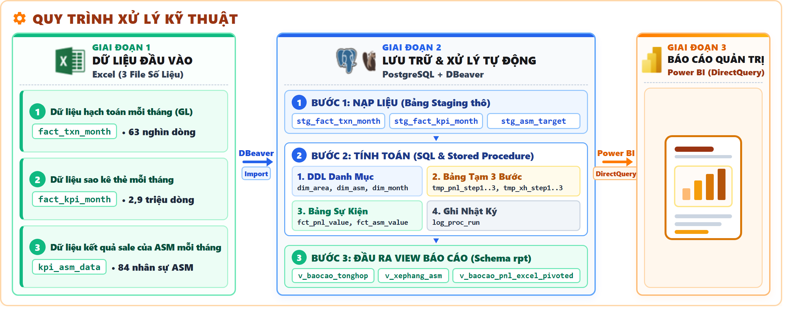
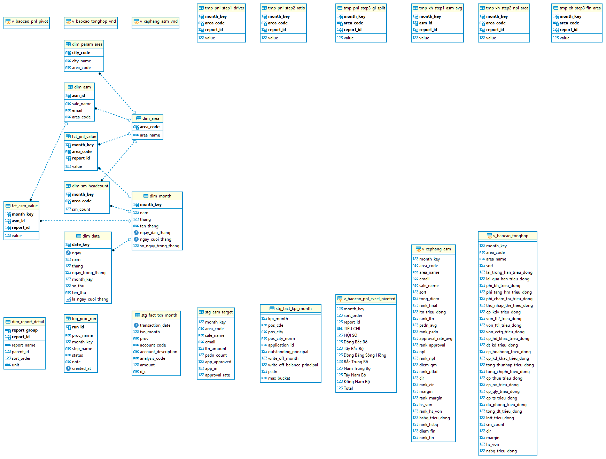

<div align="center">

# Xây dựng báo cáo quản trị kết quả kinh doanh thẻ tín dụng và đánh giá hiệu quả hoạt động của Quản lý vùng (ASM)

**Ngôn ngữ / Language**: **Tiếng Việt** · [English](README_eng.md)

<p>
  
  
  
  
</p>

</div>

## 📑 Mục lục

1. [🏢 Bối cảnh kinh doanh và yêu cầu quản trị](#1--bối-cảnh-kinh-doanh-và-yêu-cầu-quản-trị)
2. [🎯 Phân tích yêu cầu và thiết kế báo cáo](#2--phân-tích-yêu-cầu-và-thiết-kế-báo-cáo)
3. [🔍 Khảo sát dữ liệu và đánh giá mức độ đáp ứng](#3--khảo-sát-dữ-liệu-và-đánh-giá-mức-độ-đáp-ứng)
4. [🧮 Xây dựng cách tính và các chỉ tiêu quản trị](#4--xây-dựng-cách-tính-và-các-chỉ-tiêu-quản-trị)
5. [🔄 Thiết kế quy trình xử lý và kho dữ liệu](#5--thiết-kế-quy-trình-xử-lý-và-kho-dữ-liệu)
6. [🧪 Kiểm tra và đối soát dữ liệu](#6--kiểm-tra-và-đối-soát-dữ-liệu)
7. [📊 Kết quả phân tích và đề xuất quản trị](#7--kết-quả-phân-tích-và-đề-xuất-quản-trị)
8. [📚 Kinh nghiệm rút ra](#8--kinh-nghiệm-rút-ra)
9. [🛠️ Công cụ và công nghệ sử dụng](#9--công-cụ-và-công-nghệ-sử-dụng)
10. [📂 Cấu trúc thư mục dự án](#10--cấu-trúc-thư-mục-dự-án)
11. [📖 Tài liệu dự án](#11--tài-liệu-dự-án)
12. [👤 Tác giả](#12--tác-giả)

---

## 1. 🏢 Bối cảnh kinh doanh và yêu cầu quản trị

### Bối cảnh hoạt động kinh doanh thẻ tín dụng
Hoạt động kinh doanh thẻ tín dụng được tổ chức tại **7 vùng** trên toàn quốc. Mỗi vùng do các quản lý vùng (Area Sales Manager - ASM) phụ trách. Tổng số ASM dao động từ **74 đến 84 người**, tùy từng thời kỳ.

### Giai đoạn 1 – Tiếp nhận yêu cầu ban đầu từ Ban Lãnh đạo
Ban lãnh đạo chỉ đưa ra yêu cầu quản trị định hướng chung:
> *Cần xây dựng hệ thống báo cáo quản trị để theo dõi kết quả kinh doanh thẻ tín dụng tại các vùng và đánh giá hiệu quả hoạt động của đội ngũ quản lý vùng (ASM).*

Khi tiếp nhận, yêu cầu chỉ dừng ở mức định hướng tổng thể, không cung cấp sẵn công thức tính, bảng điểm KPI hay bộ số liệu mẫu, và chưa làm rõ những nội dung sau:
- Chưa có phương pháp xác định lợi nhuận thực tế của từng vùng.
- Chưa có nguyên tắc phân bổ các khoản chi phí hạch toán tập trung tại Hội sở.
- Chưa xác định bộ chỉ tiêu đo lường hiệu quả kinh doanh và rủi ro tín dụng.
- Chưa có tiêu chí đánh giá hiệu quả hoạt động của quản lý vùng.
- Chưa có công thức tính điểm, cơ chế xếp hạng hay cấu trúc biểu mẫu báo cáo.

### Những vấn đề cần làm rõ trong công tác quản trị
Khi xem xét cách tổng hợp báo cáo hiện tại, có thể thấy ba vấn đề cần giải quyết:

1. **Chưa phản ánh đầy đủ hiệu quả tài chính:**
   Trên sổ cái kế toán, doanh thu từ lãi vay và phí mở thẻ được ghi nhận tại các chi nhánh. Trong khi đó, nhiều khoản chi phí như chi phí vốn, tiếp thị, công nghệ và chi phí của các phòng ban hỗ trợ lại được hạch toán tập trung tại Hội sở. Khi chưa phân bổ những khoản chi phí này về các vùng, báo cáo có thể cho thấy cả 7 vùng đều có lãi, khiến việc nhận diện những vùng hoạt động kém hiệu quả khó khăn hơn.

2. **Đánh giá quản lý vùng tiềm ẩn rủi ro tín dụng:**
   Nếu chỉ dựa trên doanh số giải ngân hoặc số lượng thẻ mới, đội ngũ quản lý có thể nới lỏng điều kiện phê duyệt để đạt chỉ tiêu trước mắt. Điều này có thể giúp tăng trưởng nhanh trong ngắn hạn nhưng làm tăng nợ xấu và chi phí dự phòng trong các kỳ sau.

3. **Hạn chế của báo cáo kế toán hiện tại:**
   Báo cáo hiện tại chủ yếu thể hiện số liệu lũy kế từ đầu năm, chưa tách riêng kết quả từng tháng, nên khó xác định lợi nhuận tăng là nhờ hoạt động kinh doanh chính hay do chi phí dự phòng thay đổi.

Từ bối cảnh đó, 5 câu hỏi quản trị trọng tâm được xác định cần giải quyết:

| Vấn đề quản trị | Câu hỏi cần giải quyết | Mục tiêu quản trị cần đạt |
|---|---|---|
| **Hiệu quả kinh doanh** | Vùng nào đang thực sự có lợi nhuận sau khi tính chi phí chung? | Xác định chính xác lãi lỗ 7 vùng sau phân bổ Hội sở |
| **Biến động lợi nhuận** | Nguyên nhân tăng giảm lợi nhuận hàng tháng đến từ đâu? | Phân tích các khoản thu và chi cấu thành lợi nhuận |
| **Chất lượng tín dụng** | Vùng nào đang có rủi ro nợ xấu cao đe dọa an toàn vốn? | Giám sát dư nợ theo 5 nhóm nợ và tỷ lệ nợ xấu từng vùng |
| **Hiệu quả quản lý vùng** | Quản lý vùng nào có kết quả kinh doanh và quản trị rủi ro tốt? | Xây dựng hệ thống xếp hạng dựa trên nhiều khía cạnh cho 74 - 84 nhân sự |
| **Công tác điều hành** | Cần theo dõi thông tin như thế nào để ra quyết định kịp thời? | Xây dựng hệ thống dashboard trực quan và file Excel phục vụ đối soát |

---

## 2. 🎯 Phân tích yêu cầu và thiết kế báo cáo

### Giai đoạn 2 – Làm rõ yêu cầu nghiệp vụ
Từ yêu cầu ban đầu, cần làm rõ Ban lãnh đạo muốn theo dõi những thông tin nào về kết quả kinh doanh và hiệu quả hoạt động của đội ngũ ASM. Trước hết, các báo cáo dự kiến được phác thảo theo những thông tin báo cáo cần thể hiện (Output-First). Sau khi khảo sát dữ liệu, thiết kế được điều chỉnh để phù hợp với những thông tin thực tế có thể khai thác.

### Bảng làm rõ yêu cầu và xác định nội dung báo cáo:

| Yêu cầu ban đầu | Nội dung cần làm rõ | Kết quả phân tích nghiệp vụ | Yêu cầu báo cáo cần xây dựng |
|---|---|---|---|
| **Theo dõi kết quả kinh doanh** | Lãi lỗ từng vùng có tính chi phí Hội sở không? Phân bổ theo nguyên tắc nào? | Phải tính đầy đủ chi phí gián tiếp (vốn, vận hành, dự phòng) về 7 vùng theo tiêu thức kinh tế hợp lý | **Báo cáo P&L quản trị cho 7 vùng**: Thu nhập thuần, chi phí vốn, chi phí hoạt động, dự phòng rủi ro, lợi nhuận trước thuế (PBT) |
| **Theo dõi biến động kinh doanh** | Lợi nhuận tăng, giảm do hoạt động kinh doanh hay do chi phí dự phòng thay đổi? | Cần tách số lũy kế thành số phát sinh riêng từng tháng, sau đó phân tích các khoản thu và chi cấu thành lợi nhuận | **Báo cáo phân tích biến động lợi nhuận (Waterfall)**: Chênh lệch tháng (MoM) và mức đóng góp của 6 khoản thu, chi |
| **Theo dõi chất lượng tín dụng** | Làm sao phát hiện sớm rủi ro nợ xấu đe dọa an toàn vốn tại từng vùng? | Cần xem xét đồng thời mức tăng trưởng lợi nhuận và tỷ lệ nợ xấu của từng vùng | **Ma trận Lợi nhuận – Rủi ro **: Xếp 7 vùng vào 4 nhóm để phục vụ công tác quản trị |
| **Đánh giá hiệu quả quản lý vùng** | Hiệu quả của quản lý vùng (ASM) cần được đo lường bằng những yếu tố nào để tránh chạy theo số lượng? | Cần kết hợp chỉ tiêu về quy mô kinh doanh (50%) với chỉ tiêu về kỷ luật tài chính và rủi ro (50%) | **Thẻ điểm và Bảng xếp hạng Quản lý vùng **: Đánh giá 8 chỉ số trên 2 trụ cột độc lập |
| **Hỗ trợ công tác điều hành** | Cần theo dõi thông tin như thế nào để đáp ứng các nhu cầu khác nhau? | Lãnh đạo cần dashboard có thể tương tác; bộ phận kế toán cần file Excel có công thức để đối soát | **Hệ thống báo cáo tích hợp**: Dashboard Power BI 7 trang (chia làm 3 bộ báo cáo) và tệp Excel 7 sheet đối soát |

### Quy trình chuyển từ yêu cầu quản trị đến hệ thống báo cáo:

| Bước chuyển đổi | Nhánh 1: Quản trị kết quả kinh doanh vùng (P&L) | Nhánh 2: Đánh giá năng lực Quản lý vùng (ASM) |
|---|---|---|
| **1. Yêu cầu ban đầu của Ban Lãnh đạo** | Báo cáo kết quả kinh doanh thẻ tín dụng theo 7 vùng | Đánh giá hiệu quả hoạt động đội ngũ Quản lý vùng (ASM) |
| **2. Các nhóm thông tin cần có trong báo cáo** *(Phân tích nghiệp vụ & làm rõ yêu cầu)* | • Thu nhập, chi phí vốn, chi phí hoạt động, trích lập dự phòng<br>• Phân bổ chi phí Hội sở theo tiêu thức kinh tế<br>• Biến động lợi nhuận lũy kế và phát sinh theo tháng | • **Chỉ tiêu bán hàng cá nhân**: Cho vay mới, thẻ phát sinh dư nợ, tỷ lệ phê duyệt hồ sơ<br>• **Trách nhiệm địa bàn**: Tỷ lệ nợ xấu vùng, CIR vùng, Margin, Lợi nhuận bình quân/ASM |
| **3. Hệ thống báo cáo quản trị đầu ra** *(Trình bày thành 7 trang Power BI & Excel)* | • **Trang 1 – Giới thiệu đề tài**: Tổng quan bối cảnh, dữ liệu đầu vào, quy trình kỹ thuật và các báo cáo đầu ra<br>• **Trang 2 – Từ điển dữ liệu**: Chuẩn hóa 68 chỉ tiêu sang thuật ngữ nghiệp vụ ngân hàng<br>• **Trang 3 – Báo cáo kết quả kinh doanh vùng**: Chứa 32 chỉ tiêu tài chính để tra cứu và đối soát số liệu của 7 vùng<br>• **Trang 5 – Đánh giá hiệu quả kinh doanh vùng**: Trực quan hóa cơ cấu thu – chi – dự phòng để so sánh hiệu quả sinh lời giữa 7 vùng | • **Trang 4 – Báo cáo xếp hạng ASM**: Tổng hợp bảng điểm xếp hạng 84 ASM để khen thưởng cá nhân xuất sắc và chấn chỉnh nhân sự yếu<br>• **Trang 6 – Đánh giá hiệu suất ASM**: Biểu đồ hóa tương quan doanh số bán hàng và nợ xấu (NPL) để nhận diện các ASM đánh đổi rủi ro lấy quy mô<br>• **Trang 7 – Insight (Phân tích chuyên sâu & Kết luận)**: Bóc tách điểm nghẽn và đề xuất hành động điều hành định lượng<br>• **Đối soát**: Báo cáo Excel 7 sheet đối soát kế toán |

### Vai trò của hai nhóm chỉ tiêu:
- **Nhóm chỉ tiêu kết quả kinh doanh (P&L, NPL vùng, CIR, Margin):** Cho thấy tình hình tài chính của từng vùng sau khi tính đầy đủ chi phí từ Hội sở, giúp Ban lãnh đạo đưa ra quyết định phân bổ vốn và hạn mức tín dụng.
- **Nhóm chỉ tiêu đánh giá quản lý vùng (8 chỉ tiêu dùng để xếp hạng ASM):** Kết hợp kết quả bán hàng cá nhân và chất lượng tín dụng địa bàn nhằm tạo động lực thi đua lành mạnh, hạn chế việc chạy theo doanh số ngắn hạn mà bỏ qua rủi ro tín dụng.

---

## 3. 🔍 Khảo sát dữ liệu và đánh giá mức độ đáp ứng

### Khảo sát dữ liệu theo từng yêu cầu báo cáo
Ngân hàng chưa có kho dữ liệu tập trung hoặc một bảng số liệu duy nhất có thể đáp ứng ngay các yêu cầu báo cáo đã xác định. Việc tìm kiếm dữ liệu được thực hiện dựa trên từng chỉ tiêu cụ thể:

| Phòng ban cung cấp | Nguồn dữ liệu | Quy mô | Dữ liệu cung cấp và khóa liên kết |
|---|---|---:|---|
| **Khối Kế toán & Tài chính** | Dữ liệu hạch toán mỗi tháng – GL (`fact_txn_month`) | **63.134** bút toán | **Chứa** bút toán thu - chi thực tế phát sinh tại 7 vùng (62.953 dòng gắn mã tỉnh thành) và Hội sở (181 dòng chi phí chung mã `'00'`). **Dùng để** gán trực tiếp vào vùng, phân bổ chi phí chung và lập **báo cáo lãi lỗ (P&L) lũy kế 7 vùng**. Khóa dùng để liên kết: `city_code`, `account_code`. |
| **Khối Vận hành Thẻ** | Dữ liệu sao kê thẻ mỗi tháng (`fact_kpi_month`) | **2.932.922** dòng | **Chứa** sao kê dư nợ theo 5 nhóm nợ, các khoản đã xử lý rủi ro (write-off), hạn mức và doanh số của từng hợp đồng trong 5 tháng. **Dùng để** tính **tỷ lệ phân bổ chi phí Hội sở** và đo lường, kiểm soát **nợ xấu (NPL)**. Khóa dùng để liên kết: `branch_code`, `month_key`. |
| **Khối Quản lý Mạng lưới** | Dữ liệu kết quả sale của ASM mỗi tháng (`kpi_asm_data`) | **420** dòng | **Chứa** chỉ tiêu giao và doanh số bán hàng thực tế (giải ngân mới, số thẻ phát sinh dư nợ bình quân, tỷ lệ phê duyệt hồ sơ) của 74 đến 84 quản lý vùng theo tháng. **Dùng để** tính **điểm quy mô** và **chấm điểm xếp hạng ASM**. Khóa dùng để liên kết: `asm_id`, `month_key`. |
| **Phòng Kế hoạch & Quản trị Dữ liệu** | Bảng tham số địa bàn và biểu mẫu đối chiếu | **64** tỉnh thành | Cung cấp quy tắc ánh xạ 64 tỉnh thành vào 8 vùng địa lý (Hội sở `'A'` và 7 vùng kinh doanh `'B'..'H'`) kèm mẫu biểu trình bày báo cáo. Khóa dùng để liên kết: `city_code`, `area_code`. |

### Đánh giá mức độ đáp ứng của dữ liệu:

| Báo cáo cần xây dựng | Thông tin cần có | Nguồn dữ liệu hiện có | Đánh giá mức độ đáp ứng và cấp dữ liệu |
|---|---|---|---|
| **Báo cáo lãi lỗ 7 vùng** | Thu nhập, chi phí chi tiết, mã tỉnh, mã tài khoản | Sổ cái kế toán (`fact_txn_month`) & Bảng tham số | **Khả thi**: 62.953 dòng có mã tỉnh để ghi nhận trực tiếp; 181 dòng chi phí Hội sở (mã `'00'`) cần thuật toán phân bổ gián tiếp theo tiêu thức |
| **Báo cáo nợ xấu & rủi ro vùng** | Dư nợ 5 nhóm nợ, nợ write-off theo chi nhánh | Sao kê hợp đồng thẻ (`fact_kpi_month`) | **Có thể thực hiện ở cấp vùng**: Dữ liệu có mã chi nhánh nên có thể tổng hợp dư nợ và nợ xấu cho 7 vùng trong 5 tháng |
| **Xếp hạng quản lý vùng** | Chỉ tiêu kinh doanh cá nhân và nhân sự | Bảng chỉ tiêu kinh doanh ASM (`kpi_asm_data`) | **Có thể thực hiện**: Có dữ liệu theo từng tháng của 74 đến 84 quản lý vùng |
| **Đánh giá nợ xấu từng cá nhân ASM** | Dư nợ xấu gắn trực tiếp theo mã nhân sự ASM | Dữ liệu hợp đồng thẻ chỉ gắn mã chi nhánh, không có mã ASM | **Chưa đủ dữ liệu ở cấp cá nhân**: Không thể xác định nợ xấu riêng cho từng người; các chỉ tiêu nợ xấu và tài chính chỉ có thể tính ở cấp vùng, sau đó dùng chung cho các ASM trong vùng |

### Ba vấn đề phát hiện trong dữ liệu ban đầu:
1. **Dữ liệu sao kê thẻ quá lớn để xử lý thuận tiện bằng các công cụ bảng tính thông thường:** Tệp dữ liệu gồm gần 3 triệu dòng, có dung lượng **117,2 MB**, vượt khả năng xử lý thuận tiện của các công cụ bảng tính thông thường.
2. **Bảng chỉ tiêu đang được trình bày theo dạng ngang (Wide):** Các tháng hiện được trình bày thành từng cột, nên cần chuyển bảng sang dạng dọc (Tall) trước khi đưa vào cơ sở dữ liệu quan hệ.
3. **Tên địa danh chưa thống nhất:** Tên địa danh được ghi khác nhau giữa các phòng ban (ví dụ: sao kê ghi "Bà Rịa - Vũng Tàu" nhưng bảng tham số viết "Vũng Tàu"), nếu nối dữ liệu trực tiếp, hơn **36.000 hợp đồng thẻ** có thể không được ghép đúng khi tính toán tỷ lệ nợ xấu của vùng Đông Nam Bộ.

---

## 4. 🧮 Xây dựng cách tính và các chỉ tiêu quản trị

**Bối cảnh của bài toán:** Ban lãnh đạo chỉ đưa ra yêu cầu chung, không cung cấp sẵn công thức tính, bảng điểm KPI hay bộ số liệu mẫu. Vì vậy, các phương pháp tính toán trong dự án được xây dựng từ việc phân tích dòng tiền và vận dụng các nguyên tắc kế toán quản trị.

### 4.1. Xây dựng logic phân bổ thu nhập và chi phí

Câu hỏi chính cần giải quyết là: *Làm thế nào xác định kết quả kinh doanh của từng vùng khi nhiều khoản thu và chi được hạch toán tập trung tại Hội sở?*

Bài toán được triển khai qua 9 bước kế toán quản trị:
1. Phân tích toàn bộ 63.134 bút toán trên sổ cái kế toán (GL).
2. Xác định các khoản thu, chi có mã tỉnh hoặc mã chi nhánh cụ thể để ghi nhận trực tiếp.
3. Phân loại các khoản chi phí hạch toán tập trung tại Hội sở (mã tỉnh `'00'`, vùng `'A'`).
4. Tìm hiểu bản chất và nguyên nhân phát sinh của từng khoản chi phí.
5. Xác định tiêu thức phản ánh mức độ sử dụng nguồn lực hoặc nguyên nhân làm phát sinh chi phí.
6. Kiểm tra xem dữ liệu hiện có có đủ để tính tiêu thức phân bổ đã chọn hay không.
7. Chọn phương pháp phân bổ gián tiếp phù hợp.
8. Xây dựng công thức toán học và triển khai bằng Stored Procedure trên PostgreSQL.
9. Kiểm tra tính hợp lý kinh tế và khả năng giữ nguyên tổng số tiền sau phân bổ.

**Hai nguyên tắc phân bổ chi phí cốt lõi:**
- **Quy tắc 1 – Gán trực tiếp:** 62.953 bút toán phát sinh tại chi nhánh được ghi nhận trực tiếp về đúng vùng, bao gồm doanh thu (lãi thẻ, phí thường niên) và các khoản chi phí trực tiếp.
- **Quy tắc 2 – Phân bổ gián tiếp theo tiêu thức:** 181 bút toán chi phí Hội sở dùng chung được phân bổ cho 7 vùng dựa trên tỷ trọng của từng tiêu thức kinh tế tương ứng:

$$\text{Tỷ lệ phân bổ vùng } i = \frac{\text{Giá trị tiêu thức của vùng } i}{\sum_{k=1}^7 \text{Giá trị tiêu thức của vùng } k}$$

$$\text{Chi phí phân bổ về vùng } i = \text{Chi phí Hội sở} \times \text{Tỷ lệ phân bổ vùng } i$$

*Cơ sở lựa chọn tiêu thức phân bổ cho từng nhóm chi phí tại Hội sở:*
- **Chi phí vốn huy động:** Đây là chi phí ngân hàng phải trả để huy động vốn tài trợ cho các khoản cho vay qua thẻ. Khoản chi phí này tăng theo quy mô tín dụng $\rightarrow$ Phân bổ theo **Dư nợ cho vay bình quân nhóm 1**. Vùng có dư nợ bình quân lớn hơn sẽ được phân bổ phần chi phí vốn cao hơn.
- **Chi phí dự phòng rủi ro tín dụng:** Đây là khoản trích lập để bù đắp những tổn thất tín dụng có thể phát sinh. Phân bổ theo **Dư nợ nhóm 2 đến nhóm 5 cộng với Nợ đã xử lý rủi ro ngoại bảng (write-off)** (`d25_sau` hoặc `dtruoc`). Tiêu thức này phản ánh quy mô dư nợ có rủi ro của từng vùng; đây là tiêu thức phân bổ quản trị gián tiếp trong điều kiện sổ cái (GL) chỉ ghi nhận khoản mục được hạch toán tập trung tại Hội sở, không cho biết chính xác chi phí dự phòng của từng hợp đồng riêng lẻ.
- **Chi phí công nghệ và vận hành thẻ:** Đây là chi phí duy trì hệ thống Core thẻ, hạ tầng viễn thông và máy chủ $\rightarrow$ Phân bổ theo **Số hợp đồng phát sinh dư nợ bình quân** (`psdn`). Tiêu thức này được dùng để đại diện cho quy mô danh mục thẻ đang hoạt động và mức độ phục vụ của hệ thống, không khẳng định phản ánh trực tiếp tần suất giao dịch của từng chủ thẻ.
- **Chi phí vận hành và quản trị khối hỗ trợ:** Đây là chi phí lương, thưởng và phúc lợi của các phòng ban Hội sở phục vụ mạng lưới $\rightarrow$ Phân bổ theo **Định biên nhân sự (Headcount)** của từng vùng.
- *Giả định và giới hạn:* Phương pháp giả định mối quan hệ phân bổ là tuyến tính và mức chi phí bình quân trên mỗi đơn vị tiêu thức phân bổ là như nhau giữa các vùng; chưa tách riêng chi phí của những chiến dịch tiếp thị chỉ áp dụng tại một số địa phương.

*Chuyển đổi số lũy kế (YTD) sang số phát sinh tháng:*
Dữ liệu sổ cái tích lũy từ đầu năm được tách thành số phát sinh của từng tháng:
$$V_{\text{tháng } M} = V_{\text{lũy kế } M} - V_{\text{lũy kế } (M-1)}$$
Nhờ vậy, có thể phân tích mức tăng, giảm của lợi nhuận trước thuế (PBT) theo 6 khoản thu và chi cấu thành.

### 4.2. Xây dựng bộ chỉ tiêu đánh giá hiệu quả hoạt động quản lý vùng

Câu hỏi cần giải quyết: *Nếu chỉ sử dụng doanh số phát hành thẻ để đánh giá quản lý vùng (ASM), liệu kết quả có phản ánh đầy đủ hiệu quả hoạt động và kiểm soát rủi ro không?*

**Bộ chỉ tiêu kết hợp kết quả kinh doanh cá nhân với trách nhiệm đối với địa bàn:**
Bộ chỉ tiêu kết hợp kết quả kinh doanh của từng quản lý vùng (ASM) với tình hình tài chính và chất lượng tín dụng tại địa bàn người đó phụ trách. Cách đánh giá này giúp tránh việc chỉ chú trọng doanh số mà bỏ qua rủi ro tín dụng. Tuy nhiên, do một số chỉ tiêu chỉ có dữ liệu ở cấp vùng, kết quả xếp hạng không phản ánh đầy đủ năng lực riêng của từng cá nhân.

Bộ đánh giá gồm 8 chỉ tiêu, chia đều thành 2 trụ cột, mỗi trụ cột có 4 chỉ tiêu. Mỗi chỉ tiêu đóng góp một thứ hạng vào điểm tổng từ 1 đến $N$. Việc chia đều số lượng chỉ tiêu không có nghĩa hai trụ cột được gán trọng số kinh tế 50% dựa trên một mô hình định lượng:
- **Trụ cột 1: Kết quả kinh doanh và kiểm soát chất lượng tăng trưởng (`diem_qm`):** Gồm 3 chỉ tiêu bán hàng cá nhân (Doanh số cho vay mới, Số thẻ phát sinh dư nợ bình quân, Tỷ lệ phê duyệt hồ sơ) cùng 1 chỉ tiêu kiểm soát chất lượng tín dụng địa bàn (Tỷ lệ rủi ro tín dụng mở rộng toàn vùng). Cần lưu ý rằng **tỷ lệ phê duyệt hồ sơ càng cao chưa chắc đã tốt**: tỷ lệ duyệt cao có thể do khả năng khai thác khách hàng tốt nhưng cũng có thể do nới lỏng tiêu chuẩn thẩm định tín dụng. Vì vậy, cần xem tỷ lệ phê duyệt cùng với tỷ lệ nợ xấu của địa bàn.
- **Trụ cột 2: Hiệu quả tài chính (`diem_fin`):** Gồm 4 chỉ tiêu cấp vùng (Hệ số CIR, Biên lợi nhuận (Margin), Hệ số hiệu quả vốn, Lợi nhuận bình quân/ASM). Do hợp đồng thẻ không gắn mã định danh cá nhân từng ASM (chỉ quản lý theo chi nhánh/vùng), việc đưa kết quả tài chính và rủi ro của địa bàn vào bảng điểm ASM giúp gắn kết quả cá nhân với trách nhiệm chung của vùng, tránh tình trạng chỉ chạy theo doanh số ngắn hạn mà bỏ qua chất lượng tín dụng.

**Cách tính tỷ lệ rủi ro tín dụng mở rộng (bao gồm nợ đã xử lý rủi ro):**
Trong Stored Procedure SQL (`report_id = 204`), chỉ tiêu được tính như sau:

$$\text{Tỷ lệ rủi ro tín dụng mở rộng} = \frac{\text{Dư nợ nhóm 3–5} + \text{Write-off lũy kế}}{\text{Tổng dư nợ} + \text{Write-off lũy kế}} \times 100$$

Khác với tỷ lệ NPL thông thường (chỉ tính dư nợ nhóm 3–5 nội bảng trên tổng dư nợ), đây là **chỉ tiêu quản trị do dự án tự xây dựng** từ việc phân tích bản chất dòng tiền và nguyên tắc kế toán quản trị rủi ro tín dụng. Số write-off (nợ đã xử lý rủi ro ngoại bảng) được cộng dồn từ đầu năm để phản ánh đúng thực chất mức độ tổn thất vốn, tránh việc tỷ lệ nợ xấu nội bảng giảm giả tạo đơn thuần do các khoản nợ xấu được xóa khỏi bảng cân đối kế toán. *Giới hạn nghiệp vụ cần lưu ý:* Chỉ tiêu này phản ánh cả tổn thất đã tích lũy trong quá khứ, không chỉ phản ánh chất lượng danh mục hiện tại. Những vùng có danh mục thẻ lâu năm có thể tích lũy lượng nợ write-off lớn hơn vùng mới mở rộng, vì vậy cần thận trọng khi so sánh các vùng có thời gian hình thành danh mục khác nhau.

| Trụ cột 1: Kết quả kinh doanh & Kiểm soát chất lượng tăng trưởng (`diem_qm`) | Trụ cột 2: Hiệu quả tài chính địa bàn (`diem_fin`) |
|---|---|
| • **Doanh số cho vay mới bình quân** *(Càng cao càng tốt)*<br>• **Số thẻ phát sinh dư nợ bình quân** *(Càng cao càng tốt)*<br>• **Tỷ lệ phê duyệt hồ sơ bình quân** *(Đánh giá kèm rủi ro)*<br>• **Tỷ lệ rủi ro tín dụng mở rộng** *(Càng thấp càng tốt — bao gồm nợ đã xử lý rủi ro ngoại bảng)* | • **Tỷ lệ chi phí / thu nhập – CIR** *(Càng thấp càng tốt)*<br>• **Biên lợi nhuận – Margin** *(Càng cao càng tốt)*<br>• **Hệ số hiệu quả vốn** *(Càng cao càng tốt)*<br>• **Lợi nhuận bình quân / Quản lý** *(Càng cao càng tốt — gắn trách nhiệm quản trị với địa bàn)* |

**Bảng chi tiết 8 chỉ tiêu đánh giá quản lý vùng (ASM):**

| Chỉ tiêu | Nội dung phản ánh | Ý nghĩa của chỉ tiêu | Nguồn dữ liệu | Hướng đánh giá | Cấp dữ liệu | Hạn chế cần lưu ý |
|---|---|---|---|---|---|---|
| **Doanh số giải ngân mới** | Kết quả bán hàng trực tiếp | Cho biết mức độ mở rộng hoạt động kinh doanh | Bảng chỉ tiêu KPI | Càng cao càng tốt | Cá nhân ASM | Chưa tính đến tỷ lệ hủy thẻ sau phát hành |
| **Số thẻ phát sinh dư nợ bình quân** | Mức độ sử dụng thẻ | Cho biết số thẻ có phát sinh dư nợ trong kỳ | Sao kê hợp đồng | Càng cao càng tốt | Cá nhân ASM | Cần cân nhắc chi phí để kích hoạt và duy trì thẻ |
| **Tỷ lệ phê duyệt hồ sơ** | Kết quả sàng lọc hồ sơ | Cho biết tỷ lệ hồ sơ được phê duyệt | Bảng chỉ tiêu KPI | Cần xem cùng chất lượng tín dụng | Cá nhân ASM | Tỷ lệ cao có thể đi kèm nguy cơ nới lỏng thẩm định |
| **Tỷ lệ nợ xấu của vùng (NPL)** | Kiểm soát rủi ro tín dụng | Cho biết chất lượng tín dụng của địa bàn | Sao kê hợp đồng | Càng thấp càng tốt | Cấp vùng | Hợp đồng thẻ không có mã ASM nên chỉ tính được ở cấp vùng |
| **Hệ số CIR của vùng** | Hiệu quả sử dụng chi phí | Cho biết tỷ lệ chi phí hoạt động trên thu nhập | Sổ cái kế toán | Càng thấp càng tốt | Cấp vùng | Phụ thuộc vào cách phân bổ chi phí từ Hội sở |
| **Biên lợi nhuận (Margin)** | Khả năng sinh lời | Cho biết tăng trưởng có đi kèm khả năng sinh lời hay không | Sổ cái kế toán | Càng cao càng tốt | Cấp vùng | Nhạy cảm với biến động lãi suất vốn điều chuyển |
| **Hệ số hiệu quả vốn** | Hiệu quả sử dụng vốn | Cho biết mức lợi nhuận tạo ra trên mỗi đồng dư nợ | Sổ cái & Sao kê | Càng cao càng tốt | Cấp vùng | Phản ánh hiệu quả tổng hợp toàn địa bàn |
| **Lợi nhuận bình quân/ASM** | Mức đóng góp vào kết quả tài chính | Cho biết lợi nhuận bình quân theo định biên ASM | Sổ cái và dữ liệu nhân sự | Càng cao càng tốt | Cấp vùng | Tính bình quân theo định biên nhân sự quản lý vùng |

*Cách tổng hợp điểm khi các chỉ tiêu có đơn vị đo khác nhau:*
Do các chỉ số có đơn vị đo lường khác nhau (triệu đồng, số lượng thẻ, tỷ lệ phần trăm), không thể cộng trực tiếp các giá trị thô. Hệ thống áp dụng phương pháp **xếp hạng riêng từng chỉ tiêu**:
- Mỗi chỉ tiêu được xếp hạng từ 1 đến $N$ trong toàn ngân hàng (thứ hạng 1 đại diện cho thành tích tốt nhất).
- Với các chỉ tiêu "càng thấp càng tốt" (tỷ lệ nợ xấu, hệ số CIR), thuật toán đảo chiều xếp hạng để giá trị thấp nhất đạt thứ hạng 1.
- Điểm tổng được tính bằng tổng điểm của hai trụ cột:
$$\text{Điểm tổng} = \text{Điểm Quy mô } (diem\_qm) + \text{Điểm Tài chính } (diem\_fin)$$
- Quản lý vùng nào có **Điểm tổng càng thấp thì thứ hạng chung cuộc trên bảng xếp hạng toàn quốc càng cao**. Cách tính này được áp dụng cho đội ngũ từ 74 đến 84 quản lý vùng trong từng tháng.

---

## 5. 🔄 Thiết kế quy trình xử lý và kho dữ liệu

Để kết hợp dữ liệu từ nhiều nguồn và xây dựng hệ thống báo cáo hoàn chỉnh, quy trình xử lý kỹ thuật được thiết kế gồm 3 giai đoạn:

<div align="center">



</div>

### Quy trình xử lý kỹ thuật gồm 3 giai đoạn:

- **Giai đoạn 1 – Tìm dữ liệu đầu vào (Excel – 3 File Số Liệu):**
  Thu thập và chuẩn bị 3 nguồn dữ liệu thô theo thứ tự nghiệp vụ: **Dữ liệu hạch toán mỗi tháng – GL** (`fact_txn_month` gồm **63.134** dòng: *chứa* bút toán thu - chi tại 7 vùng & Hội sở, *dùng để* gán trực tiếp vào vùng và tổng hợp báo cáo lãi lỗ P&L lũy kế), **Dữ liệu sao kê thẻ mỗi tháng** (`fact_kpi_month` gồm **2.932.922** dòng, dung lượng **117,2 MB**: *chứa* sao kê dư nợ, nhóm nợ và trạng thái thẻ, *dùng để* tính tỷ lệ phân bổ Hội sở và đo lường nợ xấu NPL) và **Dữ liệu kết quả sale của ASM mỗi tháng** (`kpi_asm_data` gồm **420** dòng của **84** nhân sự ASM trong 5 tháng: *chứa* doanh số bán hàng, *dùng để* tính điểm quy mô và chấm điểm xếp hạng ASM).

- **Giai đoạn 2 – Lưu trữ và xử lý dữ liệu tự động (PostgreSQL + DBeaver):**
  Kho dữ liệu được tổ chức theo mô hình Kimball Star Schema trong schema `banking_project`, gồm **19 bảng, 3 `view` và 11 `stored procedure`**, vận hành qua 3 bước:
  - **Bước 1 – Nạp liệu (DBeaver Import trực tiếp):** Sử dụng DBeaver đưa trực tiếp dữ liệu thô từ 3 tệp Excel vào 3 bảng tiếp nhận tương ứng trong PostgreSQL (`stg_fact_txn_month` **63.134** dòng, `stg_fact_kpi_month` **2.932.922** dòng, `stg_asm_target` **420** dòng) và chuẩn hóa chuỗi tên địa danh (`pos_city_norm`) bảo toàn hơn **36.000** hợp đồng thẻ.
  - **Bước 2 – Tính toán (Thực thi script SQL & Stored Procedure):**
    - *7 bảng danh mục (`dim_`)*: `dim_area` (8 vùng), `dim_param_area` (64 tỉnh thành), `dim_month` (5 tháng), `dim_date` (151 ngày), `dim_asm` (84 nhân sự), `dim_report_detail` (55 chỉ tiêu), `dim_sm_headcount` (35 dòng).
    - *6 bảng tạm 3 bước (`tmp_`)*: Cùng cấu trúc dữ liệu dạng dọc (`month_key`, `area_code`, `report_id`, `value`) phục vụ tính trung gian cho P&L (`tmp_pnl_step1..3`) và Xếp hạng (`tmp_xh_step1..3`).
    - *2 bảng sự kiện (`fct_`)*: `fct_pnl_value` (1.115 dòng) lưu kết quả tài chính 7 vùng và `fct_asm_value` (8.536 dòng) lưu thứ hạng chi tiết từng quản lý vùng qua 5 tháng.
    - *1 bảng nhật ký (`log_`)*: `log_proc_run` ghi nhận lịch sử thực thi của 11 thủ tục lưu trữ (208 bản ghi `START` và `OK`, 0 bản ghi `FAIL`), đi kèm 9 `Virtual Foreign Keys` (Khoá ngoại ảo) trong DBeaver.
  - **Bước 3 – Đầu ra View báo cáo (Dựng 3 View sạch schema `rpt`):** Khởi tạo 3 khung nhìn chuẩn hóa (`v_baocao_tonghop` 35 dòng, `v_xephang_asm` 388 dòng, `v_baocao_pnl_excel_pivoted` 160 dòng) phục vụ kết nối trực tiếp vào Power BI.

<div align="center">



</div>

- **Giai đoạn 3 – Trực quan các báo cáo (Power BI):**
  Kết nối trực tiếp từ Power BI vào PostgreSQL, kết hợp **100** measure DAX (bao gồm bộ measure tính chỉ số KPI, hệ thống **21** measure định dạng có điều kiện màu nền – màu chữ tương phản cao cho từng cột bảng P&L vùng và các visual HTML Content cỡ chữ lớn) cùng từ điển dữ liệu **68** chỉ tiêu trên bảng màu chủ đạo **Executive Orange / Orange Tree** (`#FF7A00`, `#EA580C`, `#2B1406`, `#FFBE2E`, `#FED7AA`) để xuất bản **7 trang** báo cáo: **2 Trang Nền Tảng** (`GIỚI THIỆU ĐỀ TÀI`, `TỪ ĐIỂN DỮ LIỆU`), **2 Bản Báo Cáo Tra Cứu & Tổng Hợp** (`BÁO CÁO KẾT QUẢ KINH DOANH VÙNG` chứa **32** chỉ tiêu tài chính để tra cứu và đối soát số liệu 7 vùng; `BÁO CÁO XẾP HẠNG ASM` tổng hợp bảng điểm **84** ASM để khen thưởng cá nhân xuất sắc và chấn chỉnh nhân sự yếu), **2 Bản Báo Cáo Trực Quan Hoá Đánh Giá** (`ĐÁNH GIÁ HIỆU QUẢ KINH DOANH VÙNG` trực quan hóa cơ cấu thu – chi – dự phòng; `ĐÁNH GIÁ HIỆU SUẤT ASM` biểu đồ hóa tương quan doanh số và nợ xấu NPL) và **1 Bản Phân Tích Chuyên Sâu** (`INSIGHT` – Phân tích chuyên sâu và đưa ra kết luận).

---

## 6. 🧪 Kiểm tra và đối soát dữ liệu

**Cách kiểm tra kết quả:** Trong quá trình triển khai, không có sẵn bảng kết quả mẫu để đối chiếu từng con số. Vì vậy, quy trình kiểm tra được chia thành 5 lớp nhằm rà soát số liệu, công thức và kết quả qua từng bước xử lý.

| Lớp kiểm soát | Tên lớp đối soát dữ liệu | Nguyên tắc kiểm chứng cốt lõi |
|:---:|---|---|
| **Lớp 1** | **Đối soát số liệu sổ cái (GL Reconciliation)** | Bảo toàn tổng tiền: Tổng vùng sau phân bổ + Hội sở = Tổng sổ cái ngân hàng |
| **Lớp 2** | **Kiểm tra điều kiện toán học (Mathematical Invariants)** | Tổng tỷ trọng phân bổ của từng tiêu thức đạt chính xác `Sum(Ratio) = 1.0` |
| **Lớp 3** | **Kiểm soát toàn vẹn và chất lượng dữ liệu** | Đảm bảo không trùng lặp dòng, không rơi rớt bản ghi khi `JOIN` bảng danh mục |
| **Lớp 4** | **Kiểm tra tính hợp lý nghiệp vụ** | Kiểm soát miền giá trị hợp lý của nợ xấu, dư nợ và biến động bất thường giữa các tháng |
| **Lớp 5** | **Tính lại và đối chiếu chéo giữa các hệ thống** | Tính tay độc lập trên mẫu và đối soát số liệu giữa PostgreSQL, Power BI và Excel |

### Lớp 1 – Đối soát bảo toàn số liệu
- **Rủi ro cần kiểm tra:** Thất thoát dòng tiền hoặc nhân đôi chi phí khi thực hiện phân bổ 181 bút toán Hội sở về các vùng.
- **Nguyên tắc kiểm soát:** Tổng chi phí và thu nhập sau phân bổ của 7 vùng cộng với phần Hội sở còn lại phải khớp chính xác 100% tổng phát sinh trên sổ cái kế toán toàn ngân hàng:
$$\left| \sum_{k=1}^7 \text{Chi phí phân bổ vùng } k - \text{Chi phí Hội sở} \right| \le 10^{-6}$$
- **Cách thức triển khai:** Chạy truy vấn SQL tổng hợp đối chiếu chênh lệch giữa bảng dữ liệu thô `stg_fact_txn_month` và bảng dữ liệu sau phân bổ `fct_pnl_allocation`.
- **Kết quả thực tế:** Sai lệch bằng đúng $0,00$ VNĐ trên toàn bộ 63.134 dòng bút toán sổ cái của cả 5 tháng phân tích.
- **Giới hạn còn tồn tại:** Cách kiểm tra này chỉ xác nhận phép phân bổ không làm thay đổi tổng số liệu, không phát hiện được sai sót nếu bản thân bút toán gốc trên sổ cái GL bị hạch toán sai tài khoản.

### Lớp 2 – Kiểm tra tính đúng đắn của công thức
- **Rủi ro cần kiểm tra:** Lỗi chia cho 0 khi mẫu số bằng 0, tỷ trọng phân bổ không trọn vẹn gây hao hụt chi phí, hoặc sai quy tắc dấu của các khoản mục chi phí âm/dương.
- **Nguyên tắc kiểm soát:** Tổng tỷ trọng phân bổ của từng tiêu thức kinh tế phải bằng chính xác 1:
$$\sum_{i=1}^7 w_i = 1,000000 \quad (\text{với mọi tiêu thức phân bổ})$$
Mọi phép chia đều sử dụng `NULLIF(denominator, 0)` để tránh lỗi khi mẫu số bằng 0.
- **Cách thức triển khai:** Chạy các câu lệnh tự động để kiểm tra tổng trọng số của 9 tiêu thức kinh tế trong bảng tạm `tmp_pnl_step2_head_alloc_ratio`.
- **Kết quả thực tế:** $100\%$ các tiêu thức phân bổ có tổng tỷ lệ đạt đúng 1; không phát sinh lỗi chia cho 0 hay giá trị không xác định (`NaN`/`Infinity`).
- **Giới hạn còn tồn tại:** Phương pháp giả định chi phí phân bổ tăng tuyến tính theo quy mô của tiêu thức phân bổ, chưa xét đến các mô hình chi phí phi tuyến tính hoặc chi phí biên.

### Lớp 3 – Kiểm soát chất lượng dữ liệu
- **Rủi ro cần kiểm tra:** Dữ liệu có thể bị trùng khi nhập từ Excel, thiếu dòng khi thực hiện `JOIN`, hoặc có mã chi nhánh không ánh xạ được vào 7 vùng.
- **Nguyên tắc kiểm soát:** Kiểm tra tính toàn vẹn của các mối liên kết (*Referential Integrity*) và tính duy nhất của dữ liệu (*Uniqueness*).
- **Cách thức triển khai:** Kiểm tra đếm dòng trước và sau câu lệnh `JOIN`; kiểm tra các bản ghi có mã tỉnh không nằm trong danh mục `dim_param_area`.
- **Kết quả thực tế:** Toàn bộ 2.932.922 dòng sao kê hợp đồng thẻ và 63.134 dòng bút toán sổ cái được nạp đầy đủ; không có bản ghi không tìm được thông tin tương ứng trong bảng danh mục (*orphan records*). 181 dòng bút toán Hội sở mang mã tỉnh `'00'` được chuyển hướng xử lý thành công qua luồng phân bổ gián tiếp.
- **Giới hạn còn tồn tại:** Trường hợp khách hàng thay đổi địa chỉ cư trú giữa các tháng nhưng chi nhánh mở thẻ không đổi thì hợp đồng vẫn được tính cho vùng của chi nhánh mở ban đầu.

### Lớp 4 – Kiểm tra tính hợp lý nghiệp vụ
- **Rủi ro cần kiểm tra:** Kết quả tính toán vi phạm các giới hạn lý thuyết kinh tế hoặc biến động bất thường mà không có nguyên nhân nghiệp vụ giải thích.
- **Nguyên tắc kiểm soát:** Đặt ra các giới hạn hợp lý cho các chỉ tiêu:
  - Tỷ lệ nợ xấu vùng $NPL \in [0\%, 100\%]$; Dư nợ, số thẻ, định biên nhân sự $\ge 0$.
  - Cần xem xét chi phí dự phòng cùng với biến động dư nợ nhóm 3 đến nhóm 5.
  - Đánh dấu cảnh báo (*Red Flag*) đối với các khoản mục chi phí có mức biến động tháng $MoM > \pm 50\%$.
- **Cách thức triển khai:** Thực hiện các truy vấn kiểm tra miền giá trị trên bảng sự kiện và theo dõi biến động theo chuỗi thời gian từ tháng 1 đến tháng 5/2023.
- **Kết quả thực tế:** Trong 5 tháng, tỷ lệ nợ xấu của 7 vùng dao động từ 10,11% đến 21,99% (riêng tháng 5/2023 từ 11,24% đến 21,99%). Chi phí dự phòng tăng mạnh trong tháng 5/2023; báo cáo lý giải biến động này bằng khoản trích lập cho dư nợ nhóm 3 đến nhóm 5 phát sinh từ đợt mở rộng tín dụng trong quý trước.
- **Giới hạn còn tồn tại:** Phương pháp kiểm tra ngưỡng biến động không phân biệt được biến động do hoạt động kinh doanh tự nhiên với các điều chỉnh chính sách kế toán hồi tố nếu phòng kế toán không cung cấp thuyết minh đi kèm.

### Lớp 5 – Tính lại kết quả và đối chiếu giữa các hệ thống 
- **Rủi ro cần kiểm tra:** Sai lệch logic ẩn trong quá trình chuyển đổi giữa cơ sở dữ liệu PostgreSQL và tầng trình diễn Power BI.
- **Nguyên tắc kiểm soát:** Tính lại kết quả trên một số trường hợp mẫu (*Single-Case Reverse Audit*), đối soát chéo đa tầng giữa các hệ thống và kiểm chứng cân đối kế toán tổng thể (*Accounting Reconciliation*).
- **Cách thức triển khai:**
  1. *Tính lại độc lập trên mẫu:* Chọn ngẫu nhiên 3 trường hợp đại diện (Vùng Đông Nam Bộ, Vùng Tây Bắc Bộ và 1 quản lý vùng (ASM) cụ thể), tự tính lại bằng công thức kế toán quản trị riêng, không sử dụng hệ thống SQL và so sánh kết quả.
  2. *Đối chiếu giữa các hệ thống:* So sánh **91 ô dữ liệu** (13 chỉ tiêu tài chính cốt lõi $\times$ 7 vùng tại tháng 5/2023) giữa kết quả truy vấn PostgreSQL và 100 measure DAX trên Power BI.
  3. *Kiểm chứng cân đối kế toán tổng thể:* Đối soát tổng lợi nhuận và doanh thu sau phân bổ của các vùng với tổng số dư phát sinh trên toàn bộ sổ cái kế toán (GL), đảm bảo nguyên tắc bảo toàn dòng tiền: Lợi nhuận trước thuế toàn hệ thống (tháng 2/2023 đạt 92.226,35 triệu đồng, tháng 5/2023 đạt 250.450,06 triệu đồng) khớp tuyệt đối với sổ cái kế toán, chứng minh việc phân bổ chi phí gián tiếp từ Hội sở không làm phát sinh hay thất thoát bất kỳ đồng vốn nào của ngân hàng.
- **Kết quả thực tế:**
  - Kết quả tính lại bằng tay khớp với kết quả do Stored Procedure SQL tạo ra.
  - Cả **91 ô dữ liệu được đối chiếu giữa PostgreSQL và Power BI đều không có chênh lệch**.
  - Cân đối kế toán toàn hàng được bảo toàn trọn vẹn: LNTT toàn hệ thống đạt **92.226,35 triệu đồng** (tháng 2/2023) và **250.450,06 triệu đồng** (tháng 5/2023), phản ánh chính xác kết quả kinh doanh hợp nhất sau khi đã phân bổ 100% chi phí Hội sở; đồng thời nhân sự dẫn đầu thi đua ASM toàn quốc đạt **34 điểm** hiệu suất tổng hợp.
- **Giới hạn còn tồn tại:** Việc tính lại bằng tay chỉ thực hiện trên một số trường hợp mẫu; việc kiểm tra toàn bộ hàng triệu giao dịch vẫn dựa vào 4 lớp kiểm tra tự động trước đó.

---

## 7. 📊 Kết quả phân tích và đề xuất quản trị

### Phần A – Đánh giá mức độ đáp ứng yêu cầu ban đầu:

| Yêu cầu ban đầu của Ban lãnh đạo | Báo cáo và sản phẩm đã xây dựng | Kết quả đánh giá mức độ đáp ứng |
|---|---|---|
| **Xác định lãi, lỗ thực tế của 7 vùng** | Báo cáo P&L phân bổ chi phí Hội sở | **Đáp ứng 100%**: 7 vùng được phân bổ đầy đủ chi phí gián tiếp, đảm bảo tổng số liệu sau phân bổ khớp với sổ cái. |
| **Phân tích biến động hàng tháng** | Biểu đồ thác nước Waterfall 6 cấu phần | **Đáp ứng 100%**: Tách riêng số phát sinh của từng tháng, chỉ rõ nguyên nhân tăng giảm lợi nhuận. |
| **Theo dõi chất lượng tín dụng** | Ma trận Lợi nhuận – Rủi ro & Tỷ lệ nợ xấu | **Đáp ứng tốt**: Xác định những vùng có tỷ lệ nợ xấu cao để cảnh báo sớm rủi ro tín dụng. |
| **Đánh giá và xếp hạng quản lý vùng** | Bảng xếp hạng 2 trụ cột độc lập | **Đáp ứng tốt**: Kết hợp giữa quy mô bán hàng và kiểm soát rủi ro cho toàn bộ 74 - 84 nhân sự. |
| **Hệ thống điều hành trực quan** | Dashboard Power BI 7 trang & Excel đối chiếu | **Đáp ứng 100%**: Cung cấp dashboard tương tác cho lãnh đạo và file chi tiết để kế toán đối soát. |

### Phần B – Những điểm đáng chú ý từ số liệu tháng 5/2023:

1. **Tây Nam Bộ – Lợi nhuận tăng chủ yếu nhờ chi phí dự phòng ròng giảm:**
   - *Dữ kiện quan sát được:* Lợi nhuận trước thuế của vùng tăng **+4.267,8 triệu đồng**, chiếm **97,2%** mức tăng lợi nhuận toàn hệ thống trong tháng 5. Tuy nhiên, thu nhập thuần từ thẻ chỉ tăng 16,3 triệu đồng, chi phí hoạt động làm giảm lợi nhuận −195,9 triệu đồng, trong khi **chi phí trích lập dự phòng ròng giảm +4.447,3 triệu đồng**. Vùng ghi nhận **tỷ lệ rủi ro nợ xấu mở rộng cao nhất hệ thống (21,99%)** và không có quản lý vùng (ASM) nào lọt vào nhóm 25 vị trí dẫn đầu.
   - *Nhận xét nghiệp vụ:* Lợi nhuận tháng 5 tăng chủ yếu nhờ chi phí dự phòng ròng giảm. Thu nhập thuần từ hoạt động thẻ chỉ tăng 16,3 triệu đồng so với tháng trước, gần như không thay đổi, chưa cho thấy sự cải thiện đáng kể về nguồn thu kinh doanh cốt lõi trong kỳ.
   - *Điểm cần kiểm tra thêm:* Cần kiểm tra xem chi phí dự phòng giảm đến từ việc thu hồi nợ hay từ các điều chỉnh kỹ thuật liên quan đến giãn nợ; đề xuất kiểm tra thực địa chất lượng thu hồi nợ trong tháng 7.

2. **Đông Nam Bộ – Thu nhập thuần tăng nhưng lợi nhuận vẫn âm do áp lực chi phí dự phòng:**
   - *Dữ kiện quan sát được:* Vùng ghi nhận mức lỗ trước thuế **−8.787,4 triệu đồng** trong tháng. Hoạt động bán hàng tăng trưởng mạnh khi **thu nhập thuần tăng tới +3.210,7 triệu đồng**, nhưng bị bù trừ bởi **chi phí trích lập dự phòng tăng thêm −3.234,2 triệu đồng**, khiến **16 trong số 19 quản lý vùng** rơi xuống nửa cuối bảng xếp hạng dù doanh số cao.
   - *Nhận xét nghiệp vụ:* Vùng ghi nhận lợi nhuận âm vì chi phí dự phòng rủi ro tín dụng phát sinh trong kỳ lớn hơn phần thu nhập thuần tăng thêm từ hoạt động kinh doanh.
   - *Điểm cần kiểm tra thêm:* Cần thực hiện phân tích vintage/cohort để kiểm chứng xem các khoản cho vay tăng nhanh trong những kỳ trước có đang chuyển sang nhóm nợ quá hạn hay không; rà soát các hợp đồng đang có nợ xấu tại Đông Nam Bộ trong 30 ngày để đánh giá tốc độ dịch chuyển nợ và điều chỉnh tiêu chí phê duyệt.

3. **Đồng bằng Sông Hồng – Lợi nhuận tăng nhờ chi phí dự phòng ròng giảm:**
   - *Dữ kiện quan sát được:* Lợi nhuận trước thuế của vùng tăng thêm **+1.310,9 triệu đồng** so với tháng trước, trong khi thu nhập thuần từ thẻ thực tế giảm **−232,2 triệu đồng** và chi phí dự phòng ròng giảm **+1.455,8 triệu đồng**.
   - *Nhận xét nghiệp vụ:* Thu nhập thuần giảm trong tháng 5 là dấu hiệu cần theo dõi thêm ở các kỳ tiếp theo, đặc biệt trong bối cảnh lợi nhuận tổng vẫn tăng nhờ chi phí dự phòng ròng giảm.
   - *Điểm cần kiểm tra thêm:* Khi sổ sách chưa tách riêng khoản trích lập dự phòng mới và khoản hoàn nhập, cần kiểm toán nội bộ số liệu dự phòng chi tiết để phân biệt giữa suy giảm rủi ro tự nhiên và điều chỉnh kế toán kỹ thuật trước khi kết luận về xu hướng dài hạn.

4. **Nam Trung Bộ – Kết quả xếp hạng tốt đi cùng tỷ lệ nợ xấu thấp:**
   - *Dữ kiện quan sát được:* Địa bàn có 5 quản lý vùng duy trì tỷ lệ rủi ro nợ xấu mở rộng thấp nhất toàn ngân hàng (**11,24%**) và có tới **4 trong số 5 quản lý vùng** nằm trong nhóm 25 vị trí dẫn đầu cả nước.
   - *Nhận xét nghiệp vụ:* Kết quả này cho thấy Nam Trung Bộ là địa bàn nên được tìm hiểu thêm về cách phát triển khách hàng và kiểm soát chất lượng tín dụng.
   - *Điểm cần kiểm tra thêm:* Do quy mô địa bàn nhỏ (5 quản lý vùng), cần khảo sát thực tế quy trình thẩm định và sàng lọc khách hàng tại Nam Trung Bộ, sau đó đánh giá khả năng thử nghiệm có kiểm soát trước khi nhân rộng sang các vùng khác.

### Phần C – Báo cáo phân tích chuyên sâu và căn cứ ra quyết định điều hành:

Phần này tổng hợp các phát hiện chuyên sâu và căn cứ ra quyết định điều hành, liên kết số liệu từ kết quả kinh doanh vĩ mô đến cơ chế quản trị vi mô thông qua 4 tầng thông tin:

1. **Bốn chỉ số điều hành trọng yếu:**
   - **Tây Nam Bộ gánh 67% lợi nhuận:** Đóng góp +167,9 tỷ đồng trên tổng lợi nhuận toàn hệ thống.
   - **Nợ xấu Tây Nam Bộ chạm đỉnh 22,0%:** Vượt xa ngưỡng an toàn bình quân toàn ngân hàng.
   - **Đông Nam Bộ là vùng duy nhất chịu lỗ:** Lợi nhuận trước thuế âm −48,8 tỷ đồng.
   - **Nam Trung Bộ quản trị tối ưu chất lượng:** Tỷ lệ nợ xấu thấp nhất (11,2%) và đóng góp 20% lợi nhuận (+50,0 tỷ đồng).

2. **Bóc tách dòng chảy Lợi nhuận trước thuế giữa 7 vùng:**
   - *Đóng góp tích lũy tích cực:* Đồng bằng Sông Hồng (+54,3 tỷ đồng), Nam Trung Bộ (+50,0 tỷ đồng), Tây Nam Bộ (+167,9 tỷ đồng) và 3 Vùng khác (+27,0 tỷ đồng) tạo nên đỉnh lợi nhuận tích lũy đạt **+299,2 tỷ đồng**.
   - *Tác động kéo tụt:* Khoản lỗ **−48,8 tỷ đồng** tại Đông Nam Bộ làm bốc hơi **16%** tổng lợi nhuận tích lũy toàn hàng.
   - *Vạch đích toàn hệ thống:* Lợi nhuận trước thuế chốt sổ đạt **+250,5 tỷ đồng**.

3. **Bóc tách nghịch lý cơ chế đánh giá tại Đông Nam Bộ:**
   - *Điểm phạt vùng:* Khoản lỗ −48,8 tỷ đồng khiến vùng nhận điểm phạt kịch khung **+26 điểm** (Hạng 7/7 toàn hàng).
   - *Cơ chế cào bằng:* Điểm phạt vùng được cộng cơ học vào toàn bộ **19 Quản lý vùng**, xóa sạch ưu thế bán hàng tự thân.
   - *Dẫn chứng 3 Quản lý tiêu biểu:*
     * Lê Văn Bình: Hạng bán hàng #24 tụt xuống hạng chung cuộc #31 (tụt 7 bậc).
     * Trần Văn Hải: Hạng bán hàng #28 tụt xuống hạng chung cuộc #33 (tụt 5 bậc).
     * Trần Văn Anh: Hạng bán hàng #36 tụt xuống hạng chung cuộc #41 (tụt 5 bậc).
   - *Hậu quả & Kiến nghị:* **84% Quản lý** (16/19 nhân sự) bị đẩy xuống phân vị 25% cuối bảng toàn hàng. *Kiến nghị quyết định:* Tách riêng kết quả bán hàng cá nhân để đánh giá và tính thưởng; theo dõi lợi nhuận vùng ở cấp Giám đốc vùng.

4. **Bảng hành động điều hành theo địa bàn và tác động định lượng:**
   - *Tây Nam Bộ (Khẩn cấp – Nợ xấu đỉnh điểm 22,0%, lợi nhuận phụ thuộc giảm dự phòng):* Rà soát lại danh mục nợ; bóc tách trích lập và hoàn nhập dự phòng $\rightarrow$ Tác động định lượng: **290.377 triệu đồng** (Minh bạch dự phòng).
   - *Đông Nam Bộ (Khẩn cấp – Lỗ −48,8 tỷ đồng, 84% quản lý bị kéo tụt đáy bảng):* Thu hồi nợ xấu và tách riêng Thẻ điểm cá nhân khỏi chỉ tiêu lợi nhuận vùng $\rightarrow$ Tác động định lượng: **+55 tỷ đồng** (Xóa lỗ khi nợ xấu giảm về **14%**).
   - *Bắc Trung Bộ (Ưu tiên – Chi phí vận hành vượt trần 24% doanh thu):* Rà soát chi phí chi nhánh; khóa định mức chi theo doanh số thực tế $\rightarrow$ Tác động định lượng: **~1,5 tỷ đồng/tháng** (Đưa chi phí về mức an toàn **21%**).
   - *Nam Trung Bộ (Dài hạn – Hiệu suất vốn cao, nợ xấu thấp 11,2%):* Chuẩn hóa quy trình thẩm định và quản trị chi phí để nhân rộng $\rightarrow$ Tác động định lượng: Giữ nợ xấu dưới **12%** (Hiệu suất vốn trên **200%**).
   - *Đồng bằng Sông Hồng (Duy trì – Đầu tàu quy mô, chiếm 30,6% giải ngân mới):* Giữ nhịp tăng trưởng cho vay; kèm cặp nâng đều năng suất đội ngũ quản lý $\rightarrow$ Tác động định lượng: Giải ngân trên **55 tỷ đồng/tháng** (Giữ **30,6%** thị phần).

### Năm đề xuất gửi Ban lãnh đạo:

| # | Đề xuất quản trị | Căn cứ số liệu thực tế | Đơn vị phụ trách · Thời hạn |
|:---:|:---|:---|:---|
| 01 | **Bổ sung chỉ tiêu lợi nhuận loại trừ biến động dự phòng:** Yêu cầu tách riêng khoản trích lập dự phòng mới và khoản hoàn nhập dự phòng để phản ánh đúng lợi nhuận kinh doanh cốt lõi. | Báo cáo hiện tại chỉ có một dòng dự phòng ròng, chưa tách riêng khoản trích lập mới và khoản hoàn nhập | Khối Quản lý rủi ro · Tháng 6 |
| 02 | **Kiểm tra danh mục nợ xấu tại 3 vùng trọng điểm:** Kiểm tra các hợp đồng phát sinh nợ quá hạn tại Đông Nam Bộ, Đông Bắc Bộ và Tây Bắc Bộ. | Tổng chi phí dự phòng tại 3 vùng này tăng thêm **6.035,1 triệu đồng** trong tháng | Quản lý vùng + Quản lý rủi ro · 30 ngày |
| 03 | **Kiểm tra thực địa quy trình cấp tín dụng và thu hồi nợ tại Tây Nam Bộ:** Thẩm định lại chất lượng hồ sơ và hiệu quả thu hồi nợ. | Nợ xấu chiếm **21,99%** (cao nhất hệ thống) nhưng vùng lại chiếm **97,2%** mức tăng lợi nhuận | Khối Kinh doanh + Quản lý rủi ro · Tháng 7 |
| 04 | **Tìm hiểu và thử nghiệm có kiểm soát cách làm tại Nam Trung Bộ:** Khảo sát quy trình thẩm định và sàng lọc khách hàng trước khi xem xét mở rộng. | Tỷ lệ nợ xấu thấp nhất (**11,24%**) và 4/5 quản lý vùng đạt top 25 | Khối Kinh doanh · Đánh giá sau 2 tháng |
| 05 | **Rà soát tiêu chí đánh giá và cơ chế xét thưởng:** Không dùng riêng lợi nhuận tháng để khen thưởng hay kỷ luật; kết hợp kết quả bán hàng, chất lượng tín dụng, hiệu quả tài chính và thời gian quản lý địa bàn. | Tránh đánh giá thiếu công bằng đối với các vùng có lợi nhuận tăng do giảm trích lập dự phòng | Ban điều hành · Áp dụng ngay |

---

## 8. 📚 Kinh nghiệm rút ra

1. **Hiểu rõ bản chất nghiệp vụ trước khi viết code:**
   Trong hệ thống dữ liệu tài chính, việc hiểu rõ tại sao chi phí vốn mang dấu âm, vì sao chi phí Hội sở mang mã tỉnh `'00'` và vùng `'A'` là điều kiện tiên quyết để xây dựng câu lệnh SQL phân bổ chính xác. Không thể giải quyết bài toán dữ liệu ngân hàng nếu chỉ tiếp cận thuần túy dưới góc độ công nghệ.

2. **Làm sạch dữ liệu danh mục là bước rất quan trọng:**
   Phát hiện sự sai lệch giữa chuỗi ký tự "Bà Rịa - Vũng Tàu" và "Vũng Tàu" trong quá trình tiền xử lý đã giữ lại trọn vẹn hơn **36.000 hợp đồng thẻ**, tránh sai lệch lớn trong kết quả tính tỷ lệ nợ xấu của vùng Đông Nam Bộ.

3. **Kiểm soát tính toàn vẹn và giao dịch trong quy trình ETL:**
   Việc thiết kế 6 bảng trung gian có cùng cấu trúc dữ liệu dạng dọc và kiểm soát transaction trong các Stored Procedure giúp lưu lại lịch sử xử lý (audit trail), qua đó xác định lỗi phát sinh ở bước nào và rollback an toàn khi có sự cố.

4. **Không đánh giá hiệu quả kinh doanh qua một con số tổng duy nhất:**
   Một con số lợi nhuận dương có thể che giấu sự suy giảm của hoạt động kinh doanh cốt lõi hoặc sự gia tăng của nợ xấu tiềm ẩn. Phân tích từng khoản thu, chi và so sánh trên nhiều khía cạnh là nguyên tắc cốt lõi của phân tích dữ liệu quản trị.

5. **Hiểu rõ giới hạn của dữ liệu để tránh kết luận vội vàng:**
   Khi dữ liệu nợ xấu chỉ có ở cấp vùng, chưa thể xác định đến từng hợp đồng của từng ASM, báo cáo cần nêu rõ giới hạn này để người đọc hiểu số liệu phản ánh đến đâu và không đưa ra kết luận vượt quá những gì dữ liệu cho phép.

---

## 9. 🛠️ Công cụ và công nghệ sử dụng

Các công cụ được chọn theo yêu cầu của từng giai đoạn trong quy trình 3 giai đoạn:

| Công nghệ | Thành phần | Vai trò kỹ thuật trong dự án | Lý do lựa chọn |
|---|---|---|---|
| **DBeaver 24** | Data Import, ER Diagram | Nạp trực tiếp dữ liệu thô từ 3 tệp Excel (117,2 MB) vào bảng `staging`, quản lý 9 khoá ngoại ảo và thực thi kịch bản SQL | Công cụ quản trị cơ sở dữ liệu trực quan, hỗ trợ nạp tệp dữ liệu lớn và kiểm tra sơ đồ quan hệ nhanh chóng |
| **PostgreSQL 16** | PL/pgSQL, 11 Stored Procedure | Lưu trữ kho dữ liệu Star Schema (19 bảng, 3 `view`), thực thi tự động logic phân bổ chi phí và xếp hạng | Khả năng xử lý tập dữ liệu lớn với độ chính xác số học cao và kiểm soát transaction chặt chẽ |
| **Power BI Desktop** | Executive Orange Theme, 100 Measure DAX | Xây dựng 7 trang báo cáo quản trị (2 trang nền tảng, 2 báo cáo tra cứu tổng hợp, 2 báo cáo trực quan hóa đánh giá, 1 bản phân tích sâu và từ điển 68 chỉ tiêu) | Giúp Ban lãnh đạo theo dõi, lọc tương tác, đối soát số liệu và phân tích chuyên sâu trực quan |
| **Microsoft Excel** | XLSX, Nguồn dữ liệu & Đối chiếu | Cung cấp 3 tệp dữ liệu nguồn (sao kê hợp đồng, sổ bút toán GL, chỉ tiêu ASM) và báo cáo 7 sheet đối soát | Phục vụ lưu trữ dữ liệu gốc của các phòng ban và đối soát số liệu chi tiết của Phòng Kế toán - Quản trị |

---

## 10. 📂 Cấu trúc thư mục dự án

Dự án được tổ chức thành các thư mục chính:

```text
.
├── sql/                # Mã nguồn SQL tạo bảng, bảng tạm, thủ tục lưu trữ và khung nhìn báo cáo
│   ├── dim/            # Khởi tạo bảng staging và bảng danh mục: init_staging_tables, dim_area, dim_month_headcount, dim_asm, dim_report_detail
│   ├── tmp/            # Bảng tạm và thủ tục tính trung gian cho P&L (step 1-3) và Xếp hạng ASM (step 1-3)
│   ├── fct/            # Bảng sự kiện chính và thủ tục điều phối: fct_pnl_allocation, fct_xephang_asm, sp_pipeline
│   └── rpt/            # 3 khung nhìn báo cáo sạch: rpt_pnl_view, rpt_xephang_view, rpt_pnl_excel_pivoted_view
├── images/             # Sơ đồ quy trình kỹ thuật 3 giai đoạn, kiến trúc kho dữ liệu và ảnh chụp 7 trang Power BI
├── docs/               # Bộ tài liệu vận hành chi tiết: HIEN_TRANG_HE_THONG, PIPELINE, NHAT_KY_CONG_VIEC, LOI_THUONG_GAP
├── output/             # Sản phẩm đầu ra: Báo cáo quản trị Power BI (.pbix) và báo cáo Excel đối chiếu
├── README.md           # Tài liệu dự án bằng tiếng Việt (mặc định)
└── README_eng.md       # Tài liệu dự án bằng tiếng Anh
```

---

## 11. 📖 Tài liệu dự án

Tài liệu hướng dẫn và ghi chép dự án được lưu trong thư mục `docs/`:
- [`docs/HIEN_TRANG_HE_THONG.md`](docs/HIEN_TRANG_HE_THONG.md) — Chi tiết hiện trạng kho dữ liệu, số dòng của 19 bảng và 3 `view`, phân quyền quản lý từng bảng và các mốc đối soát chuẩn.
- [`docs/PIPELINE.md`](docs/PIPELINE.md) — Kiến trúc luồng xử lý 3 giai đoạn và hướng dẫn chạy kiểm tra dữ liệu.
- [`docs/NHAT_KY_CONG_VIEC.md`](docs/NHAT_KY_CONG_VIEC.md) — Nhật ký chi tiết các hạng mục công việc đã thực hiện qua từng giai đoạn phát triển.
- [`docs/LOI_THUONG_GAP.md`](docs/LOI_THUONG_GAP.md) — Tổng hợp **58 tình huống lỗi thường gặp** trong quá trình xử lý dữ liệu nguồn, SQL, Python và DAX.

---

## 12. 👤 Tác giả

<div align="center">

**Trần Ngọc Đức** · [Email](mailto:tranduc22104@gmail.com) · [LinkedIn](https://www.linkedin.com/in/tr%E1%BA%A7n-ng%E1%BB%8Dc-%C4%91%E1%BB%A9c-48b3a7439/)

</div>
