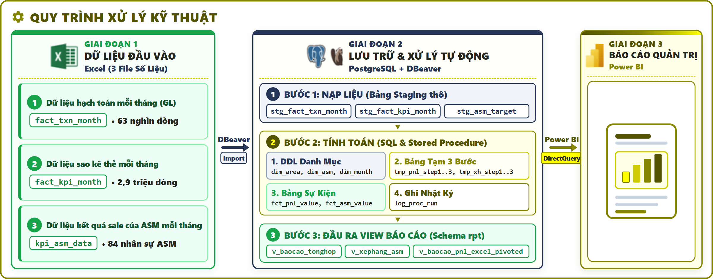

<div align="center">

# Xây dựng hệ thống Báo cáo quản trị lãi lỗ thẻ tín dụng (P&L) & Đánh giá Quản lý vùng (ASM)

**Ngôn ngữ / Language**: **Tiếng Việt** · [English](README_eng.md)

<p>
  
  
  
  
</p>

</div>


---

## 📑 Mục lục

1. [Bối cảnh & Vấn đề trước khi làm hệ thống](#1-bối-cảnh--vấn-đề-trước-khi-làm-hệ-thống)
2. [Quy trình triển khai từng bước](#2-quy-trình-triển-khai-từng-bước)
3. [Các phát hiện chính từ dữ liệu 5 tháng](#3-các-phát-hiện-chính-từ-dữ-liệu-5-tháng)
4. [Kết quả hệ thống đạt được](#4-kết-quả-hệ-thống-đạt-được)
5. [Bài học rút ra & Công cụ sử dụng](#5-bài-học-rút-ra--công-cụ-sử-dụng)

---

## 1. Bối cảnh & Vấn đề trước khi làm hệ thống

### Bối cảnh vận hành

Mảng thẻ tín dụng của ngân hàng vận hành qua **7 vùng kinh doanh** trên toàn quốc, quy mô từ **74 đến 84 Quản lý vùng (ASM)** tùy từng tháng (dữ liệu kỳ **T01 đến T05/2023**). Đội ngũ ASM vừa chịu chỉ tiêu mở mới dư nợ thẻ, vừa phải giữ chất lượng danh mục tín dụng trên địa bàn.

### Vấn đề trước khi có kho dữ liệu và báo cáo chuẩn

Trước khi dựng hệ thống này, số liệu nằm rời rạc ở 3 tệp Excel thô do các bộ phận khác nhau xuất ra hàng tháng. Ban lãnh đạo gặp 5 điểm mù lớn khi đọc báo cáo:

- **Chi phí Hội sở treo một cục, không biết vùng nào lãi thật hay lỗ thật:** Sổ cái ghi nhận **62.953** bút toán gắn mã tỉnh nhưng có **181** bút toán chi phí vốn, vận hành hệ thống và dự phòng chung gán mã Hội sở (`'00'`). Khi chưa phân bổ phần chi chung này, lợi nhuận các vùng đều bị nhìn lệch.
- **Sổ kế toán chỉ ghi số lũy kế đầu năm (YTD):** Khi lợi nhuận tháng 5 tăng hay giảm, người đọc không tách ngay được phần phát sinh riêng của tháng đó đến từ thu lãi thẻ hay từ biến động trích lập dự phòng.
- **Tệp sao kê thẻ 117,2 MB (2.932.922 dòng) vượt ngưỡng xử lý thủ công trên Excel:** Mỗi lần đối chiếu dư nợ nhóm 1 đến 5 hay cộng lại nợ đã xóa ngoại bảng (*write-off*) đều mất nhiều thời gian và dễ sai công thức.
- **Sai lệch tên tỉnh làm rớt hơn 36.000 hợp đồng thẻ khi ghép bảng:** Bảng sao kê thẻ ghi `"Bà Rịa - Vũng Tàu"` trong khi bảng danh mục vùng ghi `"Vũng Tàu"`. Nếu nối trực tiếp không qua bước làm sạch, vùng Đông Nam Bộ bị mất hơn **36.000** hợp đồng, kéo lệch tỷ lệ nợ xấu toàn vùng.
- **Thiếu thước đo chung để đánh giá 74 đến 84 ASM:** Bảng kết quả bán hàng của ASM chỉ có doanh số mở mới, số thẻ có dư nợ và tỷ lệ duyệt hồ sơ. Nếu chỉ xếp hạng theo sức bán cá nhân, những quản lý đẩy hồ sơ ồ ạt ở vùng nợ xấu cao vẫn đứng đầu bảng.

### Yêu cầu của Ban lãnh đạo & Phạm vi công việc

Ban lãnh đạo cần một hệ thống báo cáo quản trị trả lời được hai câu hỏi: **7 vùng đang lãi lỗ thực tế ra sao sau khi gánh đủ chi phí Hội sở?** và **Xếp hạng 74 đến 84 ASM thế nào để cân bằng giữa doanh số cá nhân với rủi ro nợ xấu?**

Khi nhận bài toán, dự án chưa có sẵn tiêu thức phân bổ hay công thức chấm điểm. Toàn bộ luồng từ làm sạch dữ liệu đến dựng báo cáo được triển khai theo 3 mảng:

| Phần việc phụ trách | Nội dung thực hiện |
|---|---|
| **Thiết kế Data Warehouse & ETL (SQL)** | Nạp 3 nguồn Excel thô vào PostgreSQL qua DBeaver, làm sạch tên tỉnh và xoay dọc bảng chỉ tiêu ASM bằng SQL, thiết kế Star Schema (19 bảng, 3 view) và viết 11 stored procedure tự động chạy số liệu 5 tháng. |
| **Xây dựng mô hình P&L & Bảng điểm ASM** | Thiết kế bộ tiêu thức phân bổ (allocation driver) chia 181 bút toán Hội sở về 7 vùng khớp 100% sổ cái (+250,5 tỷ đồng); thiết kế thang điểm 8 chỉ tiêu kết hợp sức bán cá nhân, nợ xấu mở rộng (NPL gồm nợ xóa ngoại bảng) và hiệu quả tài chính vùng. |
| **Trực quan hóa & Phân tích trên Power BI** | Dựng 7 trang báo cáo tương tác (90 DAX measures), bóc tách nguyên nhân biến động lợi nhuận tháng 5 và đề xuất điều chỉnh cơ chế đánh giá cho 19 ASM vùng Đông Nam Bộ. |

### Bộ báo cáo đầu ra trên Power BI

Hệ thống gồm 7 trang báo cáo nối trực tiếp vào PostgreSQL (2 trang tra cứu nền tảng và 5 trang phân tích điều hành):

| Trang báo cáo | Mục tiêu sử dụng | Chỉ số theo dõi chính |
|---|---|---|
| 📖 **Trang 1 & 2: Giới thiệu & Từ điển dữ liệu** | Chuẩn hóa cách đọc số liệu toàn hệ thống | Sơ đồ luồng dữ liệu, định nghĩa và công thức của 68 chỉ tiêu |
| 📑 **Trang 3: Bảng P&L lũy kế 7 vùng** | Đối soát kế toán giữa Hội sở và 7 vùng | 32 dòng chỉ tiêu P&L của Hội sở (Phân bổ), 7 vùng và cột Tổng |
| 📊 **Trang 4: Hiệu quả kinh doanh vùng** | Tìm nguyên nhân tăng giảm lợi nhuận từng tháng | Phát sinh tháng vs Lũy kế, thác nước thu chi, `CIR`, `Margin`, hiệu suất vốn |
| 🏆 **Trang 5: Bảng xếp hạng ASM** | Xếp hạng minh bạch 74 đến 84 ASM hàng tháng | 26 cột thông tin: 4 chỉ số quy mô, 4 chỉ số tài chính vùng, tổng điểm và hạng |
| 🎯 **Trang 6: Đánh giá năng lực ASM** | Phân loại hành vi bán hàng và thẩm định hồ sơ | Biểu đồ Radar Top 3 / Bottom 3, phân nhóm 84 ASM vào 4 nhóm hành động |
| 🧭 **Trang 7: Kết quả kinh doanh doanh nghiệp** | Chốt kế hoạch hành động cho cấp điều hành | Thác nước P&L toàn hàng (+250,5 tỷ), điểm nóng nợ xấu và bảng hành động 7 vùng |

---

## 2. Quy trình triển khai từng bước

### 2.1 Luồng xử lý dữ liệu (Data Workflow)

<div align="center">



</div>

### 2.2 Dữ liệu đầu vào & Làm sạch trong SQL

Ba tệp Excel thô được nạp thẳng vào các bảng staging trong PostgreSQL bằng DBeaver Data Import, sau đó làm sạch hoàn toàn bằng SQL:

| Tệp nguồn | Bảng staging | Số dòng | Nội dung & Bước làm sạch trong SQL |
|---|---|---:|---|
| **1. Dữ liệu hạch toán mỗi tháng (GL)** | `stg_fact_txn_month` | 63.134 | Bút toán thu chi lũy kế. Giữ nguyên dấu âm/dương kế toán; tách **62.953** dòng có mã tỉnh và **181** dòng chi chung Hội sở mã `'00'`. |
| **2. Dữ liệu sao kê thẻ mỗi tháng** | `stg_fact_kpi_month` | 2.932.922 | Dư nợ cuối kỳ, nhóm nợ 1 đến 5, nợ xóa ngoại bảng (117,2 MB). Cắt khoảng trắng mã nhóm nợ và chuẩn hóa tên tỉnh `pos_city_norm` để giữ lại hơn **36.000** hợp đồng thẻ vùng Đông Nam Bộ. |
| **3. Kết quả sale ASM mỗi tháng** | `stg_asm_target` | 420 | Doanh số mở mới (`LTN`), khách có dư nợ (`PSDN`), tỷ lệ duyệt của 84 ASM qua 5 tháng. Xoay dọc (unpivot) từ bảng ngang sang bảng dọc theo `month_key` và khử trùng lặp email ASM. |

*(Đi kèm bảng tham số ánh xạ 64 tỉnh thành vào 8 khu vực `'A'..'H'`, định biên nhân sự `dim_sm_headcount` 35 dòng và danh mục 56 chỉ tiêu `dim_report_detail`).*

### 2.3 Thiết kế kho dữ liệu Star Schema

<div align="center">


</div>

Kho dữ liệu đặt trong schema `banking_project`, gồm **19 bảng vật lý** (3 bảng staging `stg_`, 7 bảng danh mục `dim_`, 6 bảng tạm trung gian `tmp_`, 2 bảng fact `fct_`, 1 bảng log `log_proc_run`) và **3 view báo cáo** (`v_baocao_tonghop`, `v_xephang_asm`, `v_baocao_pnl_excel_pivoted`).

### 2.4 Hệ thống Stored Procedures & Logic tính toán

Toàn bộ dữ liệu 5 tháng (`202301` đến `202305`) được tính toán tự động qua hai lệnh gọi thủ tục:

```sql
CALL banking_project.sp_load_dim();        -- Đồng bộ bảng danh mục vùng, thời gian, 84 ASM và định biên SM
CALL banking_project.sp_run_all_months();  -- Chạy tuần tự 6 thủ tục bước cho luồng P&L và ASM qua 5 tháng
```

| Nhóm thủ tục | Nhiệm vụ xử lý |
|---|---|
| `sp_load_dim` | Dựng dữ liệu cho `dim_month`, `dim_date`, `dim_sm_headcount` và `dim_asm` (84 ASM). |
| `sp_pnl_step1..3` và `sp_baocao_tonghop` | Tính 9 tiêu thức phân bổ từ 2,93 triệu dòng sao kê thẻ, chuẩn hóa tổng tỷ trọng từng chỉ tiêu bằng `1`, gán thẳng bút toán tỉnh (Rule 1) và phân bổ bút toán Hội sở (Rule 2) vào `fct_pnl_value` (1.115 dòng). |
| `sp_xh_step1..3` và `sp_xephang_asm` | Tính bình quân lũy kế 3 chỉ số bán hàng cá nhân, ghép `NPL` mở rộng và 4 tỷ số tài chính vùng, xếp hạng `RANK` từ 1 đến N cho từng chỉ tiêu rồi ghi vào `fct_asm_value` (8.924 dòng). |
| `sp_run_pipeline` và `sp_run_all_months` | Điều phối giao dịch theo từng tháng (mỗi tháng là một transaction trọn vẹn, lỗi ở bước nào tự rollback tháng đó) và ghi nhật ký vào `log_proc_run`. |

**Hai quy tắc xử lý cốt lõi trong SQL:**

1. **Chia chi phí Hội sở (`'00'`) theo đúng bản chất phát sinh chi phí:**
   - *Chi phí vốn, lãi trong hạn, phí tăng hạn mức:* chia theo **Dư nợ bình quân nhóm 1 sau xóa nợ** (vùng nào có danh mục nợ tốt đang sinh lời lớn hơn thì nhận phần tương ứng).
   - *Lãi quá hạn:* chia theo **Dư nợ bình quân nhóm 2**.
   - *Chi phí dự phòng rủi ro, phí trả chậm, thu hồi nợ ngoại bảng:* chia theo **Dư nợ bình quân nhóm 2 đến 5 cộng nợ đã xóa ngoại bảng** (gắn chi phí dự phòng vào đúng vùng phát sinh nợ rủi ro).
   - *Phí bảo hiểm thẻ, chi phí vận hành hệ thống thẻ:* chia theo **Số lượng thẻ có phát sinh dư nợ bình quân (`PSDN`)**.
   - *Chi phí lương và quản lý khối hỗ trợ Hội sở:* chia theo **Định biên Quản lý bán hàng (`Sale Manager Headcount`)** của từng vùng.
   - *Tách số phát sinh từng tháng:* lấy số lũy kế tháng $M$ trừ số lũy kế tháng $M-1$ ($V_{\text{tháng } M} = V_{\text{lũy kế } M} - V_{\text{lũy kế } (M-1)}$).

2. **Chấm điểm ASM kết hợp quy mô cá nhân và sức khỏe tài chính vùng:**
   - **Tỷ lệ nợ xấu mở rộng (`NPL`):** cộng ngược nợ đã xóa ngoại bảng lũy kế vào cả tử số và mẫu số để các vùng đã *write-off* nhiều không làm đẹp được tỷ lệ nợ xấu:
     $$\text{NPL mở rộng} = \frac{\text{Dư nợ nhóm 3–5} + \text{Nợ xóa ngoại bảng lũy kế}}{\text{Tổng dư nợ} + \text{Nợ xóa ngoại bảng lũy kế}} \times 100$$
   - **Điểm quy mô (`diem_qm`):** tổng thứ hạng `RANK` của `Doanh số mở mới BQ`, `Số khách có dư nợ BQ (PSDN)`, `Tỷ lệ duyệt hồ sơ` và `NPL mở rộng vùng`.
   - **Điểm tài chính (`diem_fin`):** tổng thứ hạng `RANK` của `CIR`, `Margin`, `Hiệu suất trên vốn` và `Lợi nhuận BQ trên mỗi SM` (áp chung theo vùng do hợp đồng thẻ chỉ ghi mã chi nhánh, chưa gắn `asm_id`).
   - **Tổng điểm = `diem_qm` + `diem_fin`:** quản lý có Tổng điểm thấp nhất đứng hạng `#1`.

---

### 2.5 Hệ thống Dashboard trên Power BI

#### Trang 3 & Trang 4: Theo dõi P&L lũy kế và Bóc tách hiệu quả kinh doanh vùng

Hai trang này tái hiện cấu trúc báo cáo lãi lỗ 32 chỉ tiêu của mảng thẻ tín dụng, giúp ban lãnh đạo vừa đối soát được số lũy kế với sổ cái kế toán (Trang 3), vừa bóc tách được dòng thu chi phát sinh riêng trong từng tháng (Trang 4).

- **Nhóm thu nhập hoạt động:** Thu lãi trong hạn, thu lãi quá hạn, phí bảo hiểm thẻ, phí tăng hạn mức và thu dịch vụ thẻ khác (riêng tháng 5 đạt **+288.146 triệu đồng**, lũy kế 5 tháng **1.353.898 triệu đồng**).
- **Nhóm chi phí & dự phòng:** Chi phí vốn nội bộ, chi phí hoạt động (`CIR`) và chi phí trích lập dự phòng rủi ro tín dụng.
- **Hiệu quả sinh lời:** Lợi nhuận trước thuế (riêng tháng 5 đạt **+56.798 triệu đồng**, lũy kế **250.450 triệu đồng**), biên lợi nhuận (`Margin`), hiệu suất sinh lời trên vốn và lợi nhuận bình quân mỗi quản lý.

Nhờ tách riêng phát sinh tháng khỏi số lũy kế trên biểu đồ thác nước và thẻ KPI, người đọc nhận ra ngay những tháng lợi nhuận tăng vọt dù thu nhập thẻ đi ngang do chi phí dự phòng ròng giảm mạnh, hoặc những vùng doanh thu lớn nhưng bị dự phòng ăn mòn hết lãi.

#### Trang 5 & Trang 6: Bảng xếp hạng ASM và Phân tích năng lực bán hàng cá nhân

Hai trang này đi sâu vào đội ngũ 74 đến 84 Quản lý vùng để trả lời câu hỏi ai đang bán tốt thực chất và ai đang chạy doanh số bằng cách nới lỏng duyệt hồ sơ.

- **Bảng điểm 26 cột (Trang 5):** Hiển thị đầy đủ giá trị và thứ hạng của từng ASM trên cả 8 chỉ tiêu, từ điểm quy mô bán hàng đến điểm tài chính vùng (quán quân kỳ T02 và tháng 5 là **Hoàng Văn Nam** thuộc Đồng Bằng Sông Hồng với **34** và **36 điểm**).
- **Biểu đồ Radar đối chiếu Top 3 & Bottom 3 (Trang 6):** So sánh 4 trục bán hàng cá nhân (`Doanh số mở thẻ`, `Khách có dư nợ`, `Tỷ lệ duyệt thẻ`, `Hồ sơ được duyệt`) của từng quản lý với mặt bằng chung toàn hàng hoặc từng vùng.
- **Ma trận 4 nhóm hành động cá nhân:** Dựa trên ngưỡng trung bình toàn hàng kỳ tháng 5 (**2.141 triệu đồng** doanh số mở mới và **42,8%** tỷ lệ duyệt), hệ thống chia 84 ASM vào 4 nhóm:
  - *Bán tốt, Duyệt cao (Toàn diện):* **22** ASM
  - *Bán tốt, Duyệt thấp (Chưa chọn lọc hồ sơ đầu vào):* **12** ASM
  - *Bán kém, Duyệt cao (Tiềm năng, cần đẩy quy mô):* **14** ASM
  - *Bán kém, Duyệt thấp (Nguy cơ):* **36** ASM

#### Trang 7: Tổng hợp kết quả doanh nghiệp & Kế hoạch hành động 7 vùng

Trang cuối gom hai luồng P&L và ASM về một màn hình điều hành: đi từ tổng thu nhập thẻ **+1.810,5 tỷ đồng**, trừ các lớp chi phí vốn, bán hàng, vận hành (**-235,1 tỷ đồng**) và dự phòng nợ xấu (**-868,3 tỷ đồng**) về lợi nhuận trước thuế **+250,5 tỷ đồng**, đồng thời vạch rõ lộ trình xử lý cho từng vùng theo 5 mức độ ưu tiên.

---

## 3. Các phát hiện chính từ dữ liệu 5 tháng

### 🔴 Cơ chế cộng điểm tài chính vùng kéo 84% ASM Đông Nam Bộ xuống cuối bảng

Đông Nam Bộ là vùng duy nhất báo lỗ trong 5 tháng đầu năm: riêng tháng 5 lỗ **-8.787,4 triệu đồng**, đẩy lỗ lũy kế lên **-48.763 triệu đồng** (**-48,8 tỷ đồng**, làm hụt **16,3%** tổng lợi nhuận **+299,2 tỷ đồng** của 6 vùng có lãi). Dù thu nhập thuần tháng 5 của vùng tăng **+3.210,7 triệu đồng**, chi phí dự phòng tăng thêm **-3.234,2 triệu đồng** (lũy kế dự phòng **223,7 tỷ đồng**) khiến vùng xếp hạng 7/7 ở cả 4 chỉ tiêu tài chính.

Vì bảng điểm áp chung điểm tài chính vùng cho các quản lý trong địa bàn, toàn bộ 19 ASM Đông Nam Bộ đều bị cộng mức phạt tối đa **26 điểm**:
- **`Trần Văn Hải`** có sức bán cá nhân đứng hạng **#28/84** (`124` điểm quy mô), sau khi cộng 26 điểm vùng bị đẩy xuống **#33** (tụt 5 bậc).
- **`Nguyễn Thị Hằng`** từ hạng bán hàng **#52** (`197` điểm) tụt xuống **#61** (giảm 9 bậc); **`Lê Văn An`** từ **#55** (`200` điểm) tụt xuống **#62** (giảm 7 bậc).
- Tổng cộng **16/19 ASM (84%)** rơi xuống nhóm cuối bảng (`#61` đến `#84`).

**Hành động đề xuất:** Tách riêng 4 chỉ số bán hàng cá nhân (ma trận Trang 6) để xét thưởng thi đua cho 19 ASM Đông Nam Bộ, giao chỉ tiêu thu hồi nợ và xử lý khoản lỗ 48,8 tỷ đồng về cấp Giám đốc vùng.

---

### 🟡 97,2% mức tăng lợi nhuận tháng 5 của Tây Nam Bộ đến từ giảm dự phòng giữa lúc nợ xấu ở đỉnh 21,99%

Lũy kế 5 tháng, Tây Nam Bộ mang về **+167,9 tỷ đồng** lợi nhuận trước thuế (chiếm **67,0%** lãi toàn hàng, hiệu suất vốn **131,7%**). Tuy nhiên khi tách số phát sinh riêng tháng 5, mức tăng **+4.267,8 triệu đồng** lợi nhuận của vùng (chiếm **97,2%** mức tăng toàn hàng) hầu như không đến từ hoạt động kinh doanh cốt lõi: thu nhập thuần chỉ nhích thêm **+16,3 triệu đồng**, chi phí hoạt động làm giảm lợi nhuận **-195,9 triệu đồng**, còn nguồn tăng thực tế đến từ **chi phí dự phòng ròng giảm +4.447,3 triệu đồng**.

Điểm đáng ngại là tỷ lệ nợ xấu mở rộng của Tây Nam Bộ đang cao nhất cả nước (**21,99%** so với mức chung **17,3%**, tổng dự phòng lũy kế **290,4 tỷ đồng**) và vùng không có ASM nào lọt vào Top 25 toàn hàng.

**Hành động đề xuất:** Yêu cầu bộ phận kế toán và rủi ro tách rõ dòng trích lập dự phòng mới và dòng hoàn nhập dự phòng trên sổ cái từ kỳ kế tiếp; kiểm tra chéo hồ sơ tín dụng tại Tây Nam Bộ để kéo nợ xấu từ **22,0%** về ngưỡng trung bình **17,3%**.

---

### 🟠 Chi phí vận hành (`CIR`) và dự phòng ăn mòn biên lợi nhuận tại Bắc Trung Bộ và Tây Bắc Bộ

- **Bắc Trung Bộ** lãi lũy kế **+10,5 tỷ đồng** nhưng tỷ lệ chi phí hoạt động trên thu nhập (`CIR`) lên tới **26,5%**, cao nhất toàn hệ thống (mặt bằng chung là **17,4%**).
- **Tây Bắc Bộ** chỉ giữ được biên lợi nhuận mỏng **2,4%** (lãi lũy kế **+2,7 tỷ đồng**) do `CIR` chiếm **22,0%** và chi phí dự phòng ngốn tới **74,7%** tổng thu nhập.
- **Đông Bắc Bộ** đạt biên lãi **6,7%** (lãi **+13,8 tỷ đồng**), nợ xấu ở mức **18,1%** và dự phòng chiếm **73,2%** thu nhập.

**Hành động đề xuất:** Cắt giảm khoảng **3,5 tỷ đồng** chi phí vận hành tại Bắc Trung Bộ để đưa `CIR` về **17,4%**, đồng thời tiết kiệm **3,8 tỷ đồng** chi phí chi nhánh và siết thẩm định hồ sơ mới tại Tây Bắc Bộ để nâng biên lãi vượt mốc **10%**.

---

### 🟢 Nam Trung Bộ và Đồng Bằng Sông Hồng là hai hình mẫu về kiểm soát rủi ro và mở rộng quy mô

- **Nam Trung Bộ (5 ASM):** Giữ tỷ lệ nợ xấu mở rộng thấp nhất toàn hàng (**11,24%**), tạo ra **+50,0 tỷ đồng** lợi nhuận lũy kế (**50.036 triệu đồng**, đóng góp **20%** lãi toàn hàng) với hiệu suất sinh lời trên vốn đạt **203,5%** (1 đồng chi phí vốn tạo ra hơn 2 đồng lợi nhuận). **4/5 ASM** của vùng nằm trong Top 25 toàn quốc.
- **Đồng Bằng Sông Hồng:** Dẫn đầu quy mô giải ngân mở mới toàn hàng với **55.010 triệu đồng** (**30,6%** tổng doanh số mở mới, gấp **1,5 lần** Tây Nam Bộ) nhưng vẫn giữ tỷ lệ nợ xấu ở mức an toàn **13,9%**.

**Hành động đề xuất:** Đóng gói quy trình sàng lọc hồ sơ trước phát hành và nhắc nợ sớm của Nam Trung Bộ trong 60 ngày để áp dụng sang Tây Nam Bộ và Đông Nam Bộ.

---

## 4. Kết quả hệ thống đạt được

| Hạng mục triển khai | Kết quả đo lường thực tế |
|---|---|
| Quy mô dữ liệu xử lý trong PostgreSQL | **2.932.922** dòng sao kê thẻ (`117,2 MB`) + **63.134** bút toán GL + **420** dòng chỉ tiêu ASM |
| Dữ liệu hợp đồng cứu khỏi rớt `JOIN` | **>36.000** hợp đồng thẻ tại Đông Nam Bộ nhờ chuẩn hóa `pos_city_norm` |
| Độ chính xác đối soát P&L (`fct_pnl_value`) | Khớp **100%** sổ cái kế toán (`T02`: **92.226,35** trđ; `T05`: **250.450,06** trđ / **+250,5 tỷ đồng**) |
| Tự động hóa chấm điểm ASM (`fct_asm_value`) | **8.924** dòng kết quả qua 5 tháng cho **74 đến 84** ASM (`#1` T02 & T05: **Hoàng Văn Nam**, 34 & 36 điểm) |
| Kiểm soát thực thi pipeline (`log_proc_run`) | **208** bản ghi `START`/`OK` qua 11 stored procedure, **0** lỗi `FAIL` |
| Hệ thống báo cáo Power BI | **7** trang dashboard, **90** DAX measures, Từ điển **68** thuật ngữ, bảng P&L **32** chỉ tiêu |

---

## 5. Bài học rút ra & Công cụ sử dụng

### Những gì đúc kết được sau dự án

- **Kiến trúc nghiệp vụ:** Hiểu cách vận hành P&L mảng thẻ tín dụng ngân hàng, cách dùng tiêu thức phân bổ (allocation driver) để chia chi phí Hội sở về địa bàn mà không làm lệch tổng sổ cái, và lý do phải cộng ngược nợ xóa ngoại bảng (*write-off*) khi tính `NPL` thực chất.
- **Kỹ thuật dữ liệu:** Nạp và xử lý bảng sao kê gần 3 triệu dòng trong PostgreSQL, thiết kế Star Schema và thủ tục PL/pgSQL theo cơ chế transaction trọn vẹn từng tháng, kết hợp 90 công thức DAX để làm báo cáo động trên Power BI.

**4 bài học thực tế khi bắt tay vào làm:**
1. **Làm sạch khóa nối trước khi viết công thức phức tạp:** Chỉ một khác biệt chữ `"Bà Rịa - Vũng Tàu"` và `"Vũng Tàu"` giữa hai tệp Excel đã làm bay hơn **36.000** hợp đồng thẻ. Nếu không kiểm tra số dòng rớt sau phép `JOIN`, mọi công thức `NPL` phía sau đều tính trên dữ liệu thiếu.
2. **Số lũy kế (YTD) rất dễ che giấu biến động bất thường của từng tháng:** Nhìn lũy kế 5 tháng, Tây Nam Bộ lãi lớn nhất ngân hàng (**+167,9 tỷ đồng**). Chỉ khi tách riêng số phát sinh tháng 5 ($V_M - V_{M-1}$) mới thấy **97,2%** mức tăng lãi kỳ đó đến từ giảm dự phòng chứ không phải từ thu nhập thẻ tăng.
3. **Độ hạt dữ liệu (granularity) quyết định ranh giới thưởng phạt:** Vì hợp đồng thẻ trên sao kê chỉ gắn mã chi nhánh mà không gắn mã `asm_id`, việc gán chỉ số tài chính vùng vào bảng điểm cá nhân chỉ hợp lý để xem bức tranh chung. Khi dùng để xét thưởng, phải tách riêng 4 chỉ số bán hàng cá nhân để không phạt oan **84%** quản lý ở vùng đang lỗ dự phòng như Đông Nam Bộ.
4. **Không đặt lệnh `COMMIT` bên trong các thủ tục bước con:** Trong PostgreSQL, nếu một thủ tục con lỡ `COMMIT` giữa chừng và bước sau bị lỗi, dữ liệu kỳ đó sẽ rơi vào trạng thái nửa ghi nửa hủy. Mọi thao tác xóa và ghi của một kỳ phải gói gọn trong thủ tục điều phối ngoài cùng.

---

### Công cụ & Cấu trúc thư mục

| Lớp xử lý | Công cụ & Thành phần |
|---|---|
| Dữ liệu nguồn & Nạp staging | Microsoft Excel (3 tệp nguồn + bảng tham số), DBeaver 24 (Data Import 117,2 MB, ER Diagram 9 khóa ngoại ảo) |
| Kho dữ liệu & Xử lý ETL | PostgreSQL 16 (Star Schema 19 bảng, 3 view, 11 PL/pgSQL Stored Procedures) |
| Báo cáo & Trực quan hóa | Power BI Desktop (7 trang báo cáo, 90 công thức DAX, định dạng bảng P&L phân tầng) |

```text
.
├── sql/                # Mã SQL dựng bảng, bảng tạm, thủ tục tính toán và view báo cáo
│   ├── dim/            # Bảng staging và bảng danh mục: init_staging_tables, dim_area, dim_month_headcount, dim_asm, dim_report_detail
│   ├── tmp/            # Bảng tạm và 6 thủ tục tính trung gian cho Lãi lỗ và Xếp hạng ASM
│   ├── fct/            # Bảng kết quả chính và thủ tục chạy toàn luồng: fct_pnl_allocation, fct_xephang_asm, sp_pipeline
│   └── rpt/            # 3 view đầu ra sạch cho Power BI: rpt_pnl_view, rpt_xephang_view, rpt_pnl_excel_pivoted_view
├── images/             # Ảnh sơ đồ quy trình 3 giai đoạn và sơ đồ kho dữ liệu Star Schema
├── docs/               # Tài liệu vận hành: HIEN_TRANG_HE_THONG, PIPELINE, NHAT_KY_CONG_VIEC, LOI_THUONG_GAP (62 vấn đề xử lý)
├── output/             # Báo cáo quản trị trên Power BI (.pbix)
├── README.md           # Tài liệu dự án bằng tiếng Việt
└── README_eng.md       # Tài liệu dự án bằng tiếng Anh
```

Tài liệu kỹ thuật chi tiết trong `docs/`: [`docs/HIEN_TRANG_HE_THONG.md`](docs/HIEN_TRANG_HE_THONG.md) · [`docs/PIPELINE.md`](docs/PIPELINE.md) · [`docs/NHAT_KY_CONG_VIEC.md`](docs/NHAT_KY_CONG_VIEC.md) · [`docs/LOI_THUONG_GAP.md`](docs/LOI_THUONG_GAP.md).

---

<div align="center">

**Trần Ngọc Đức** · [Email](mailto:tranduc22104@gmail.com) · [LinkedIn](https://www.linkedin.com/in/tr%E1%BA%A7n-ng%E1%BB%8Dc-%C4%91%E1%BB%A9c-48b3a7439/)

</div>
