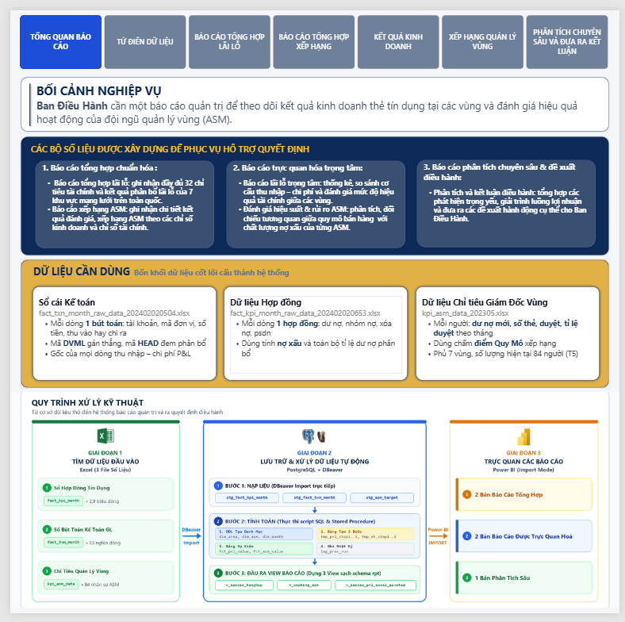
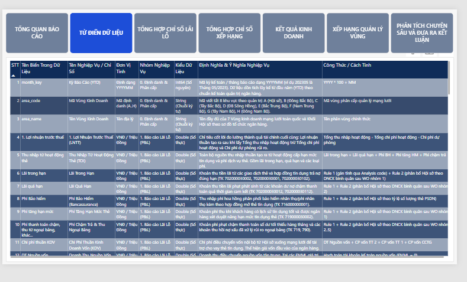
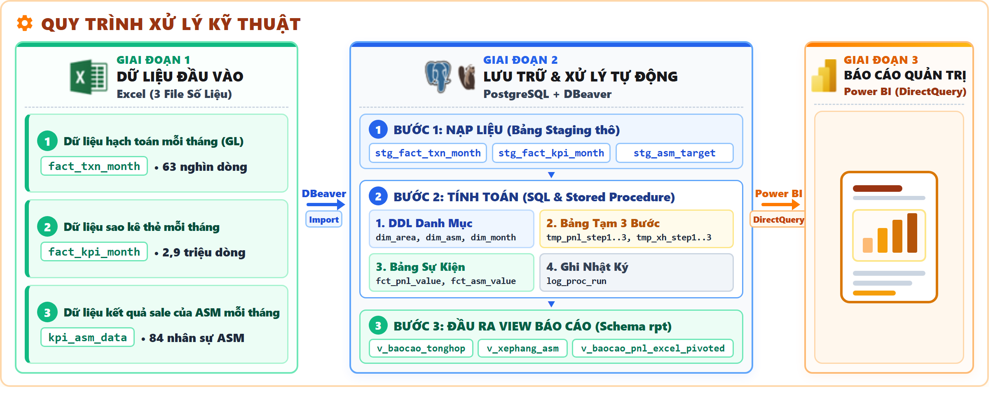
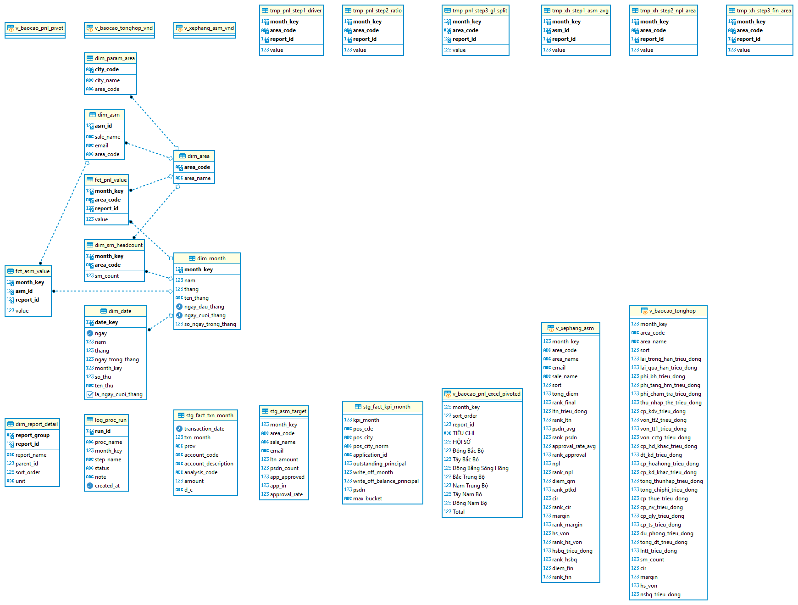
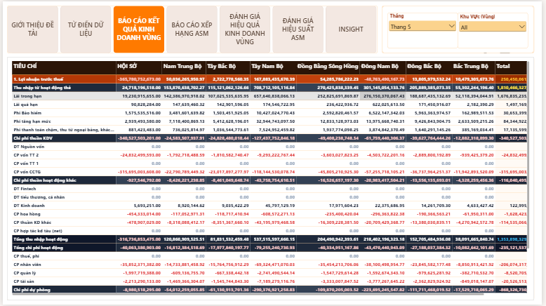
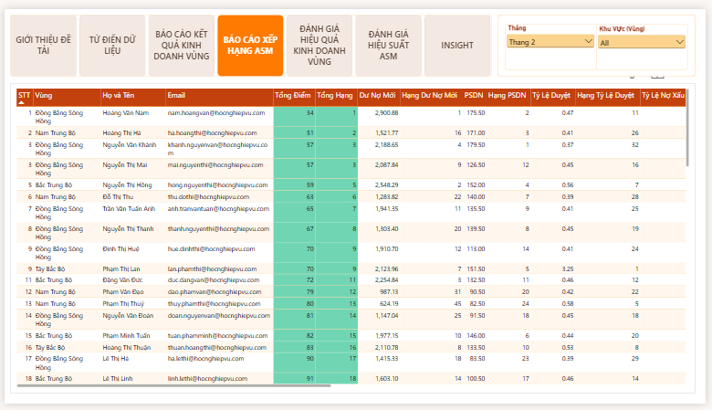
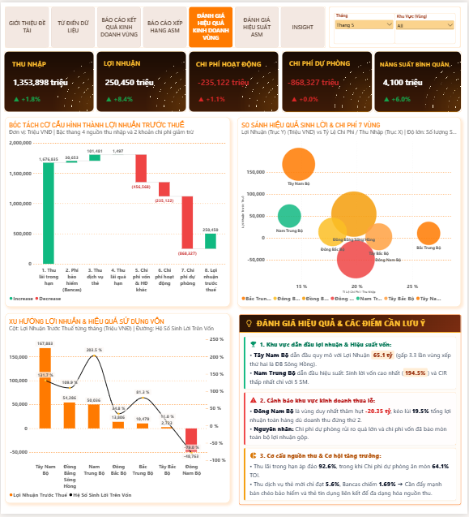
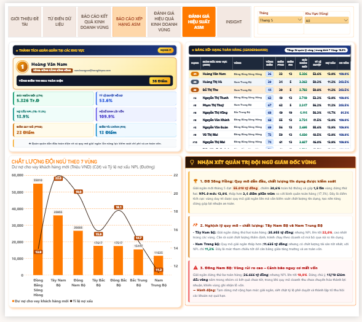
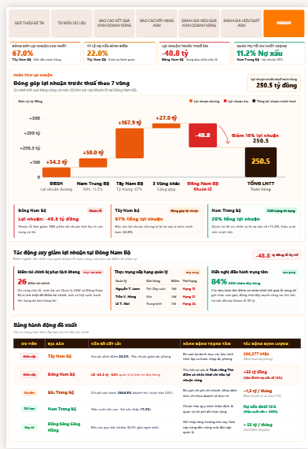

<div align="center">

# Building Credit Card Business Management Reporting And Ranking Regional Sales Management Performance

**Ngôn ngữ / Language**: [Tiếng Việt](README.md) · **English**

<p>
  
  
  
  
</p>

</div>

## 📑 Table Of Contents

1. [🏢 Business Context And Executive Requirements](#1--business-context-and-executive-requirements)
2. [🎯 Requirement Analysis And Report Output Design](#2--requirement-analysis-and-report-output-design)
3. [🔍 Data Discovery And Assessment](#3--data-discovery-and-assessment)
4. [🧮 Business Logic And Metric Design](#4--business-logic-and-metric-design)
5. [🔄 Data Engineering And Warehouse Architecture](#5--data-engineering-and-warehouse-architecture)
6. [🧪 Data Validation And Quality Assurance](#6--data-validation-and-quality-assurance)
7. [📊 Business Insights And Management Recommendations](#7--business-insights-and-management-recommendations)
8. [📚 Key Takeaways](#8--key-takeaways)
9. [🛠️ Tools Used](#9--tools-used)
10. [📂 Project Repository Structure](#10--project-repository-structure)
11. [📖 Reference Documentation](#11--reference-documentation)
12. [👤 Author](#12--author)

---

## 1. 🏢 Business Context And Executive Requirements

### Credit card operational background
Credit card operations are organized across **7 business regions** nationwide. Each region is managed by Area Sales Managers (ASMs). The total number of ASMs ranges from **74 to 84 personnel**, depending on the period.

### Initial Broad Mandate From Executive Leadership
On the opening **`GIỚI THIỆU ĐỀ TÀI`** (Project Overview) page of the reporting system, the problem originates from the general mandate of Executive Leadership:
> *"**Executive Leadership** requested several **management reports** to monitor credit card business performance across regions and **evaluate the operational effectiveness** of the **Area Sales Management (ASM)** team"*

Upon reception, the request remained a high-level directive without pre-existing calculation formulas, KPI scorecards, or sample benchmark datasets, leaving the following areas undefined:
- No established method to determine actual regional profitability.
- No principles for allocating centralized expenses booked at Head Office.
- No defined indicator set measuring business performance and credit risk.
- No evaluation criteria for Area Sales Manager operational effectiveness.
- No scoring formulas, ranking mechanisms, or report template structures.

### Identified ambiguities and business management challenges
Reviewing the existing reporting approach revealed three core management issues:

1. **Financial profitability was not fully reflected:**
   In general accounting ledgers, revenue from loan interest and card issuance fees is recorded at branches. Meanwhile, many expenses such as funding costs, marketing, technology, and support department costs are booked centrally at Head Office. Without allocating these costs to the regions, reports can show all 7 regions as profitable, making it harder to identify underperforming regions.

2. **Sales manager evaluation carried latent credit risk:**
   If evaluated solely on disbursement volume or new card counts, managers may relax approval criteria to meet short-term targets. While this can drive rapid short-term growth, it increases non-performing loans (NPL) and provision expenses in subsequent periods.

3. **Limitations of current accounting reports:**
   Current reports mainly display year-to-date (YTD) cumulative figures without separating monthly flows, making it difficult to determine whether profit growth comes from core business operations or fluctuations in provision expenses.

From this context, 5 core management questions were defined:

| Management Issue | Question To Resolve | Management Objective To Achieve |
|---|---|---|
| **Commercial Performance** | Which regions are genuinely profitable after absorbing shared costs? | Accurately determine 7-region P&L after Head Office allocation |
| **Profit Variance** | What drives monthly profit increases and decreases? | Analyze the revenue and expense components forming profit |
| **Credit Quality** | Which regions face high NPL risk threatening capital safety? | Monitor credit balances across 5 debt buckets and regional NPL ratios |
| **Managerial Performance** | Which ASMs achieve strong sales results alongside sound risk control? | Build a multi-dimensional ranking system for 74 - 84 personnel |
| **Executive Governance** | How should information be tracked for lookup, reconciliation, and timely decisions? | Build an interactive management reporting and visual dashboard suite in Power BI |

---

## 2. 🎯 Requirement Analysis And Report Output Design

### Clarifying business requirements and defining target outputs
From the initial mandate, it was necessary to clarify what information Executive Leadership needed to monitor regarding regional business results and ASM team effectiveness. The reporting system was designed using an *Output-First* approach, followed by surveying actual source data to construct a calculation pipeline satisfying both detailed figure lookup/reconciliation and visual chart analysis.

<div align="center">



</div>

### Output Structure: 4 Dashboards Required To Solve Executive Leadership's Problem

Directly on the **`GIỚI THIỆU ĐỀ TÀI`** page, the output solution is structured into **4 Core Dashboards** (corresponding to Pages 3 through 6 in Power BI), each fulfilling a distinct governance objective under the *"What it contains – What it is used for"* framework:

| Code | Output Dashboard Name On Overview Page | Corresponding Power BI Tab | Contained Content & Governance Purpose (What It Contains – What It Is Used For) |
|:---:|---|---|---|
| **01** | **BÁO CÁO KẾT QUẢ KINH DOANH** *(Business Results Report)* | Page 3: `BÁO CÁO KẾT QUẢ KINH DOANH VÙNG` | **Contains 32 financial indicators** to look up and reconcile figures across **7 regions** (alongside Head Office and bank-wide Total columns). |
| **02** | **BÁO CÁO XẾP HẠNG ASM** *(ASM Ranking Report)* | Page 4: `BÁO CÁO XẾP HẠNG ASM` | **Summarizes the ASM ranking scorecard** (for 74 – 84 personnel) to reward top-performing individuals and coach underperformers. |
| **03** | **ĐÁNH GIÁ HIỆU QUẢ KINH DOANH VÙNG** *(Regional Business Performance Evaluation)* | Page 5: `ĐÁNH GIÁ HIỆU QUẢ KINH DOANH VÙNG` | **Visualizes the revenue – cost – provision structure** to compare profitability, operating costs, and capital efficiency across **7 regions**. |
| **04** | **ĐÁNH GIÁ HIỆU SUẤT ASM** *(ASM Performance Evaluation)* | Page 6: `ĐÁNH GIÁ HIỆU SUẤT ASM` | **Charts the correlation between sales volume and non-performing loans (NPL)** to identify ASMs trading credit risk for disbursement scale. |

### Requirement clarification matrix and detailed 7-page Power BI design:

To ensure the 4 Core Dashboards operate transparently with formula referenceability and quantitative executive recommendations, the complete Power BI solution is delivered as an integrated **7-page reporting suite**:

| Initial Request | Content To Clarify | Business Analysis Finding | Designed Product In Power BI (7 Pages) |
|---|---|---|---|
| **Frame the problem & standardize terminology** | Readers need to quickly grasp business context, source data, processing pipeline, and metric formulas | Requires a project overview page and a data dictionary explaining definitions and calculation formulas | • **Page 1 (`GIỚI THIỆU ĐỀ TÀI`)**: Summarizes Business Context, 4 Output Dashboards, 3 Source Datasets, and Technical Pipeline<br>• **Page 2 (`TỪ ĐIỂN DỮ LIỆU`)**: Standardizes **68 indicators** across 5 domain groups with formulas |
| **Look up & reconcile regional business results** | Does regional P&L include Head Office costs? How to look up and reconcile itemized revenues and expenses? | Must fully allocate indirect costs (funding, OPEX, provisions) across 7 regions and present a hierarchical matrix | • **Page 3 (`BÁO CÁO KẾT QUẢ KINH DOANH VÙNG` – Dashboard 01)**: Matrix table of **32 financial indicators** across `HỘI SỞ`, 7 regions, and `Total`, powered by **21 automated background & font color formatting measures** |
| **Look up scorecards & rank ASM personnel** | Which indicators evaluate ASMs to encourage sales growth while controlling territorial credit risk? | Combine 4 Commercial Scale indicators (`diem_qm`) and 4 Territorial Financial Efficiency indicators (`diem_fin`) | • **Page 4 (`BÁO CÁO XẾP HẠNG ASM` – Dashboard 02)**: Detailed scorecard for **74 – 84 ASMs** (Total Score, Total Rank, actual values, and component ranks) for rewarding and coaching |
| **Visually analyze profitability across 7 regions** | How is profit formed? Which regions generate high returns, and which incur high costs or operating losses? | Decompose revenue – cost – provision steps, comparing profit against CIR and return on capital across 7 regions | • **Page 5 (`ĐÁNH GIÁ HIỆU QUẢ KINH DOANH VÙNG` – Dashboard 03)**: Features **5 KPI cards**, an **8-step** PBT Waterfall chart, a **Profit vs CIR** bubble chart, a **Profit & Capital Efficiency** combo chart, and an **Evaluation summary** |
| **Visually analyze ASM team performance & risk** | Which regions and individuals grow sales sustainably, and where is volume pursued alongside high NPL? | Highlight the overall Champion while plotting new loan disbursement volume against NPL ratios across regions | • **Page 6 (`ĐÁNH GIÁ HIỆU SUẤT ASM` – Dashboard 04)**: **Rank #1 Champion** profile card, nationwide **Leaderboard**, **New Loans (Column) & NPL Ratio (Line)** combo chart across 7 regions, and **Team Governance Commentary** |
| **Synthesize deep insights & drive executive actions** | What are the root causes of regional losses or rank drops? What are the prioritized actions and financial impacts? | Connect macro 7-region profit flows with micro ASM scoring mechanics to propose prioritized quantitative actions | • **Page 7 (`INSIGHT`)**: Synthesizes **4 executive KPI cards**, 7-region PBT contribution waterfall, analysis of the **−48.8 billion** loss and **+26-point** penalty in the Southeast (pushing **84% of ASMs** to the bottom group), and **Action Matrix** |

### Logical transformation from management requirements to the Power BI reporting system:

| Transformation Stage | Track 1: Regional Business Performance (P&L) | Track 2: Area Sales Management Evaluation (ASM) |
|---|---|---|
| **1. Initial Broad Executive Mandate** | Monitor credit card business performance across 7 regions | Evaluate operational effectiveness of the Area Sales Management (ASM) team |
| **2. Information Groups Required In Reports** *(Domain analysis & requirement refinement)* | • Card operating income, net treasury funding cost, operating expense, provision expense<br>• Head Office cost allocation by economic drivers<br>• CIR ratio, profit margin (Margin), return on capital, and average productivity/SM | • **Individual sales scale metrics**: New loan disbursement, active cards with balance (PSDN), application approval rate<br>• **Territorial financial & risk responsibility metrics**: Extended NPL ratio, regional CIR, Margin, Capital Efficiency, average PBT/SM |
| **3. Output Management Reporting System** *(Designed across 7 Power BI pages)* | • **Page 1 (`GIỚI THIỆU ĐỀ TÀI`)**: Overview of context, outputs, inputs & pipeline<br>• **Page 2 (`TỪ ĐIỂN DỮ LIỆU`)**: Standardizes 68 business indicators<br>• **Page 3 (`BÁO CÁO KẾT QUẢ KINH DOANH VÙNG`)**: Lookup & reconciliation matrix of 32 P&L metrics<br>• **Page 5 (`ĐÁNH GIÁ HIỆU QUẢ KINH DOANH VÙNG`)**: Visualizes revenue – cost – provision across 7 regions | • **Page 4 (`BÁO CÁO XẾP HẠNG ASM`)**: Comprehensive score & rank table for 84 ASMs<br>• **Page 6 (`ĐÁNH GIÁ HIỆU SUẤT ASM`)**: Visualizes sales volume vs NPL correlation, Top 1 Champion & Leaderboard<br>• **Page 7 (`INSIGHT`)**: Deep-dive analysis of profit flows, regional penalty mechanics, and executive action matrix |

### Roles of the two indicator groups:
- **Regional Business Performance Indicators (32 P&L metrics, Regional NPL, CIR, Margin, Return on Capital):** Accurately reflect the financial health of each region after absorbing allocated Head Office costs, providing Executive Leadership with a solid basis for capital allocation, target setting, and expense cap control.
- **Area Sales Management Evaluation Indicators (8 ASM ranking metrics across Scale & Financial pillars):** Combine individual customer acquisition results with territorial credit quality and profitability to foster sustainable competition, preventing relaxed underwriting in pursuit of short-term volume.

---

## 3. 🔍 Data Discovery And Assessment

### Required Source Data To Collect (Structured Per Power BI Overview Page)
The bank lacked a single pre-aggregated table capable of immediately feeding the 4 Output Dashboards. Based on the **`DỮ LIỆU ĐẦU VÀO CẦN THU THẬP`** (Required Source Data To Collect) block on the **`GIỚI THIỆU ĐỀ TÀI`** page, the project collected **3 raw source datasets (3 Excel Data Files)** from operational divisions, structured clearly under **`CHỨA`** (Contains) and **`DÙNG ĐỂ`** (Used To):

| No. | Source Dataset Name (In Power BI) | Target Table & Volume | **CHỨA / CONTAINS** (Stored Data Content) | **DÙNG ĐỂ / USED TO** (Analytical Purpose In Model) |
|:---:|---|---|---|---|
| **1** | **Dữ liệu hạch toán mỗi tháng (GL)** *(Monthly General Ledger)* | `fact_txn_month`<br>(**63,134** entries / 63 thousand rows) | **Revenue and expense entries incurred across 7 regions & Head Office** (comprising **62,953** province-tagged rows assigned directly to regions and **181** shared overhead rows booked at Head Office under province code `'00'`). Join keys: `city_code`, `account_code`. | **Calculate revenues, expenses, and compile the 7-region P&L report** (direct aggregation via Rule 1 and indirect Head Office allocation via Rule 2). |
| **2** | **Dữ liệu sao kê thẻ mỗi tháng** *(Monthly Card Statements)* | `fact_kpi_month`<br>(**2,932,922** rows / 2.9 million rows, **117.2 MB**) | **Card statements of balances, debt buckets, and card statuses** (recording balances across 5 debt buckets, written-off accounts, and active balance statuses for each card contract across 5 months). Join keys: `branch_code`, `month_key`. | **Calculate Head Office allocation ratios and measure non-performing loans (NPL)** (construct economic cost drivers to allocate Head Office expenses and compute extended NPL across 7 regions). |
| **3** | **Dữ liệu kết quả sale của ASM mỗi tháng** *(Monthly ASM Sales Results)* | `kpi_asm_data`<br>(**420** rows for **84** ASM personnel across 5 months) | **Sales performance figures of 84 ASMs** (new loan disbursement volume, average active cards with balance PSDN, and application approval rates for 74 to 84 active regional managers per month). Join keys: `asm_id`, `month_key`. | **Calculate scale scores used for ASM ranking** (score and rank the Commercial Scale pillar `diem_qm`, combined with the Financial pillar `diem_fin` for final ranking). |

*(In addition to the 3 transactional Excel files above, the system utilizes a parameter table mapping **64** provinces into **8** management zones comprising Head Office `'A'` and 7 commercial regions `'B'..'H'`, alongside a catalog of **55** reporting metrics in `dim_report_detail` and a **68**-metric dictionary in `Data Glossary`).*

### Data feasibility and granularity assessment:

| Target Dashboard | Required Information | Fulfilling Source Dataset | Feasibility And Granularity Assessment |
|---|---|---|---|
| **01. Business Results Report** & **03. Regional Business Performance Evaluation** | Itemized revenue/expense, province codes, GL accounts, Head Office allocation drivers | `1. Dữ liệu hạch toán mỗi tháng (GL)` & `2. Dữ liệu sao kê thẻ mỗi tháng` | **Fully Feasible**: 62,953 GL rows contain province codes for direct assignment; 181 Head Office rows (code `'00'`) are accurately allocated across 7 regions using balance and active card drivers derived from 2,932,922 statement rows |
| **Regional NPL Measurement & Credit Risk Control** | Credit balances across 5 debt buckets, cumulative write-offs by branch and region | `2. Dữ liệu sao kê thẻ mỗi tháng` (`fact_kpi_month`) | **Feasible at regional level**: Branch-tagged contract records aggregate accurately into debt buckets 1..5 and write-offs across 7 regions over 5 months |
| **02. ASM Ranking Report** & **04. ASM Performance Evaluation** (Scale Pillar) | New loan disbursement, active PSDN cards, application approval rate per ASM | `3. Dữ liệu kết quả sale của ASM mỗi tháng` (`kpi_asm_data`) | **Feasible at individual level**: Complete monthly records for 74 to 84 regional managers enable direct individual ranking |
| **NPL & Financial Efficiency in ASM Scorecard** (Financial & Risk Pillar) | Extended NPL ratio, CIR, Margin, Capital Efficiency, average PBT per ASM | Combined regional outputs from `fact_txn_month` and `fact_kpi_month` | **Applied at regional level to ASMs in the same territory**: Because card contracts do not carry ASM employee IDs, delinquency and financial metrics are calculated regionally and assigned uniformly to ASMs within that region to enforce territorial stewardship |

### Three key challenges in raw source data:
1. **Monthly card statement data exceeded standard spreadsheet processing limits:** Comprising **2,932,922 rows** and weighing **117.2 MB**, the dataset exceeded smooth handling capacities of conventional spreadsheet tools and required ingestion into PostgreSQL.
2. **Monthly ASM sales results were structured in wide format (Wide):** Monthly indicators from January through May were arranged horizontally across columns, requiring unpivoting into a vertical relational structure (Tall format).
3. **Inconsistent province naming across sources:** Province names differed between card statements and regional parameter tables (e.g., statements recorded `"Bà Rịa - Vũng Tàu"` while parameter tables recorded `"Vũng Tàu"`). Joining directly without string normalization (`pos_city_norm`) would drop over **36,000 card contracts**, severely distorting Southeast regional NPL calculations.

---

## 4. 🧮 Business Logic And Metric Design

**Business Context:** Executive Leadership provided a high-level governance mandate without pre-existing calculation formulas, KPI scorecards, or sample benchmark figures. Consequently, the entire P&L cost allocation methodology and ASM ranking scorecard were constructed from cash-flow analysis and banking management accounting principles.

<div align="center">



</div>

### 4.1. Revenue And Cost Allocation Logic (Compiling the 7-Region P&L Report)

Core analytical question: *How can actual regional operating performance be determined when major revenue and expense items are booked centrally at Head Office?*

The methodology is implemented across 9 management accounting steps:
1. Analyze all 63,134 journal entries in **Monthly General Ledger (GL)**.
2. Identify revenue and expense entries carrying specific province or branch codes for direct assignment.
3. Classify centralized expenses booked at Head Office (province code `'00'`, region `'A'`).
4. Examine the economic nature and underlying cause of each expense line.
5. Define allocation drivers (*Cost Drivers*) reflecting actual regional resource consumption.
6. Verify the calculability of these drivers from **Monthly Card Statements** and headcount tables.
7. Select monthly proportional indirect allocation methods.
8. Formulate mathematical expressions and automate execution via PostgreSQL Stored Procedures.
9. Verify economic reasonableness and 100% conservation of aggregate general ledger balances post-allocation.

**Two Core Cost Allocation Rules:**
- **Rule 1 – Direct Assignment (Rule 1):** 62,953 branch-level entries are assigned directly to the commercial region managing that province, encompassing revenues (performing interest, overdue interest, insurance fees, credit limit increase fees, late payment fees) and direct regional expenses.
- **Rule 2 – Driver-Based Indirect Allocation (Rule 2):** 181 centralized Head Office entries are allocated across the 7 regions according to each region's share of the corresponding economic driver:

$$\text{Allocation Ratio for Region } i = \frac{\text{Driver Value for Region } i}{\sum_{k=1}^7 \text{Driver Value for Region } k}$$

$$\text{Allocated Expense to Region } i = \text{Head Office Expense} \times \text{Allocation Ratio for Region } i$$

*Rationale for selecting Head Office allocation drivers (documented in the `Công Thức / Cách Tính` column on the `TỪ ĐIỂN DỮ LIỆU` page):*
- **Treasury Funding Costs & Performing Interest / Limit Increase Fees allocated from Head Office:** Internal fund transfer costs from Head Office to finance credit card lending scale with performing credit volume $\rightarrow$ Allocated by **Average Ending Post-Write-Off Balance in Bucket 1**. Regions holding larger average Bucket 1 balances absorb a proportionally larger share.
- **Overdue Interest allocated from Head Office:** Generated from early-stage delinquent balances $\rightarrow$ Allocated by **Average Ending Post-Write-Off Balance in Bucket 2**.
- **Credit Risk Provision Expenses & Late Payment / Off-Balance Recovery Fees:** Allowances set aside to cover expected credit losses $\rightarrow$ Allocated by **Average Balance in Buckets 2 to 5 plus Off-Balance-Sheet Write-Offs** (`d25_sau` or `dtruoc`). This driver captures regional delinquent exposure when the General Ledger (GL) records provisions centrally at Head Office.
- **Insurance Fees (Bancassurance), Card Technology, and Operations Expenses:** Insurance commission revenues tied to card contracts and core card system maintenance costs $\rightarrow$ Allocated by **Average Active Cards With Balance** (`psdn`), representing the active card portfolio scale in each region.
- **Personnel, Administration, and Asset Expenses of Head Office Support Divisions:** Salaries, bonuses, and operating costs of central support departments serving the network $\rightarrow$ Allocated by regional **Sales Manager Headcount**.
- *Assumptions and Limitations:* The method assumes linear allocation relationships and uniform unit costs per driver across regions; localized marketing campaign costs are not isolated separately.

*Converting Cumulative (YTD) Figures to Monthly Flows:*
Year-to-date accounting balances are separated into discrete monthly flows for variance analysis:
$$V_{\text{Month } M} = V_{\text{Cumulative } M} - V_{\text{Cumulative } (M-1)}$$

### 4.2. Designing Area Sales Management Operational Evaluation Metrics (ASM)

Core analytical question: *If Area Sales Managers (ASMs) are evaluated solely on disbursement volume or new card issuance, does the result accurately reflect profitability and credit risk control?*

**Scorecard combining individual sales achievement with territorial financial & risk stewardship:**
Combining **Monthly ASM Sales Results** with regional P&L and delinquency outcomes, the evaluation system establishes **8 indicators** divided equally across **2 pillars** (4 indicators per pillar). Each indicator contributes an independent rank from 1 to $N$:
- **Pillar 1: Commercial Results and Quality Growth Control (`diem_qm` – Scale / PTKD Score):** Comprises **3 individual sales indicators** (`Average New Loan Disbursement`, `Average Active Cards With Balance – PSDN`, `Application Approval Rate`) sourced from *Monthly ASM Sales Results*, paired with **1 territorial credit quality indicator** (`Extended Credit Risk Ratio – Regional NPL`) sourced from *Monthly Card Statements*. Notably, a **higher application approval rate is not necessarily better**: a high approval rate may reflect strong customer sourcing or relaxed underwriting standards. Placing approval rate in the same pillar as regional NPL balances scale expansion against credit risk screening.
- **Pillar 2: Territorial Financial Efficiency (`diem_fin` – Financial / FIN Score):** Comprises **4 regional indicators** derived from the post-allocation P&L report (`Cost-to-Income Ratio – CIR`, `Profit Margin – Margin`, `Return on Capital`, `Average Profit Before Tax per SM`). Because card contracts in statements carry branch codes rather than individual ASM IDs, incorporating 4 regional financial metrics links individual evaluation with collective territorial profitability.

**Calculating the Extended Credit Risk Ratio (including off-balance-sheet write-offs):**
In the SQL Stored Procedure (`report_id = 204`), the extended NPL metric is calculated as:

$$\text{Extended Credit Risk Ratio} = \frac{\text{Bucket 3–5 Balances} + \text{Cumulative Write-offs}}{\text{Total Balances} + \text{Cumulative Write-offs}} \times 100$$

Unlike standard on-balance-sheet NPL (which divides Bucket 3–5 balances by on-balance-sheet total loans), this is a **project-designed management indicator** that accumulates written-off bad debts removed from the balance sheet (*cumulative write-offs* from year-start). This prevents artificial drops in reported NPL following off-balance-sheet write-off accounting entries. *Operational Limitation:* Because the metric includes cumulative historical write-offs, regions with older card portfolios may carry larger accumulated write-off balances than newly expanded territories.

| Pillar 1: Commercial Results & Quality Growth Control (`diem_qm`) | Pillar 2: Territorial Financial Efficiency (`diem_fin`) |
|---|---|
| • **Average new loan disbursement (`ltn_avg`)** *(Higher is better)*<br>• **Average active cards with balance (`psdn_avg`)** *(Higher is better)*<br>• **Average application approval rate (`approval_rate_avg`)** *(Evaluated alongside credit risk)*<br>• **Extended Credit Risk Ratio (`npl_truoc_wo_luy_ke`)** *(Lower is better — includes off-balance-sheet write-offs)* | • **Cost-to-Income Ratio – `CIR`** *(Lower is better)*<br>• **Profit Margin – `Margin`** *(Higher is better)*<br>• **Capital efficiency coefficient (`hs_von`)** *(Higher is better)*<br>• **Average Profit / Manager (`hs_nhan_su`)** *(Higher is better — links governance responsibility to territory)* |

**Detailed Matrix of 8 Area Sales Manager Evaluation Indicators (ASM):**

| Indicator | Reflected Dimension | Indicator Meaning | Input Data Source | Evaluation Direction | Data Level | Limitation To Note |
|---|---|---|---|---|---|---|
| **New Loan Disbursement** | Direct sales execution | Measures new customer lending scale | `3. Monthly ASM Sales Results` | Higher is better | Individual ASM | Does not account for post-issuance card cancellation |
| **Active Cards With Balance (PSDN)** | Actual card utilization | Measures cards generating balances in the period | `3. Monthly ASM Sales Results` | Higher is better | Individual ASM | Must consider card activation and retention costs |
| **Application Approval Rate** | Application screening outcome | Measures proportion of approved applications | `3. Monthly ASM Sales Results` | View alongside NPL | Individual ASM | Excessively high rates may indicate relaxed underwriting |
| **Extended NPL Ratio (NPL)** | Credit risk control | Reflects true territorial credit quality | `2. Monthly Card Statements` | Lower is better | Regional level | Card contracts lack ASM IDs, so calculated regionally |
| **Regional CIR Ratio** | Cost control efficiency | Ratio of total operating expense to total income | `1. Monthly General Ledger (GL)` | Lower is better | Regional level | Depends on Head Office cost allocation drivers |
| **Profit Margin (Margin)** | Income profitability | Measures net profit margin on card revenue | `1. Monthly General Ledger (GL)` | Higher is better | Regional level | Sensitive to internal fund transfer pricing changes |
| **Capital Efficiency Ratio** | Return on capital | Profit generated per unit of net funding cost | `1. GL Data` & `2. Card Statements` | Higher is better | Regional level | Reflects aggregate regional capital utilization |
| **Average Profit/SM** | Average financial productivity | Pre-tax profit per Sales Manager headcount | `1. GL Data` & SM Headcount | Higher is better | Regional level | Averaged across allocated regional SM headcount |

*Score aggregation across indicators with different measurement units:*
Because the 8 indicators have different units (million VND, card counts, percentages), the system applies **independent percentile ranking for each indicator**:
- Each indicator is ranked from 1 to $N$ bank-wide (rank 1 represents the best performance).
- For "lower is better" indicators (extended NPL ratio, CIR ratio), the sorting order is reversed so the lowest value achieves rank 1.
- The composite score equals the sum of rank scores from both pillars:
$$\text{Total Score} = \text{Scale Score } (diem\_qm) + \text{Financial Score } (diem\_fin)$$
- An Area Sales Manager with a **lower Total Score achieves a higher final Total Rank on the nationwide leaderboard** (Rank #1 is the manager with the lowest Total Score).

---

## 5. 🔄 Data Engineering And Warehouse Architecture

Matching the **`QUY TRÌNH XỬ LÝ KỸ THUẬT`** (Technical Processing Pipeline) diagram on the **`GIỚI THIỆU ĐỀ TÀI`** page, the data flow from the 3 input Excel files to the Power BI reporting system is structured into **3 stages**:

<div align="center">



</div>

### Detailed 3 stages of the technical processing pipeline:

- **Stage 1 – Input Data (`Excel – 3 File Số Liệu` / 3 Data Files):**
  Collected and prepared 3 source data files from business divisions in the exact sequence displayed on the Overview page:
  1. **Dữ liệu hạch toán mỗi tháng (GL)** (`fact_txn_month` • **63,134** rows / 63 thousand rows): Contains revenue and expense entries incurred across 7 regions & Head Office, used to calculate revenues, expenses, and compile the 7-region P&L report.
  2. **Dữ liệu sao kê thẻ mỗi tháng** (`fact_kpi_month` • **2,932,922** rows / 2.9 million rows, weighing **117.2 MB**): Contains card statements of balances, debt buckets, and card statuses, used to calculate Head Office allocation ratios and measure non-performing loans (NPL).
  3. **Dữ liệu kết quả sale của ASM mỗi tháng** (`kpi_asm_data` • **420** rows for **84** ASM personnel across 5 months): Contains sales figures of 84 ASMs, used to calculate scale scores for ASM ranking.

- **Stage 2 – Automated Storage and Processing (`PostgreSQL + DBeaver`):**
  The data warehouse is organized following a Kimball Star Schema inside schema `banking_project`, comprising **19 tables, 3 `views`, and 11 `stored procedures`**, operating across 3 automated steps:
  - **Step 1 – Data Ingestion (`Raw Staging Tables` via `DBeaver Import`):** Uses **DBeaver** in **`Import`** mode to load raw data directly from the 3 input Excel files into 3 PostgreSQL staging tables (`stg_fact_txn_month` **63,134** rows, `stg_fact_kpi_month` **2,932,922** rows, `stg_asm_target` **420** rows) while normalizing province names (`pos_city_norm`), preserving over **36,000** card contracts in Ba Ria - Vung Tau.
  - **Step 2 – Calculation (`SQL & Stored Procedure`):**
    1. *Dimension DDL (`7 dim_ tables`)*: `dim_area` (8 zones), `dim_param_area` (64 provinces), `dim_month` (5 months), `dim_date` (151 days), `dim_asm` (84 personnel), `dim_report_detail` (55 indicators), `dim_sm_headcount` (35 SM headcount rows).
    2. *3-Step Temporary Tables (`6 tmp_ tables`)*: Share a unified vertical structure (`month_key`, `area_code`, `report_id`, `value`) storing intermediate 3-step calculations for the P&L flow (`tmp_pnl_step1..3`) and ASM Ranking flow (`tmp_xh_step1..3`).
    3. *Fact Tables (`2 fct_ tables`)*: `fct_pnl_value` (**1,115** rows) stores post-allocation P&L results for 7 regions and Head Office; `fct_asm_value` (**8,536** rows) stores itemized values, scores, and ranks for the ASM cohort across 5 months.
    4. *Execution Audit Log (`1 log_ table`)*: `log_proc_run` records execution history across 11 stored procedures (**208** `START` and `OK` records, **0** `FAIL` records), accompanied by **9** `Virtual Foreign Keys` in DBeaver.
  - **Step 3 – Reporting View Output (`Schema rpt`):** Builds 3 standardized reporting views (`v_baocao_tonghop` **35** rows, `v_xephang_asm` **388** rows, `v_baocao_pnl_excel_pivoted` **160** rows) feeding Power BI.

<div align="center">



</div>

- **Stage 3 – Management Reporting (`Power BI – DirectQuery`):**
  Connects **Power BI** to the PostgreSQL data warehouse, operating **100 DAX measures** (comprising executive KPI calculation measures, **21** high-contrast conditional formatting background `PnlTable_BgColor_*` & font color `PnlTable_FontColor_*` measures across P&L matrix columns, and large-scale HTML Content visuals) alongside the `Data Glossary` table (**68** indicators) styled in the **Executive Orange / Orange Tree** palette across **7 report pages**:

  1. **Page 1 – `GIỚI THIỆU ĐỀ TÀI` *(Project Overview)***: Outlines the entire project through 4 visual blocks: *Business Context*, *Output: 4 Dashboards required to solve Executive Leadership's problem*, *Required Source Data To Collect (3 sources structured by Contains – Used To)*, and the *3-Stage Technical Processing Pipeline* diagram.
  2. **Page 2 – `TỪ ĐIỂN DỮ LIỆU` *(Data Dictionary)***: Standardized lookup table of **68** indicators and data variables grouped into 5 domain categories (`0. Identification & Hierarchy`, `1. Profit & Loss Report (P&L)`, `2. Financial & Headcount Ratios`, `3. Head Office Allocation Drivers`, `4. ASM Evaluation & Ranking`), displaying `No.`, `Dataset Variable Name`, `Business Metric Name`, `Unit`, `Domain Group`, `Data Type`, `Business Definition & Meaning`, and `Formula / Calculation Method`.
  3. **Page 3 – `BÁO CÁO KẾT QUẢ KINH DOANH VÙNG` *(Output Dashboard 01)***: Matrix table containing all **32** financial, headcount, and efficiency indicators to look up and reconcile figures across `HỘI SỞ`, **7** commercial regions (`Nam Trung Bộ`, `Tây Bắc Bộ`, `Tây Nam Bộ`, `Đồng Bằng Sông Hồng`, `Đông Nam Bộ`, `Đông Bắc Bộ`, `Bắc Trung Bộ`), and `Total`. Conditional formatting automatically highlights row `1. Profit before tax` (deep orange background, white/gold text), Tier-1 totals and Tier-2 group headers (dark backgrounds, high-contrast light text, bright rose-pink negative numbers), and detail rows (light backgrounds, crimson negative numbers, muted gray zeros).

<div align="center">



</div>

  4. **Page 4 – `BÁO CÁO XẾP HẠNG ASM` *(Output Dashboard 02)***: Comprehensive scorecard and ranking table for the entire ASM cohort (**74 – 84** personnel per month) to reward top performers and coach underperforming staff. Users can filter by month and region to inspect `Total Score`, `Total Rank` (highlighted in emerald green), alongside actual values and ranks for every component metric (`New Loan Volume`, `New Loan Rank`, `PSDN`, `PSDN Rank`, `Approval Rate`, `Approval Rate Rank`, `NPL Ratio`...).

<div align="center">



</div>

  5. **Page 5 – `ĐÁNH GIÁ HIỆU QUẢ KINH DOANH VÙNG` *(Output Dashboard 03)***: Visualizes the revenue – cost – provision structure to compare profitability across **7** regions through 5 interactive visual blocks:
     - *5 Executive KPI Cards*: `INCOME` (**1,353,898 million**, +1.8%), `PROFIT` (**250,450 million**, +8.4%), `OPERATING EXPENSE` (**-235,122 million**, +1.1%), `PROVISION EXPENSE` (**-868,327 million**, +0.0%), `AVERAGE PRODUCTIVITY` (**4,100 million**, +6.0%).
     - *Waterfall Chart – Decomposing Pre-Tax Profit Formation*: Displays 4 positive revenue steps (`1. Performing interest` **1,676,835** million, `2. Insurance fees (Bancas)` **30,653** million, `3. Card service fees` **101,481** million, `4. Overdue interest` **1,497** million) and 3 negative cost deductions (`5. Funding & other net costs` **-456,568** million, `6. Operating expenses` **-235,122** million, `7. Provision expenses` **-868,327** million) resulting in `8. Profit before tax` (**250,450** million).
     - *Bubble Chart – Comparing Profitability & Cost Efficiency Across 7 Regions*: Plots Profit Before Tax (Y-axis) against Cost-to-Income Ratio – CIR (X-axis), with bubble size representing regional Sales Manager headcount.
     - *Combo Column & Line Chart – Profit Trend & Capital Utilization Efficiency*: Contrasts Profit Before Tax (Column) with Return on Capital (Line) across 7 regions (scale leader Southwest at **167,883** million with **131.7%** capital return; capital efficiency leader South Central Coast at **203.5%** with **50,036** million profit; sole loss-making region Southeast at **-48,763** million with **-78.0%** capital return).
     - *Performance Evaluation & Key Takeaways Panel*: Automatically summarizes 3 insight groups covering leading territories, loss-making region warnings, and cross-selling opportunities for Bancassurance (currently **1.69%** of TOI) and card service fees (**5.6%** of TOI), while performing interest accounts for **92.6%** and provision expenses consume **64.1%** of total operating income.

<div align="center">



</div>

  6. **Page 6 – `ĐÁNH GIÁ HIỆU SUẤT ASM` *(Output Dashboard 04)***: Charts the correlation between sales volume and non-performing loans (NPL) to identify ASMs trading credit risk for scale across 4 blocks:
     - *Regional Champion Achievement Card (Rank #1)*: Highlights the top nationwide performer (Hoang Van Nam – Red River Delta Region, achieving **34 points** in February and **36 points** in May with New Loan Disbursement of **5,326 million VND**, Application Approval Rate of **53.6%**, NPL Ratio of **13.9%** below the **17.3%** bank-wide average, Return on Capital of **109.9%**, Scale Score of **23 points**, and Financial Score of **13 points**).
     - *Bank-Wide Leaderboard*: Compares top-ranked managers across Total Score, PTKD Score, FIN Score, New Disbursement, Approval Rate, NPL Ratio, and Capital Efficiency.
     - *Combo Column & Line Chart – Team Quality Across 7 Regions*: Plots `New Customer Loan Disbursement` (Columns: Red River Delta **55,010** million, Southwest **35,955** million, Southeast **26,666** million, Northwest **17,617** million, Northeast **17,517** million, North Central Coast **15,443** million, South Central Coast **11,635** million) against `NPL Ratio` (Line: Southwest **22.0%**, Southeast **19.9%**, Northeast **18.1%**, Northwest **15.9%**, North Central Coast **14.7%**, Red River Delta **13.9%**, South Central Coast **11.2%**).
     - *Regional Director Team Governance Commentary*: Analyzes safe scale leadership in the Red River Delta, the scale-versus-quality paradox between the Southwest and South Central Coast, and the red-zone risk alert in the Southeast.

<div align="center">



</div>

  7. **Page 7 – `INSIGHT`**: Synthesizes strategic findings and the quantitative executive action matrix for Executive Leadership (detailed in Section 7 – Part C).

---

## 6. 🧪 Data Validation And Quality Assurance

**Verification Approach:** During implementation, no pre-computed benchmark answer sheet was available to check individual numbers. Consequently, a 5-layer validation framework was established to verify data, formulas, and outputs from the PostgreSQL warehouse through to the Power BI tables and visuals.

| Control Layer | Quality Assurance Dimension | Core Verification Principle |
|:---:|---|---|
| **Layer 1** | **GL Reconciliation Conservation** | Cash-flow conservation: Sum of allocated regions + Head Office = Nationwide General Ledger |
| **Layer 2** | **Mathematical Invariants** | Allocation weight ratios for every economic driver sum to exactly `Sum(Ratio) = 1.0` |
| **Layer 3** | **Data & Referential Integrity** | Zero duplicate records and zero orphaned rows across all dimensional `JOIN` operations |
| **Layer 4** | **Business Sanity & Boundary Checks** | Domain range verification for regional NPL, loan balances, and month-over-month variances |
| **Layer 5** | **Independent Recalculation & Cross-Audit** | Standalone manual sample recalculation and 100% figure reconciliation between PostgreSQL and Power BI |

### Layer 1 – General Ledger Balance Reconciliation
- **Control Risk:** Financial leakage or cost duplication when disaggregating 181 Head Office entries across 7 regions.
- **Control Principle:** Aggregate post-allocation regional revenues and expenses plus remaining corporate balances must match 100% of nationwide GL balances:
$$\left| \sum_{k=1}^7 \text{Allocated Regional Expense}_k - \text{Total Head Office Expense} \right| \le 10^{-6}$$
- **Implementation Method:** Automated SQL reconciliation scripts comparing raw transactions in `stg_fact_txn_month` against allocated entries in `fct_pnl_allocation`.
- **Observed Result:** Variance equals exactly $0.00$ VND across all 63,134 journal rows across 5 reporting months.
- **Known Limitation:** Aggregate reconciliation verifies allocation arithmetic conservation; it cannot detect misclassifications within raw GL source entries.

### Layer 2 – Mathematical Invariants And Formula Validity
- **Control Risk:** Divide-by-zero runtime exceptions, unallocated residuals, or sign inversions on revenue/expense line items.
- **Control Principle:** Dynamic allocation weights for each economic driver must sum to exactly 1:
$$\sum_{i=1}^7 w_i = 1.000000 \quad (\text{for all driver categories})$$
All division expressions are guarded with `NULLIF(denominator, 0)`.
- **Implementation Method:** Automated invariant assertions verifying table `tmp_pnl_step2_head_alloc_ratio` across 9 distinct economic drivers.
- **Observed Result:** $100\%$ of allocation drivers sum to exactly 1; zero divide-by-zero exceptions or `NaN`/`Infinity` values occurred.
- **Known Limitation:** Assumes linear cost allocation elasticity; non-linear step-fixed overhead costs are not modeled.

### Layer 3 – Data Integrity And Referential Integrity
- **Control Risk:** Duplicate records when importing from the 3 input Excel files, missing rows during `JOIN` execution, or unmapped branch identifiers.
- **Control Principle:** Foreign key referential integrity and entity uniqueness constraints.
- **Implementation Method:** Row count reconciliation before and after SQL `JOIN` statements; scanning for province IDs absent from `dim_param_area`.
- **Observed Result:** All 2,932,922 card contracts and 63,134 accounting transactions loaded completely; zero orphaned records. 181 Head Office entries with province code `'00'` routed successfully to the indirect allocation pipeline.
- **Known Limitation:** Cardholders who relocated across regions remain mapped to their original issuing branch territory.

### Layer 4 – Business Sanity And Boundary Conditions
- **Control Risk:** Results violating financial logic or displaying inexplicable month-over-month variances.
- **Control Principle:** Establishing domain boundary conditions:
  - Regional $NPL \in [0\%, 100\%]$; Loan balances, active card counts, and staff headcount $\ge 0$.
  - Credit risk provisioning must be examined alongside delinquent loan movements in Buckets 3 to 5.
  - Red Flag threshold triggers for expense lines with month-over-month variance $MoM > \pm 50\%$.
- **Implementation Method:** Boundary query assertions on fact tables and time-series sensitivity monitoring from January through May 2023.
- **Observed Result:** Across 5 months, regional NPL across all 7 regions fluctuated between 10.11% and 21.99% (specifically 11.24% to 21.99% in May 2023). Credit provisioning increased sharply in May 2023; the report explains this movement through provisioning on Bucket 3 to 5 balances originating from earlier credit expansion.
- **Known Limitation:** Threshold scanning cannot distinguish organic business fluctuations from retroactive accounting policy adjustments without explanatory notes from the accounting department.

### Layer 5 – Independent Recalculation And Cross-Audit Between PostgreSQL And Power BI
- **Control Risk:** Latent logic divergence between PostgreSQL database storage and the Power BI presentation layer.
- **Control Principle:** Single-case reverse auditing, multi-layer cross-validation between PostgreSQL and Power BI, and total general ledger accounting reconciliation.
- **Implementation Method:**
  1. *Sample Reverse Audit:* Randomly selected 3 representative cases (Southeast Region, Northwest Region, and 1 specific Area Sales Manager ASM), recalculating figures independently via standalone management accounting formulas outside SQL for comparison.
  2. *Cross-System Reconciliation:* Compared **91 data cells** (13 core financial indicators $\times$ 7 regions in May 2023) between PostgreSQL query results and the **100** DAX measures in Power BI (reconciled directly on the matrix table of Page 3 – `BÁO CÁO KẾT QUẢ KINH DOANH VÙNG`).
  3. *Total Accounting Balance Verification:* Reconciled total post-allocation regional profits and revenues against total balance movements across the entire General Ledger (GL), ensuring cash-flow conservation: System-wide Profit Before Tax (February 2023 reached 92,226.35 million VND, May 2023 reached 250,450.06 million VND) matched the general ledger exactly, proving that indirect Head Office cost allocation neither created nor lost a single unit of bank capital.
- **Observed Result:**
  - Manual sample recalculations matched SQL Stored Procedure outputs exactly.
  - All **91 data cells cross-audited between PostgreSQL and Power BI showed zero variance**.
  - Bank-wide accounting balance was preserved in full: System-wide PBT reached **92,226.35 million VND** (February 2023) and **250,450.06 million VND** (May 2023), accurately reflecting consolidated performance after allocating 100% of Head Office expenses; meanwhile, the nationwide Top 1 ASM achieved **34 points** (February) and **36 points** (May).
- **Known Limitation:** Manual recalculation covers representative samples; full verification across millions of transactions relies on the preceding 4 automated control layers.

---

## 7. 📊 Business Insights And Management Recommendations

### Part A – Evaluation of Executive Leadership Requirement Fulfillment:

| Executive Leadership Requirement | Constructed Power BI Dashboard & Report Page | Fulfillment Evaluation Outcome |
|---|---|---|
| **Look up & reconcile actual P&L across 7 regions** | **01. BÁO CÁO KẾT QUẢ KINH DOANH** (`Page 3`) | **100% Satisfied**: Contains all 32 post-allocation financial metrics across 7 regions and Head Office, matching 100% of the GL for direct lookup and reconciliation. |
| **Fairly rank ASMs for rewarding & coaching** | **02. BÁO CÁO XẾP HẠNG ASM** (`Page 4`) | **100% Satisfied**: Summarizes the 2-pillar scorecard for 74 - 84 ASM personnel, clearly identifying top performers to reward and underperformers to coach. |
| **Compare revenue – cost – provision & profitability** | **03. ĐÁNH GIÁ HIỆU QUẢ KINH DOANH VÙNG** (`Page 5`) | **100% Satisfied**: Visualizes 8 profit formation steps, Profit vs CIR correlation, and Return on Capital across 7 regions. |
| **Identify ASMs trading credit risk for scale** | **04. ĐÁNH GIÁ HIỆU SUẤT ASM** (`Page 6`) | **Well Satisfied**: Charts the correlation between new loan disbursement and NPL ratios, highlighting regions and individuals with rapid growth accompanied by high NPL. |
| **Standardize definitions & propose executive actions** | **GIỚI THIỆU ĐỀ TÀI** (`Page 1`), **TỪ ĐIỂN DỮ LIỆU** (`Page 2`) & **INSIGHT** (`Page 7`) | **100% Satisfied**: Standardizes 68 business metrics and provides a deep-dive insight page with a quantitative action matrix for Executive Leadership. |

### Part B – Notable Findings from May 2023 Figures:

1. **Southwest Region – Profit increased mainly due to reduced net provision expenses:**
   - *Observed Facts:* Regional pre-tax profit increased by **+4,267.8 million VND**, accounting for **97.2%** of system-wide profit growth in May. However, net card income increased by only 16.3 million VND and operating expenses reduced profit by −195.9 million VND, whereas **net provision expenses decreased by +4,447.3 million VND**. The region recorded the **highest extended NPL ratio in the system (21.99%)** with zero Area Sales Managers (ASMs) reaching the top 25 nationwide.
   - *Business Assessment:* May profit growth stemmed primarily from lower net provision charges. Net income from card operations grew by just 16.3 million VND compared to the prior month, remaining nearly flat and showing no significant improvement in core business revenue during the period.
   - *Points Requiring Further Inspection:* Verify whether the provision decrease came from actual debt recovery or technical debt restructuring adjustments; propose on-site collection quality audits in July.

2. **Southeast Region – Net income grew but profit remained negative under provision expense pressure:**
   - *Observed Facts:* The region recorded a pre-tax loss of **−8,787.4 million VND** incurred in May alone (5-month cumulative loss of **−48,763 million VND**, or **−48.8 billion VND**). Sales activity expanded strongly as **net income rose by +3,210.7 million VND**, but this was offset by **provision expenses increasing by −3,234.2 million VND**, pushing **16 out of 19 Area Sales Managers** into the bottom group of the ranking despite high sales volume.
   - *Business Assessment:* The region recorded negative profit because credit risk provision expenses incurred during the period exceeded the incremental net income generated from business operations.
   - *Points Requiring Further Inspection:* Conduct vintage/cohort analysis to verify whether rapid loan originations from prior periods are migrating into overdue debt buckets; review delinquent contracts in the Southeast within 30 days to assess migration speed and tighten approval criteria.

3. **Red River Delta – Profit increased due to lower net provisions while maintaining safe scale leadership:**
   - *Observed Facts:* Regional pre-tax profit increased by **+1,310.9 million VND** compared to the prior month, while actual net card income declined by **−232.2 million VND** and net provision expenses decreased by **+1,455.8 million VND**. Cumulatively through May, the region led nationwide new loan disbursement (**55,010 million VND**, 1.5 times the second-ranked region) while keeping its NPL ratio at **13.9%** (below the **17.3%** bank-wide average).
   - *Business Assessment:* Although the region serves as the safest scale pillar in the system, the slight dip in net card income in May warrants continued monitoring in upcoming periods.
   - *Points Requiring Further Inspection:* Because accounting ledgers do not separate new provision charges from write-back recoveries, internal audit should inspect detailed provision entries to distinguish natural risk reduction from technical accounting adjustments before concluding long-term trends.

4. **South Central Coast – Strong ranking results paired with the lowest NPL ratio and leading capital efficiency:**
   - *Observed Facts:* Operating with 5 Area Sales Managers, the territory maintained the lowest extended NPL ratio bank-wide (**11.24%**), achieved the highest return on capital in the system (**203.5%** on the cumulative May chart), and placed **4 out of 5 Area Sales Managers** in the top 25 nationwide.
   - *Business Assessment:* These results position the South Central Coast as a benchmark model for capital safety optimization and credit quality control worthy of further study for replication.
   - *Points Requiring Further Inspection:* Given the small territory scale (5 Area Sales Managers), survey actual underwriting and customer screening procedures in the South Central Coast and evaluate controlled pilot testing before scaling to other regions.

### Part C – Deep-Dive Diagnostic Report (Page 7 – `INSIGHT`) and Executive Decision Support:

On the **`INSIGHT`** page of Power BI, findings from macro 7-region business performance to micro ASM scoring mechanics are connected across **4 executive information tiers**:

<div align="center">



</div>

1. **Four Executive KPI Cards:**
   - **Highest Profit Contribution – `67.0%`:** Southwest leads the bank, contributing +167.9 billion VND to total system profit.
   - **Peak NPL Ratio – `22.0%`:** Southwest far exceeds the safe bank-wide average benchmark.
   - **Negative Pre-Tax Profit – `-48.8 billion`:** Southeast is the sole region recording a cumulative 5-month loss.
   - **Optimal Quality Governance – `11.2% NPL`:** South Central Coast maintains the lowest NPL ratio while contributing 20% of profit (+50.0 billion VND).

2. **Profit Analysis – Pre-Tax Profit Contribution Across 7 Regions (Waterfall Chart):**
   - *Positive cumulative contributions:* Red River Delta (**+54.3 billion VND**), South Central Coast (**+50.0 billion VND**), Southwest (**+167.9 billion VND**), and 3 Other Regions (**+27.0 billion VND**) build cumulative profit to a peak of **+299.2 billion VND**.
   - *Downward drag:* The **−48.8 billion VND** loss in the Southeast reduces cumulative profit from profitable regions by **16%**.
   - *System-wide finish line:* Consolidated bank-wide pre-tax profit closes at **+250.5 billion VND**.

3. **Impact of Profit Decline in the Southeast (Deconstructing the Regional Penalty Paradox):**
   - *Maximum financial penalty score (`26 financial points` – Maximum Penalty):* Because the region incurred a −48.8 billion VND loss (ranking 7/7 bank-wide across financial indicators), all Area Sales Managers in the Southeast received the maximum financial penalty of **26 points**, losing their ability to compete in rankings despite strong individual sales results.
   - *Managerial ranking reality (Blanket penalty erasing individual sales advantages):*
     * Illustration table on the `INSIGHT` page: Nguyen T. Loan (sales **Good – Top sale**, **16** points) only reaches **Rank 18**; Tran V. Hung (sales **Fair**, **14** points) reaches **Rank 21**; Le T. Mai (sales **Average**, **11** points) reaches **Rank 24**.
     * On the full nationwide leaderboard: Le Van Binh dropped from sales rank #24 to final rank #31 (down 7 places); Tran Van Hai dropped from sales rank #28 to #33 (down 5 places); Tran Van Anh dropped from sales rank #36 to #41 (down 5 places).
   - *Core Executive Recommendation (`84% of ASMs in bottom group`):* Up to **84% of Managers** (**16/19** personnel in the Southeast) were pushed into the bottom group bank-wide. **Solution:** Decouple individual sales scorecards from regional loss outcomes to retain capable sales talent, while assigning regional profit accountability and accelerating bad debt recovery at the Regional Director level to eliminate the 48.8 billion VND loss.

4. **Proposed Action Matrix by Territory and Quantitative Impact:**

| Priority Level | Territory | Core Issue | Primary Action | Quantitative Impact |
|:---:|---|---|---|---|
| **Urgent** | **Southwest** | Peak NPL at **22.0%** – Profit reliant on provision decrease | Audit loan portfolio; separate new provision charges from write-back recoveries | **290,377 million VND** *(Provision transparency)* |
| **Urgent** | **Southeast** | Loss of **−48.8 billion** – **84%** of managers pulled to bottom | Recover bad debt & **Decouple individual Scorecard** from regional profit targets | **+55 billion VND** *(Eliminate loss when NPL reaches **14%**)* |
| **Priority** | **North Central Coast** | Operating expenses exceeding the **24%** revenue cap | Review branch expenses; lock spending caps to actual sales turnover | **~1.5 billion VND/month** *(Bring CIR to safe **21%** level)* |
| **Long-term** | **South Central Coast** | High capital efficiency – Low NPL (**11.2%**) | Standardize underwriting & cost management procedures for replication | **Keep NPL below 12%** *(Capital efficiency above **200%**)* |
| **Sustain** | **Red River Delta** | Scale leader (accounting for **30.6%** of new lending) | Maintain lending growth pace; coach managers to evenly lift team productivity | **Disbursement above 55 billion VND/month** *(Hold **30.6%** share)* |

### Five Proposals Submitted to Executive Leadership:

| # | Management Proposal | Empirical Data Basis | Responsible Unit · Timeline |
|:---:|:---|:---|:---|
| 01 | **Add a profit metric excluding provision fluctuations:** Separate new provision charges from write-back recoveries to reflect core business profitability accurately. | Current reporting shows only a single net provision line without separating new charges and recoveries | Risk Management Division · June |
| 02 | **Audit delinquent loan portfolios across 3 focal regions:** Inspect overdue contracts in the Southeast, Northeast, and Northwest. | Total provision expenses across these 3 regions increased by **6,035.1 million VND** in May | Regional ASMs + Risk Management · 30 Days |
| 03 | **Conduct field audits of underwriting and debt collection in the Southwest:** Re-examine application quality and debt recovery effectiveness. | NPL reached **21.99%** (highest in the system) while accounting for **97.2%** of profit growth | Commercial Division + Risk Management · July |
| 04 | **Study and pilot-test practices from the South Central Coast:** Survey underwriting and customer screening workflows before considering broader rollout. | Lowest NPL ratio (**11.24%**) with 4/5 regional managers in the top 25 | Commercial Division · Review after 2 Months |
| 05 | **Review evaluation criteria and incentive mechanisms:** Decouple individual ASM sales evaluation from regional provision swings; combine sales results, credit quality, financial efficiency, and tenure. | Prevents unfair evaluation pushing 84% of Southeast ASMs to the bottom or misrewarding regions where profit rose due to provision drops | Executive Board · Apply Immediately |

---

## 8. 📚 Key Takeaways

1. **Understand banking domain fundamentals before writing code:**
   In banking financial data systems, understanding why funding costs carry negative signs and why Head Office expenses carry province code `'00'` and zone `'A'` is a prerequisite for writing accurate SQL allocation queries. Banking data problems cannot be solved through a purely technical lens alone.

2. **Cleaning dimensional master data is critical:**
   Detecting the string mismatch between `"Bà Rịa - Vũng Tàu"` and `"Vũng Tàu"` during preprocessing preserved over **36,000 card contracts**, preventing major distortion in Southeast regional NPL calculations.

3. **Enforce data integrity and transaction control in ETL pipelines:**
   Designing 6 intermediate tables with a unified vertical structure and strict transaction control inside Stored Procedures preserves an execution audit trail (`log_proc_run`), pinpointing the exact step where errors occur and enabling safe rollbacks.

4. **Design reporting systems that serve both detailed figure reconciliation and executive visual analysis:**
   Clearly separating 2 detailed lookup table pages (`01. BÁO CÁO KẾT QUẢ KINH DOANH` and `02. BÁO CÁO XẾP HẠNG ASM`) from 2 interactive visual evaluation pages (`03. ĐÁNH GIÁ HIỆU QUẢ KINH DOANH VÙNG` and `04. ĐÁNH GIÁ HIỆU SUẤT ASM`) and a strategic synthesis page (`INSIGHT`) satisfies both operational reconciliation needs and Executive Leadership decision-making within a single Power BI model.

5. **Recognize data boundaries to avoid premature conclusions:**
   When delinquency data on card statements is tagged only to branch codes at the regional level rather than individual ASM contracts, reports must state this limitation clearly (and transparently show the impact of regional penalty points on the `INSIGHT` page) so leadership can make fair, grounded personnel decisions.

---

## 9. 🛠️ Tools Used

Tools were selected to align with the 3 stages in the **`QUY TRÌNH XỬ LÝ KỸ THUẬT`** diagram:

| Technology | Component | Technical Role In Project | Selection Justification |
|---|---|---|---|
| **Microsoft Excel** | 3 Input Data Files (`.xlsx`) | Supplies the 3 raw input datasets: `1. Dữ liệu hạch toán mỗi tháng (GL)`, `2. Dữ liệu sao kê thẻ mỗi tháng`, and `3. Dữ liệu kết quả sale của ASM mỗi tháng` | Native file format exported from core operational systems across banking divisions |
| **DBeaver 24** | Data Import, ER Diagram | Performs direct **`Import`** of data from the 3 input Excel files (117.2 MB) into 3 PostgreSQL `staging` tables, manages 9 virtual foreign keys, and executes SQL scripts | Visual database administration tool supporting fast large-file imports and relational diagram inspection |
| **PostgreSQL 16** | PL/pgSQL, 11 Stored Procedures | Hosts the Star Schema data warehouse (19 tables, 3 `views`), automatically executing Head Office cost allocation logic (Rule 1 & Rule 2) and ASM ranking calculations | Processes nearly 3 million rows with exact numeric precision and strict transaction control |
| **Power BI Desktop** | DirectQuery, 100 DAX Measures, HTML Content | Builds the **7-page management reporting system** (centered on **4 Core Output Dashboards**, alongside the Project Overview page, **68**-metric Data Dictionary, and Deep-Dive `INSIGHT` page) | Enables Executive Leadership and operational divisions to both look up/reconcile detailed figures and perform interactive visual analysis |

---

## 10. 📂 Project Repository Structure

The project is organized into core directories:

```text
.
├── sql/                # SQL source code creating tables, temporary tables, stored procedures, and reporting views
│   ├── dim/            # Initializes staging and dimension tables: init_staging_tables, dim_area, dim_month_headcount, dim_asm, dim_report_detail
│   ├── tmp/            # Temporary tables and intermediate calculation procedures for P&L (step 1-3) and ASM Ranking (step 1-3)
│   ├── fct/            # Core fact tables and orchestration procedures: fct_pnl_allocation, fct_xephang_asm, sp_pipeline
│   └── rpt/            # 3 clean reporting views: rpt_pnl_view, rpt_xephang_view, rpt_pnl_excel_pivoted_view
├── images/             # 3-stage technical pipeline diagram, data warehouse schema, and screenshots of 7 Power BI pages
├── docs/               # Operational documentation suite: HIEN_TRANG_HE_THONG, PIPELINE, NHAT_KY_CONG_VIEC, LOI_THUONG_GAP
├── output/             # Output management reporting deliverable in Power BI (.pbix)
├── README.md           # Project documentation in Vietnamese (default)
└── README_eng.md       # Project documentation in English
```

---

## 11. 📖 Reference Documentation

Project guides and operational records are stored in `docs/`:
- [`docs/HIEN_TRANG_HE_THONG.md`](docs/HIEN_TRANG_HE_THONG.md) — Detailed warehouse status, row counts for 19 tables and 3 `views`, Power BI model with 100 DAX measures, and standard reconciliation benchmarks.
- [`docs/PIPELINE.md`](docs/PIPELINE.md) — 3-stage technical processing architecture and data verification instructions.
- [`docs/NHAT_KY_CONG_VIEC.md`](docs/NHAT_KY_CONG_VIEC.md) — Detailed worklog of tasks completed across development phases.
- [`docs/LOI_THUONG_GAP.md`](docs/LOI_THUONG_GAP.md) — Compilation of **58 common troubleshooting cases** across source data processing, SQL, Python, and DAX.

---

## 12. 👤 Author

<div align="center">

**Trần Ngọc Đức** · [Email](mailto:tranduc22104@gmail.com) · [LinkedIn](https://www.linkedin.com/in/tr%E1%BA%A7n-ng%E1%BB%8Dc-%C4%91%E1%BB%A9c-48b3a7439/)

</div>
