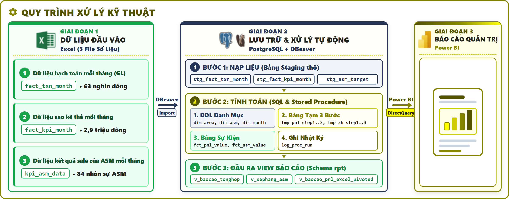
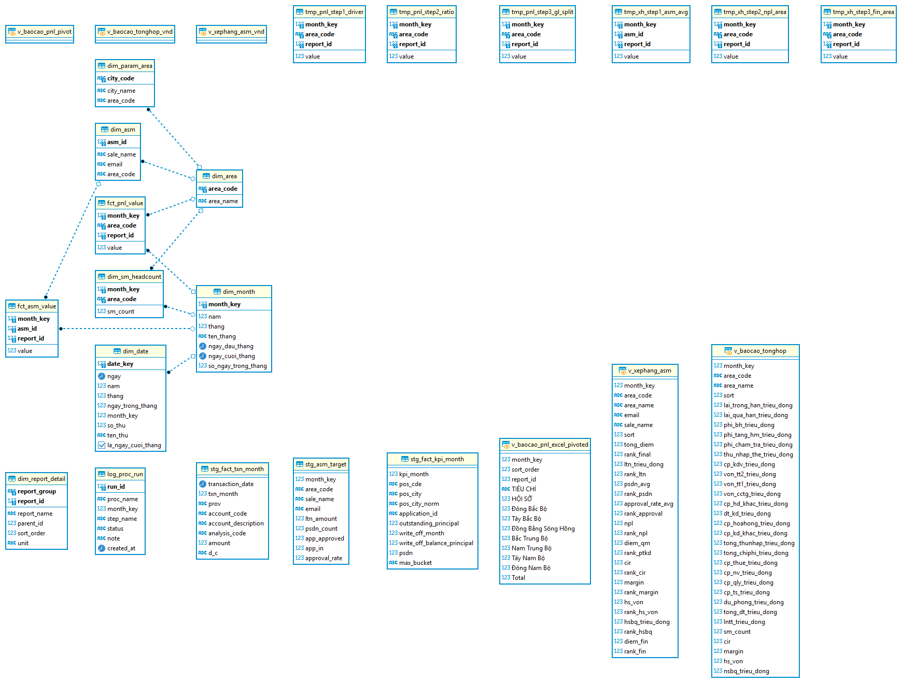

<div align="center">

# Credit Card P&L Reporting and Area Sales Manager (ASM) Ranking System

**Ngôn ngữ / Language**: [Tiếng Việt](README.md) · **English**

<p>
  
  
  
  
</p>

</div>

## 📑 Table of Contents

1. [🏢 The Problem Executive Management Wanted Solved](#1--the-problem-executive-management-wanted-solved)
2. [🎯 From Initial Request to Final Reporting Suite](#2--from-initial-request-to-final-reporting-suite)
3. [🔍 Source Data and Real-World Data Quirks](#3--source-data-and-real-world-data-quirks)
4. [🧮 Splitting Head Office Costs and Scoring ASMs](#4--splitting-head-office-costs-and-scoring-asms)
5. [🔄 Data Pipeline and the 7 Power BI Pages](#5--data-pipeline-and-the-7-power-bi-pages)
6. [📊 Key Findings and Practical Recommendations](#6--key-findings-and-practical-recommendations)
7. [📚 Practical Lessons From Building This Project](#7--practical-lessons-from-building-this-project)
8. [🛠️ Tools and Stack Used](#8--tools-and-stack-used)
9. [📂 Project Repository Structure](#9--project-repository-structure)
10. [📖 Accompanying Documentation](#10--accompanying-documentation)
11. [👤 Author](#11--author)

---

## 1. 🏢 The Problem Executive Management Wanted Solved

### How Credit Card Operations Are Organized
The bank runs its credit card business across **7 commercial regions** nationwide. Each territory is managed by Area Sales Managers (ASMs), who are responsible for both sales growth and portfolio quality. Depending on the month, there are between **74 and 84 active ASMs**.

### The Request From Executive Management
Everything started with a broad mandate from leadership:
> *"**Executive Management** wants a **management reporting system** to track credit card performance in every region and **fairly evaluate how well the Area Sales Manager (ASM) team is performing**."*

That request set the goal, nothing more — there were no existing formulas, no sample scorecards, and no report layouts. From day one, we had to figure out five missing pieces ourselves:
- No agreed way to calculate true profit or loss by region.
- No rules to push shared Head Office costs back down to the 7 regions.
- No balanced metric set that captures both sales volume and bad debt risk.
- No fair way to score regional sales managers.
- No scoring math, ranking order, or clean report format.

### Three Blind Spots in Old Accounting Reports
Looking through existing accounting statements quickly exposed three traps:

1. **Every region looked profitable on paper:**
   Interest income and card fees are booked directly at branches, while heavy costs — funding costs, marketing, IT, and central support teams — sit together at Head Office. Without sharing those Head Office expenses back to the 7 regions, reports looked unrealistically rosy and hid money-losing territories.

2. **Judging managers on sales alone invites reckless lending:**
   If bonuses only reward new loan volume or card counts, managers have every reason to loosen credit checks just to hit targets. Numbers look great in month one, then bad debt and provision costs wipe out the profit a few months later.

3. **YTD-only figures hide monthly swings:**
   Existing accounting reports lump everything into year-to-date totals without breaking out each individual month. That makes it hard to tell whether profit rose because business improved or simply because provisions dropped.

To fix all three issues, the reporting system was built around 5 plain business questions:

| Focus Area | Plain Question to Answer | What the Report Delivers |
|---|---|---|
| **True Regional P&L** | After paying their share of Head Office costs, which regions actually make money? | Full 7-region and Head Office P&L table |
| **Why Profit Moved** | Did profit go up this month because of higher revenue, lower expenses, or fewer provisions? | Monthly standalone flows and step-by-step profit waterfalls |
| **Bad Debt Safety** | Which regions are seeing risky loans pile up fast? | Tracking across 5 debt buckets, write-offs, and regional NPL |
| **ASM Performance** | Who sells well while keeping bad debt low, and who is chasing risky volume? | Multi-factor scorecard for 74 to 84 managers combining sales and regional finance |
| **Audit & Action** | How can leaders check numbers fast, reconcile to the general ledger, and act early? | A 7-page Power BI report wired directly to PostgreSQL |

---

## 2. 🎯 From Initial Request to Final Reporting Suite

Instead of jumping straight into charts, we split the assignment into two parallel tracks: one focused on getting regional P&L right, and one focused on scoring managers fairly.

| Stage | Track 1: Regional P&L Accounting | Track 2: ASM Performance Scoring |
|---|---|---|
| **Step 1: Define the Goal** | Show true credit card profit and loss across 7 regions after allocating shared overhead | Rank **74 – 84** Area Sales Managers (ASMs) fairly to reward top talent and coach weak spots |
| **Step 2: Pick the Right Metrics** | • Separate card income, funding costs, operating costs, and credit risk provisions.<br>• Share central Head Office costs across the 7 regions using real drivers like loan balances, active card counts, and headcount.<br>• Track clean ratios: cost-to-income (`CIR`), profit margin (`Margin`), return on funding capital, and profit per manager. | • **Personal sales metrics**: New loan volume (`LTN`), active balance-carrying cards (`PSDN`), application approval rate.<br>• **Regional financial & risk guardrails**: Extended `NPL`, regional `CIR`, margin, return on capital, and average pre-tax profit per manager — stopping volume growth at the expense of bad debt. |
| **Step 3: Build Power BI Pages** | • **Page 2 – Data Dictionary**: Explains **68** indicators in 5 groups so every team uses the same definitions.<br>• **Page 3 – Regional YTD P&L Table**: Reconciles **32** financial rows across `HỘI SỞ (Phân Bổ)`, 7 regions, and `Total`, using **21** dynamic color measures.<br>• **Page 4 – Regional Performance Review**: Features **5** KPI cards showing both monthly flow and YTD totals, an **8**-step monthly waterfall, a bubble chart, and a monthly trend combo chart. | • **Page 5 – ASM Ranking Table**: Full **26**-column scorecard for **74 – 84** managers combining commercial scale (`diem_qm`) and regional finance (`diem_fin`).<br>• **Page 6 – ASM Capability Radar**: Interactive radar views for Top 3 winners, Bottom 3 at-risk managers, **7**-region comparison, and 4 plain-language groups (*Good Sales - Low Bad Debt*, *Good Sales - High Bad Debt*, *Slow Sales - Low Bad Debt*, *Weak Sales - High Bad Debt*).<br>• **Page 7 – Enterprise Results & Action Plan**: Highlights **4** big KPIs, enterprise waterfall, why the **−48.8 billion** Southeast loss triggered a **+26-point** penalty dragging **84%** of its managers down, and a 5-region action table. |

### Why Running Both Tracks Together Matters
- **Real P&L visibility (32 P&L lines, cost ratio, margin, return on capital):** Management can see which regions genuinely earn money after central costs, making budget and target setting realistic.
- **Growth tied to credit discipline (8 ASM ranking metrics):** Selling lots of cards in a region buried in bad debt no longer puts someone at the top, while balanced managers clearly stand out.

---

## 3. 🔍 Source Data and Real-World Data Quirks

### Three Raw Excel Inputs
No single database table held everything needed for both P&L and ASM scoring, so we collected **3 Excel files** from banking operations teams:

| No. | Source Dataset | Target Table & Size | **WHAT'S INSIDE?** | **WHAT IS IT USED FOR?** |
|:---:|---|---|---|---|
| **1** | **Dữ liệu hạch toán mỗi tháng (GL)** *(Monthly General Ledger)* | `fact_txn_month`<br>(**63,134** rows / 63 thousand rows) | **Actual revenue and expense entries across 7 regions and Head Office**, made of **62,953** province-tagged entries and **181** central Head Office entries coded `'00'`. Join keys: `city_code`, `account_code`. | **Building the 7-region P&L**: Sums direct regional entries as-is and spreads Head Office costs across regions. |
| **2** | **Dữ liệu sao kê thẻ mỗi tháng** *(Monthly Card Statements)* | `fact_kpi_month`<br>(**2,932,922** rows / 2.9 million rows, **117.2 MB**) | **Card-by-card monthly statements across 5 months**: ending principal, debt buckets 1–5, cumulative *write-offs*, and active balance flags. Join keys: `branch_code`, `month_key`. | **Computing Head Office cost drivers and regional bad debt**: Supplies balance shares and active card counts to split central costs and measure extended NPL across 7 regions. |
| **3** | **Dữ liệu kết quả sale của ASM mỗi tháng** *(Monthly ASM Sales Results)* | `kpi_asm_data`<br>(**420** rows covering **84** managers over 5 months) | **Monthly sales output for 74 to 84 active ASMs**: new disbursement volume, active cards with balances, and approval rates. Join keys: `asm_id`, `month_key`. | **Scoring the personal sales pillar**: Scores commercial scale (`diem_qm`) before combining with regional finance (`diem_fin`) for final rankings. |

*(Alongside those 3 raw files sits a parameter workbook mapping **64** provinces into **8** zones — Head Office `'A'` and 7 commercial regions `'B'..'H'` — plus **55** P&L/ranking report items in `dim_report_detail` and a **68**-term Data Dictionary).*

### Can the Data Answer Everything We Need?

| Report View | Data Required | Source Used | How It Fits Together |
|---|---|---|---|
| **01. Regional P&L** & **03. Regional Performance** | Revenues, costs, province codes, GL accounts, Head Office split weights | `1. Dữ liệu hạch toán mỗi tháng (GL)` & `2. Dữ liệu sao kê thẻ mỗi tháng` | Assigns 62,953 province-tagged GL rows straight to 7 regions; allocates 181 Head Office rows (code `'00'`) using loan and active-card shares from 2,932,922 card statements |
| **Regional Bad Debt (NPL)** | Debt across buckets 1–5 and write-offs by branch | `2. Dữ liệu sao kê thẻ mỗi tháng` (`fact_kpi_month`) | Branch codes on every card record roll up cleanly to all 7 regions across 5 months |
| **02. ASM Ranking** & **04. ASM Capability** (Sales pillar) | New loan volume, active balance cards, approval rate by person | `3. Dữ liệu kết quả sale của ASM mỗi tháng` (`kpi_asm_data`) | Complete monthly sales stats for 74 to 84 ASMs let us score every manager directly |
| **Regional Finance & NPL in ASM Scorecard** | Extended NPL, `CIR`, margin, return on capital, profit per manager | Combined regional outputs from `fact_txn_month` and `fact_kpi_month` | Card statements track branch codes rather than individual ASM IDs, so financial and NPL scores are calculated at the region level and shared across ASMs in that territory |

### Three Data Headaches We Had to Clean Up First:
1. **Card statement file too big for Excel:** With **2,932,922 rows** weighing **117.2 MB**, spreadsheet joins hang or crash, so ingestion and heavy aggregation belong in PostgreSQL.
2. **ASM sales spreadsheet was laid out sideways (Wide format):** January through May sat in side-by-side columns instead of vertical rows, so we unpivoted them cleanly on load.
3. **Province names didn't match across files:** Statements spelled `"Bà Rịa - Vũng Tàu"` while the lookup sheet wrote `"Vũng Tàu"`. Without string normalization (`pos_city_norm`), more than **36,000 card contracts** would vanish from Southeast joins and completely skew that region's bad debt numbers.

---

## 4. 🧮 Splitting Head Office Costs and Scoring ASMs

**Starting Point:** Leadership asked for the end result without handing over formulas or templates. We had to design both the P&L allocation logic and the ASM scorecard from the ground up using banking accounting logic.

### 4.1. Building the 7-Region P&L (Handling Head Office Costs)

The hardest part of regional P&L reporting is deciding how to divide large shared entries sitting at Head Office. We followed 9 straightforward steps:
1. Inspect all 63,134 rows in the **Monthly General Ledger (GL)**.
2. Keep branch/province entries pinned directly to their own regions.
3. Isolate shared entries parked at Head Office (province `'00'`, zone `'A'`).
4. Check what each Head Office line actually pays for (funding, IT, insurance, back-office staff).
5. Pick a matching real-world driver for each cost type.
6. Verify every driver can be calculated cleanly from **Monthly Card Statements** and SM headcount.
7. Calculate monthly regional percentage shares for each driver.
8. Wrap all rules into automated PostgreSQL stored procedures.
9. Sum all 7 regions back up and prove they equal 100% of the original general ledger — zero missing cents.

**Two Simple Allocation Rules:**
- **Rule 1 – Direct Assignment:** **62,953** GL rows carrying a province code go straight to that region (in-term interest, overdue interest, insurance fees, limit-increase fees, late fees, and direct branch expenses).
- **Rule 2 – Driver-Based Share of Head Office:** **181** central Head Office rows are divided across the 7 regions based on each region's share of the matching business driver:

$$\text{Share of Region } i = \frac{\text{Driver Value of Region } i}{\sum_{k=1}^7 \text{Driver Value of Region } k}$$

$$\text{Allocated Amount to Region } i = \text{Head Office Pool} \times \text{Share of Region } i$$

*Which driver goes with which item (every formula is listed under `Công Thức / Cách Tính` in the Data Dictionary):*
- **Funding cost, in-term interest, and limit-increase fees from Head Office:** Internal transfer pricing follows healthy performing loans $\rightarrow$ Split by **Average post-write-off balance in Bucket 1**. Regions with larger healthy portfolios absorb proportionally more funding cost.
- **Overdue interest from Head Office:** Comes from early delinquent accounts $\rightarrow$ Split by **Average post-write-off balance in Bucket 2**.
- **Credit risk provisions, late fees, and off-balance recoveries:** Provisions cover expected loan losses $\rightarrow$ Split by **Average balances in Buckets 2–5 plus cumulative write-offs** (`d25_sau` or `dtruoc`), ensuring riskier territories carry their fair share of provisions.
- **Card insurance (Bancassurance) fees and card IT/operations costs:** Card system maintenance and insurance commissions track active card usage $\rightarrow$ Split by **Average active cards carrying balances** (`psdn`).
- **Central support staff, management, and overhead costs:** Back-office support scales with field leadership footprint $\rightarrow$ Split by **Sales Manager Headcount** in each region.
- *Practical caveat:* This assumes shared costs move proportionally with regional averages and does not isolate one-off local marketing campaigns.

*Separating Standalone Monthly Activity From YTD Totals:*
Since the general ledger reports year-to-date cumulative numbers, isolating any single month's activity is simply current YTD minus prior-month YTD:
$$V_{\text{Month } M} = V_{\text{YTD } M} - V_{\text{YTD } (M-1)}$$

### 4.2. Designing the ASM Performance Scorecard

If managers are graded only on loan disbursements, chasing easy approvals quickly creates a wave of bad debt. The scorecard keeps managers honest by mixing **individual sales metrics** with **regional profitability and credit safety**.

**8 Metrics Split Into 2 Equal Pillars (4 Metrics Each):**
Each metric is ranked from `1` to `N` across the bank (Rank `1` goes to the best value — highest for sales/profit metrics, lowest for bad debt and cost ratios):
- **Pillar 1: Sales Scale & Credit Discipline (`diem_qm`):** Combines **3 individual metrics** (`Average new loan disbursement`, `Average active cards – PSDN`, `Approval rate`) with **1 regional risk check** (`Extended NPL ratio`). **Watch out for approval rate!** A high approval rate can mean great sales quality — or sloppy screening — so reading it side by side with regional NPL prevents gaming.
- **Pillar 2: Regional Financial Health (`diem_fin`):** Combines **4 regional P&L metrics** post-allocation (`CIR`, `Margin`, `Return on Capital`, `Average Profit per SM`). Because card statements do not carry individual ASM IDs, these four metrics apply evenly across all ASMs in the same region so managers care about overall territory health.

**Extended NPL Formula (Adding Write-Offs Back In):**
Inside SQL (`report_id = 204`), extended NPL puts cumulative *write-offs* back into both numerator and denominator:

$$\text{Extended NPL Ratio} = \frac{\text{Buckets 3–5 Balance} + \text{Cumulative Write-offs}}{\text{Total Balance} + \text{Cumulative Write-offs}} \times 100$$

Why do that? Standard on-book NPL drops overnight whenever bad loans are written off the books, creating an illusion of improvement. Adding YTD write-offs back keeps the true credit risk visible. *(Note: mature regions with older portfolios naturally accumulate more historical write-offs than newer markets.)*

| Pillar 1: Commercial Scale & Risk Control (`diem_qm`) | Pillar 2: Regional Financial Health (`diem_fin`) |
|---|---|
| • **Average new loan disbursement (`ltn_avg`)** *(Higher is better)*<br>• **Average active balance cards (`psdn_avg`)** *(Higher is better)*<br>• **Average approval rate (`approval_rate_avg`)** *(Read alongside NPL)*<br>• **Extended NPL ratio (`npl_truoc_wo_luy_ke`)** *(Lower is better — includes write-offs)* | • **Cost-to-Income Ratio (`CIR`)** *(Lower is better)*<br>• **Profit Margin (`Margin`)** *(Higher is better)*<br>• **Return on Capital (`hs_von`)** *(Higher is better)*<br>• **Average Pre-Tax Profit per SM (`hs_nhan_su`)** *(Higher is better — shared regional outcome)* |

**Breakdown of All 8 ASM Scoring Metrics:**

| Metric | What It Shows | Why It Matters | Data Source | Better When | Level | Keep in Mind |
|---|---|---|---|---|---|---|
| **New Loan Disbursement** | Direct sales push | Tracks monthly new borrowing volume brought in | `3. ASM Sales Results` | Higher | Individual ASM | Ignores later card cancellations |
| **Active Balance Cards (`PSDN`)** | Real card usage | Counts customers actively carrying a balance | `3. ASM Sales Results` | Higher | Individual ASM | Must weigh against activation/servicing costs |
| **Approval Rate** | Screening strictness | Number approved per 100 submitted applications | `3. ASM Sales Results` | Judge with NPL | Individual ASM | Very high rates can signal weak screening |
| **Extended NPL Ratio** | Portfolio credit safety | Measures severe delinquency including write-offs | `2. Card Statements` | Lower | Regional | Statements have branch IDs only, not ASM IDs |
| **Regional CIR** | Operating cost control | Operating dong spent per 100 dong of income | `1. General Ledger (GL)` | Lower | Regional | Partly affected by Head Office allocation shares |
| **Profit Margin** | Bottom-line retention | Percentage of card revenue kept as pre-tax profit | `1. General Ledger (GL)` | Higher | Regional | Sensitive to internal funding cost rates |
| **Return on Capital** | Capital efficiency | Profit earned per dollar of net funding cost | `1. GL` & `2. Card Statements` | Higher | Regional | Reflects regional capital efficiency overall |
| **Profit per SM** | Manager productivity | Average pre-tax profit per Sales Manager slot | `1. GL` & SM Headcount | Higher | Regional | Divided by authorized SM headcount in region |

*Combining Different Units Into One Fair Rank:*
Since dollars, card counts, and percentages cannot be added directly, each of the 8 metrics is converted into a national rank (`1` to `N`), then summed:
$$\text{Total Score} = \text{Scale Score } (diem\_qm) + \text{Financial Score } (diem\_fin)$$
**Lower Total Scores win better National Ranks** (`#1` belongs to the manager with the smallest Total Score).

---

## 5. 🔄 Data Pipeline and the 7 Power BI Pages

Data flows across 3 clear stages from raw Excel workbooks into a 7-page Power BI report:

<div align="center">



</div>

### How the 3 Stages Work:

- **Stage 1 – Collect 3 Raw Excel Files (`Excel – 3 File Số Liệu`):**
  1. **Dữ liệu hạch toán mỗi tháng (GL)** (`fact_txn_month` • **63,134** rows / 63 thousand rows): Revenue and expense ledger entries for 7 regions & Head Office.
  2. **Dữ liệu sao kê thẻ mỗi tháng** (`fact_kpi_month` • **2,932,922** rows / 2.9 million rows, **117.2 MB**): Contract-level balances, debt buckets, write-offs, and active cards used for cost splitting and NPL tracking.
  3. **Dữ liệu kết quả sale của ASM mỗi tháng** (`kpi_asm_data` • **420** rows for **84** managers over 5 months): Individual sales numbers used to score scale performance.

- **Stage 2 – Clean Storage and Automated Math in PostgreSQL (`PostgreSQL + DBeaver`):**
  Everything lives inside schema `banking_project` as a clean Star Schema with **19 tables, 3 `views`, and 11 `stored procedures`**:
  - **Ingest (`DBeaver Import`):** Loads the 3 Excel sources into staging tables (`stg_fact_txn_month` **63,134** rows, `stg_fact_kpi_month` **2,932,922** rows, `stg_asm_target` **420** rows) and cleans province names (`pos_city_norm`) so over **36,000** card contracts in Ba Ria - Vung Tau stay intact.
  - **Calculate via SQL & Stored Procedures:**
    1. *7 dimension tables (`dim_`)*: `dim_area` (8 zones), `dim_param_area` (64 provinces), `dim_month` (5 months), `dim_date` (151 days), `dim_asm` (84 ASMs), `dim_report_detail` (55 line items), `dim_sm_headcount` (35 SM headcount rows).
    2. *6 three-step working tables (`tmp_`)*: Uniform tall format (`month_key`, `area_code`, `report_id`, `value`) holding intermediate math for P&L (`tmp_pnl_step1..3`) and ASM Ranking (`tmp_xh_step1..3`).
    3. *2 final fact tables (`fct_`)*: `fct_pnl_value` (**1,115** rows) stores post-allocation P&L; `fct_asm_value` (**8,536** rows) stores 5 months of ASM values, scores, and ranks.
    4. *1 run-history log (`log_`)*: `log_proc_run` logs execution across 11 procedures (**208** `START` and `OK` rows, **0** `FAIL` rows), backed by **9** virtual foreign keys in DBeaver.
  - **Publish 3 Clean Reporting Views (`Schema rpt`):** `v_baocao_tonghop` (**35** rows), `v_xephang_asm` (**388** rows), and `v_baocao_pnl_excel_pivoted` (**160** rows).

<div align="center">



</div>

- **Stage 3 – Interactive Reporting in Power BI (`DirectQuery`):**
  Power BI queries PostgreSQL live over `DirectQuery` and runs **90 DAX measures** (**89** in `'LAI LO (Visuals & DAX)'` and **1** in `'Data Glossary'`, including **21** `PnlTable_BgColor_*` and `PnlTable_FontColor_*` formatting measures). Every visual across all 7 pages follows the **Pure Yellow** palette (`Pure_Yellow_Improved_Theme.json` — soft cream canvas, bright yellow highlights, deep navy labels, green for healthy/profitable metrics, and red for losses or high risk):

  1. **Page 1 – `GIỚI THIỆU ĐỀ TÀI` (Topic Introduction)**: Frames management's request, previews the 4 core analytical areas, summarizes the 3 raw data sources, and embeds the 3-stage pipeline diagram.
  2. **Page 2 – `TỪ ĐIỂN DỮ LIỆU` (Data Dictionary)**: Documents **68** fields and KPIs across 5 clear categories (`0. Identification & Hierarchy`, `1. P&L Statement`, `2. Financial & Headcount Ratios`, `3. Head Office Allocation Drivers`, `4. ASM Evaluation & Ranking`) with plain definitions and formulas.
  3. **Page 3 – `BÁO CÁO KẾT QUẢ KINH DOANH LUỸ KẾ VÙNG` *(Dashboard 01)***: Reconciles **32** YTD P&L indicators across `HỘI SỞ (Phân Bổ)`, **7** regions (`Đông Bắc Bộ`, `Tây Bắc Bộ`, `Đồng Bằng Sông Hồng`, `Bắc Trung Bộ`, `Nam Trung Bộ`, `Tây Nam Bộ`, `Đông Nam Bộ`), and `Total`. `1. Profit before tax` stands out in bright yellow, section totals use dark olive rows with high-contrast text, detail rows sit cleanly on cream/white, negatives turn crimson red, and zeros fade softly.
  4. **Page 4 – `ĐÁNH GIÁ HIỆU QUẢ KINH DOANH VÙNG` *(Dashboard 03)***: Compares revenue, expenses, provisions, and profitability across 7 regions using 5 linked visuals that clearly separate monthly numbers from YTD totals:
     - *Top Strip of 5 Large KPI Cards:* Bold primary numbers show the **selected month's standalone result** (green when positive/favorable, red for expenses or losses) plus `%` change vs. prior month, while the bottom line prints **YTD cumulative totals** matching Page 3. For May: `Operating Income` **+288,146 million** (+1.8% vs. April, YTD **1,353,898 million**); `Pre-Tax Profit` **+56,798 million** (+8.4%, YTD **250,450 million**); `Operating Expense` **-48,577 million** (+1.1%, YTD **-235,122 million**); `Provision Expense` **-182,771 million** (+0.0%, YTD **-868,327 million**); `Average Productivity` **+915.7 million/person** (+6.0%, YTD **4,099.5 million/person**).
     - *Monthly Waterfall Chart:* Breaks down standalone May pre-tax profit from 4 revenue drivers (`In-term interest` **355,009** million, `Insurance fees` **6,596** million, `Card services` **21,192** million, `Overdue interest` **323** million) minus 3 cost buckets (`Funding & other net costs` **-94,975** million, `Operating expense` **-48,577** million, `Provision expense` **-182,771** million) down to **56,798** million.
     - *Bubble Comparison Chart:* Plots Pre-Tax Profit against Cost-to-Income Ratio (`CIR`), sizing each bubble by regional Sales Manager headcount (`SM`).
     - *Monthly Trend Combo Chart:* Tracks monthly Pre-Tax Profit from January through May (**40,173**, **52,053**, **49,019**, **52,407**, **56,798** million) alongside Return on Capital (**57.9%**, **82.9%**, **70.2%**, **76.9%**, **80.7%**).
     - *Dynamic Insight & Takeaways Panel:* Automatically rewrites itself when you filter by Month or Region — in bank-wide mode it highlights Southwest leading monthly profit at **+37.07 billion** (YTD **+167.88 billion**, **2.9x** Red River Delta), South Central leading capital efficiency (**233.7%** monthly return, **13.4%** `CIR`), Southeast's loss of **-8.79 billion** in the month (YTD **-48.76 billion**, dragging bank-wide monthly profit down **15.5%** and YTD down **19.5%**), and cross-sell opportunities where in-term interest accounts for **92.7%** of gross income while provisions eat **63.4%** of monthly operating income (**64.1%** YTD). Picking a single region switches it to rank `1..7` and tailored regional notes.
  5. **Page 5 – `BÁO CÁO XẾP HẠNG ASM` *(Dashboard 02)***: Complete **26**-column leaderboard covering **74 – 84** managers each month so leaders can filter by month or region, inspect `Total Score` and `Final Rank`, and see exact sub-ranks (February champion Hoang Van Nam scored **34 points**; May champion Hoang Van Nam scored **36 points**).
  6. **Page 6 – `ĐÁNH GIÁ NĂNG LỰC ASM` *(Dashboard 04)***: Visualizes 4 capabilities (`New Lending`, `Active Cards`, `Approval Rate`, `Bad Debt Safety`) on Radar charts across 4 panels:
     - *Top 3 Winners* & *Bottom 3 Managers*: Interactive 3-tab cards let viewers click directly between Rank 1, 2, and 3 against bank averages. In May, #1 Hoang Van Nam (Red River Delta) posted **5,326 million** in new lending, **208** active balance customers, **53.6%** approval rate, and **13.9%** NPL (vs. bank averages of **2,141 million**, **101** customers, **42.8%**, and **17.3%**); back in February he led with **2,901 million**, **176** customers, **47.2%**, and **12.8%** (vs. averages of **986 million**, **72** customers, **41.8%**, and **15.5%**).
     - *National / Regional Benchmark:* Shows team totals (**179.8 billion** card sales and **8,459** active cardholders in May; North Central leading average sales at **3,089 million/person**, South Central holding the lowest NPL at **11.2%**).
     - *4 Plain-Language Capability Groups:* Splits May's **84** managers into four actionable buckets: **Good Sales - Low Bad Debt** (**22** people, **26.2%**), **Good Sales - High Bad Debt** (**12** people, **14.3%**), **Slow Sales - Low Bad Debt** (**18** people, **21.4%**), and **Weak Sales - High Bad Debt** (**32** people, **38.1%**), each with average stats and concrete next steps.
  7. **Page 7 – `KẾT QUẢ KINH DOANH CỦA DOANH NGHIỆP VÀ ĐỀ XUẤT`**: Full **5-month YTD** executive summary built cleanly on 3 blocks:
     - *4 Headline KPI Cards:* Operating Income **+1,353.9 billion** (+1.8% vs. April), Operating Expense **-235.1 billion** (+1.1%, 17.4% of income), Bad Debt Provision **-868.3 billion** (+0.05%, 64.1% of income), Pre-Tax Profit **+250.5 billion** (+8.4%, 6/7 regions profitable).
     - *Enterprise Profit Waterfall:* Walks from Card Revenue **+1,810.5 billion** (92.6% card interest) minus Funding Cost **-340.5 billion** and Card Selling Costs **-116.0 billion** to Net Operating Income **+1,353.9 billion**, then deducts Operating Expense **-235.1 billion** and Bad Debt Provision **-868.3 billion** to arrive at **+250.5 billion** Profit (13.8% margin), flanked by 3 callouts (Southwest **+167.9 billion**, South Central & RRD **+104.3 billion**, Southeast loss **-48.8 billion** wiping **16.3%** off profitable regions' gains).
     - *Regional Priority Action Table:* Uses plain 5-column language (**Priority · Region · Current Situation · Action Needed · Target Outcome**) across the 5 priority regions (detailed in Section 6 – Part C).

---

## 6. 📊 Key Findings and Practical Recommendations

### Part A – Did We Deliver What Executive Management Asked For?

| Executive Request | Where to See It | Outcome |
|---|---|---|
| **Check and reconcile true 7-region P&L** | **Page 3 · Regional YTD P&L Statement** | **Delivered:** All 32 metrics across 7 regions + Head Office match 100% of general ledger totals. |
| **Rank ASMs fairly for rewards & coaching** | **Page 5 · ASM Ranking Leaderboard** | **Delivered:** Full **26**-column scorecard covering **74 - 84** managers across sales and regional finance. |
| **Compare income, expenses, provisions, and returns** | **Page 4 · Regional Business Performance** | **Delivered:** Separates monthly flow from YTD totals, shows 8 waterfall steps, `CIR`, and capital return across 7 regions. |
| **Spot managers trading credit safety for fast sales** | **Page 6 · ASM Competency Radar** | **Delivered Well:** Pairs sales against NPL on interactive Radar tabs and groups all managers into 4 action buckets. |
| **Standardize metrics and list next actions** | **Page 2 · Data Dictionary & Page 7 · Enterprise Results** | **Delivered:** Defines 68 terms and turns 5-month numbers into a clear 5-region action plan. |

### Part B – Four Standout Takeaways From May Figures

1. **Southwest – Biggest profit jump, but driven by lower provisions amid the worst bad debt:**
   - *Numbers:* May pre-tax profit climbed by **+4,267.8 million VND**, accounting for **97.2%** of the bank's total profit growth that month. Yet net card income barely budged (**+16.3 million VND**) and operating costs shaved off **−195.9 million VND** — almost the entire jump came from **net provision expenses dropping by +4,447.3 million VND**. Worse, Southwest holds the **highest extended NPL nationwide (21.99%)** with zero ASMs inside the Top 25. (Over 5 months YTD, it booked **+167,883 million VND** profit at **131.7%** capital return.)
   - *Plain take:* May's profit bump reflects lower provisioning rather than stronger card sales.
   - *What to check next:* Verify whether provision drops came from real cash recoveries or technical loan restructures; schedule an on-site underwriting and collection audit in July.

2. **Southeast – Solid sales wiped out by surging bad debt provisions:**
   - *Numbers:* Southeast lost **−8,787.4 million VND** in May alone, pushing its 5-month cumulative loss to **−48,763 million VND** (**−48.8 billion VND**). Even though card teams lifted net income by **+3,210.7 million VND**, new provision charges jumped by **−3,234.2 million VND** and swallowed every cent. Under shared regional scoring, **16 out of 19 ASMs** (84%) dropped into the bottom tier despite solid personal sales.
   - *Plain take:* Fresh credit provisions simply outpaced extra card revenue, leaving Southeast as the lone money-losing region.
   - *What to check next:* Review recent months' newly issued accounts to see if fast approvals are sliding straight into delinquency, and audit all overdue contracts across Southeast within 30 days.

3. **Red River Delta – #1 in new lending scale with healthy credit safety:**
   - *Numbers:* Across 5 months, Red River Delta leads the country in new disbursements (**55,010 million VND**, **1.5 times** second-place Southwest) while keeping extended NPL at a comfortable **13.9%** (well below the **17.3%** national average). In May, pre-tax profit grew **+1,310.9 million VND**, as a **+1,455.8 million VND** drop in net provisions easily offset a slight **−232.2 million VND** dip in net income.
   - *Plain take:* Still the bank's safest growth engine, though the small dip in monthly income deserves watching.
   - *What to check next:* Separate fresh provision charges from write-back recoveries in accounting logs so temporary accounting swings aren't mistaken for lasting risk improvement.

4. **South Central Coast – Cleanest loan book and highest return on capital:**
   - *Numbers:* With just 5 managers, South Central sustains the **lowest extended NPL in the bank (11.24%)**, earns **50,036 million VND** YTD profit at a standout **203.5%** return on capital (over **2.0 dong** profit for every 1 dong of funding cost), and places **4 out of 5 ASMs** in the nationwide Top 25.
   - *Plain take:* Lean operation with disciplined customer screening that every high-risk region can learn from.
   - *What to check next:* Spend 60 days (2 months) documenting how this region screens applicants and collects early delinquencies, then pilot those steps elsewhere.

### Part C – Enterprise Big Picture and Regional Action Plan

Page 7 (`KẾT QUẢ KINH DOANH CỦA DOANH NGHIỆP VÀ ĐỀ XUẤT`) sums up 5-month YTD performance into **4 key points**:

1. **4 Headline Figures to Remember:**
   - **Largest Profit Share – `67.0%`:** Southwest contributes **+167.9 billion VND** out of **+250.5 billion VND** bank-wide.
   - **Highest Bad Debt – `22.0%`:** Southwest sits well above the **17.3%** system average.
   - **Only Loss-Making Region – `-48.8 billion`:** Southeast posted a net 5-month cumulative loss.
   - **Safest Portfolio – `11.2%` NPL:** South Central carries the lowest bad debt while supplying **20%** of bank profit (**+50.0 billion VND**).

2. **How the 7 Regions Add Up to +250.5 Billion:**
   - *6 profitable regions:* Southwest (**+167.9 billion VND**), Red River Delta (**+54.3 billion VND**), South Central (**+50.0 billion VND**), and 3 smaller regions (**+27.0 billion VND**) generate **+299.2 billion VND** combined.
   - *Southeast's drag:* Southeast's **−48.8 billion VND** loss wipes out **16.3%** (around 16%) of all gains earned by the profitable territories.
   - *Final bank-wide profit:* Consolidated pre-tax profit finishes at **+250.5 billion VND**.

3. **Why Good Sellers in Southeast Still Fell to the Bottom:**
   - *Maximum financial penalty (`26 points`):* Because Southeast ran a −48.8 billion VND loss and placed 7/7 on all four regional financial ratios, all 19 Southeast ASMs received the full **26-point** penalty no matter how much they sold personally.
   - *Real scorecard examples:*
     * Inside Southeast: Nguyen T. Loan (**Top sale**, **16 points**) landed at **Rank 18**; Tran V. Hung (**Good**, **14 points**) landed at **Rank 21**; Le T. Mai (**Average**, **11 points**) landed at **Rank 24**.
     * Nationwide: Le Van Binh slipped from #24 on sales to #31 overall (down 7 spots); Tran Van Hai fell from #28 to #33 (down 5 spots); Tran Van Anh fell from #36 to #41 (down 5 spots).
   - *Practical fix:* Don't punish strong individual salespeople with **16/19 managers (84%)** sunk by regional write-offs. **Score personal card sales separately** to keep morale up, while holding territory heads directly accountable for fixing the **48.8 billion VND** loss and collecting bad loans.

4. **Priority Action Plan for 5 Key Regions (Shown Live on Page 7):**

| Priority | Region | Current Situation | Action Needed | Target Outcome |
|:---:|---|---|---|---|
| **Urgent** | **Southwest** *(Profit +167.9 billion)* | Generates the biggest profit (**+67.0%** of total), but has the highest bad debt (**22.0%**). | Tighten underwriting checks before issuing new cards and push overdue collection hard. | Cut bad debt **22.0% → 17.3%**; stop provisions (**290.4 billion** / **290,377 million VND**) from growing further. |
| **Urgent** | **Southeast** *(Loss −48.8 billion)* | The sole loss-making region (**−48.8 billion**) from heavy bad debt, pulling **16/19** managers (**84%**) into the bottom tier. | Focus on bad-debt recovery to close the loss; score personal card sales separately so top sellers aren't penalized. | Recover debt to clear the **48.8 billion** loss; give fair evaluations to all **19** managers (provisions now eat **223.7 billion**). |
| **Priority** | **North Central** *(Profit +10.5 billion)* | Operating costs eat **26.5%** of income — highest in the bank (average is only **17.4%**). | Trim non-essential branch spending and tie budgets strictly to real sales volume. | Save **~3.5 billion** in expenses; bring operating cost ratio down to the **17.4%** norm. |
| **Sustain** | **Red River Delta** *(Profit +54.3 billion)* | Leads the country in new card lending (**30.6%** of all new card volume). | Keep acquisition pace steady and coach average performers to raise team output evenly. | Hit **+55.0 billion** in new lending; hold the #1 national share (**30.6%**). |
| **Replicate** | **South Central** *(Profit +50.0 billion)* | Safest and most efficient business: lowest bad debt (**11.2%**), earning **2.0 dong profit** per 1 dong capital (**203.5%**). | Package this region's screening and collection habits as a playbook for high-NPL territories. | Keep bad debt under **12%**; sustain **203.5%** return on capital. |

### Five Clear Recommendations for Executive Management:

| # | Recommended Move | Supporting Evidence | Owner · Timing |
|:---:|:---|:---|:---|
| 01 | **Split new provisions from loan recoveries in accounting:** Shows whether profit growth came from real sales or accounting adjustments. | Current GL only reports one net provision figure combining both | Risk Management · June |
| 02 | **Inspect overdue contracts in 3 provision-spiking regions:** Southeast, Northeast, and Northwest. | Provisions across these 3 territories jumped **6,035.1 million VND** in May alone | Regional Heads + Risk · 30 Days |
| 03 | **Audit underwriting and collections on-site in Southwest:** Check why provisions fell sharply despite peak bad debt. | Highest NPL (**21.99%**) alongside **97.2%** of May's total profit growth | Business + Risk · July |
| 04 | **Study and test South Central's playbook elsewhere:** Document how they pick customers and monitor early arrears. | Lowest NPL (**11.24%**) with 4/5 regional managers ranking in Top 25 | Commercial Division · After 2 Months |
| 05 | **Update ASM bonus & ranking rules:** Separate individual sales scoring from regional provision swings; balance sales, risk quality, finance, and tenure. | Stops **84%** of Southeast ASMs from sinking together and avoids over-rewarding provision drops | Executive Board · Immediate |

---

## 7. 📚 Practical Lessons From Building This Project

1. **Understand the accounting before writing SQL:**
   Without knowing banking sign conventions (funding costs come in negative, Head Office entries use code `'00'`), even clean SQL will misallocate all 7 regional P&L statements.

2. **One mismatched city name can break an entire region:**
   Because card statements wrote `"Bà Rịa - Vũng Tàu"` while the parameter sheet wrote `"Vũng Tàu"`, skipping string normalization drops over **36,000 card contracts** and ruins Southeast's NPL metric.

3. **Check data granularity before grading people:**
   Card statements track bad debt by branch, not by individual ASM. Applying a whole region's loss to punish personal sales scores demotivates strong sellers in tough areas.

4. **Never read profit without reading provisions alongside it:**
   Rising monthly profit doesn't automatically mean better sales. Without separating risk provision movements, banks can accidentally reward risky territories that merely slowed provisioning for a month.

---

## 8. 🛠️ Tools and Stack Used

Each stage of the 3-step workflow runs on a dedicated tool:

| Tool | Role in Pipeline | What It Handles | Why It Fits |
|---|---|---|---|
| **Microsoft Excel** | 3 Raw Source Files (`.xlsx`) | Supplies `1. Dữ liệu hạch toán mỗi tháng (GL)`, `2. Dữ liệu sao kê thẻ mỗi tháng`, and `3. Dữ liệu kết quả sale của ASM mỗi tháng` | Native export format from banking operational systems |
| **DBeaver 24** | Data Import, ER Diagram | Loads the 3 Excel sources (including the **117.2 MB** file) into 3 PostgreSQL `staging` tables, maintains 9 virtual FKs, and runs SQL | Clean visual import wizard for large spreadsheets and quick schema checks |
| **PostgreSQL 16** | PL/pgSQL, 11 Stored Procedures | Stores the 19-table, 3-`view` Star Schema and runs Head Office cost splitting (Rule 1 & Rule 2) plus ASM scoring automatically | Handles nearly 3 million records accurately under strict transactions |
| **Power BI Desktop** | DirectQuery, 90 DAX Measures, HTML Content | Runs all **7 report pages** in the **Pure Yellow** theme (from Data Dictionary of **68** terms and **32**-line P&L to ASM Radar and Enterprise Summary) | Lets leadership audit exact Excel-style numbers and slice visuals live |

---

## 9. 📂 Project Repository Structure

```text
.
├── sql/                # SQL scripts for tables, working steps, procedures, and reporting views
│   ├── dim/            # Staging & dimension tables: init_staging_tables, dim_area, dim_month_headcount, dim_asm, dim_report_detail
│   ├── tmp/            # Working tables & 6 intermediate calculation procedures for P&L and ASM Ranking
│   ├── fct/            # Core fact tables & pipeline orchestrators: fct_pnl_allocation, fct_xephang_asm, sp_pipeline
│   └── rpt/            # 3 clean reporting views for Power BI: rpt_pnl_view, rpt_xephang_view, rpt_pnl_excel_pivoted_view
├── images/             # 3-stage pipeline diagram and Star Schema warehouse diagram
├── docs/               # Operational documentation: HIEN_TRANG_HE_THONG, PIPELINE, NHAT_KY_CONG_VIEC, LOI_THUONG_GAP
├── output/             # Power BI deliverable (.pbix), Pure Yellow theme JSON, and exported Excel report
├── README.md           # Project guide in Vietnamese
└── README_eng.md       # Project guide in English
```

---

## 10. 📖 Accompanying Documentation

Four detailed reference guides sit inside `docs/`:
- [`docs/HIEN_TRANG_HE_THONG.md`](docs/HIEN_TRANG_HE_THONG.md) — Current row counts across 19 tables and 3 `views`, Power BI model with **90** DAX measures under Pure Yellow, and reconciliation benchmarks.
- [`docs/PIPELINE.md`](docs/PIPELINE.md) — Step-by-step 3-stage architecture and DBeaver SQL execution order.
- [`docs/NHAT_KY_CONG_VIEC.md`](docs/NHAT_KY_CONG_VIEC.md) — Chronological build and tuning log across all development phases.
- [`docs/LOI_THUONG_GAP.md`](docs/LOI_THUONG_GAP.md) — Log of **62 real-world issues and fixes** encountered across source Excel files, SQL, Python, and DAX.

---

## 11. 👤 Author

<div align="center">

**Trần Ngọc Đức** · [Email](mailto:tranduc22104@gmail.com) · [LinkedIn](https://www.linkedin.com/in/tr%E1%BA%A7n-ng%E1%BB%8Dc-%C4%91%E1%BB%A9c-48b3a7439/)

</div>
